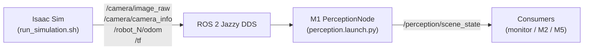

# Isaac Sim + M1 Perception Demo Guide

**Prepared:** 2026-06-11

**Revision history:**
- Initial draft: end-to-end walkthrough for running a scenario in Isaac Sim and connecting M1 perception on the same host.

---

## Overview

This guide walks through launching a warehouse scenario in Isaac Sim 6.0, then
connecting M1 Perception so it receives the simulated overhead camera feed and
publishes robot state vectors in real time.



**Platform split:**

| Machine | OS | Role |
|---|---|---|
| Isaac Sim host | Windows + NVIDIA GPU | Runs Isaac Sim 6.0, publishes ROS 2 topics |
| Dev/ROS machine | Linux (Ubuntu 22.04) | Builds ROS 2 workspace, runs M1 PerceptionNode |
| Dev machine | macOS | Host-only Python tests, calibration export, editing |

This guide assumes Isaac Sim runs on **Windows** and M1 runs on a
**Linux machine on the same network** (or the same Windows host if ROS 2 Jazzy
is available there via WSL2).

---

## Prerequisites

### Isaac Sim host (Windows)

- Windows 10/11 with NVIDIA GPU (driver ≥ 535)
- Isaac Sim 6.0 installed via Omniverse Launcher
- `ISAAC_SIM_ROOT` environment variable set to the Isaac Sim install directory
  (e.g. `C:\Users\<you>\AppData\Local\ov\pkg\isaac-sim-6.0.0`)

### ROS 2 / M1 machine (Linux or WSL2)

- Ubuntu 22.04 (native or WSL2 on the same Windows host)
- ROS 2 Jazzy installed at `/opt/ros/jazzy`
- `colcon` build tool available

### One-time environment check

**On Windows (PowerShell):**

```powershell
# Verify Isaac Sim root
echo $env:ISAAC_SIM_ROOT
Test-Path "$env:ISAAC_SIM_ROOT\python.bat"

# Verify NVIDIA GPU
nvidia-smi
```

**On Linux / WSL2:**

```bash
# Verify ROS 2 Jazzy
ls /opt/ros/jazzy/setup.bash

# Verify ROS_DOMAIN_ID matches Windows side (default: 0)
echo $ROS_DOMAIN_ID
```

---

## Step 1 — Clone and build the workspace

**On the Linux / WSL2 machine:**

```bash
git clone https://github.com/tuanhdangdinh/VLM-swarm-congestion.git vgu-vlm-swarm
cd vgu-vlm-swarm

# Install Python dev dependencies
python -m venv .venv
source .venv/bin/activate
pip install -r requirements-dev.txt

# Build the ROS 2 workspace
source /opt/ros/jazzy/setup.bash
make build-ros2
```

**On Windows**, clone the same repo so the `isaac/` scripts are available:

```powershell
git clone https://github.com/tuanhdangdinh/VLM-swarm-congestion.git vgu-vlm-swarm
cd vgu-vlm-swarm
```

---

## Step 2 — Regenerate calibration (one-time)

The calibration file derives analytically from the Isaac camera config. This
runs on any machine (macOS, Linux, or Windows) — no Isaac Sim required.

**On Linux / macOS (from repo root):**

```bash
source .venv/bin/activate
python -m isaac.scripts.export_calibration
```

**On Windows (PowerShell):**

```powershell
.venv\Scripts\Activate.ps1
python -m isaac.scripts.export_calibration
```

Expected output:

```
Calibration written to: ros2_ws/src/swarm_perception/config/calibration.yaml
```

Commit and push the updated `calibration.yaml`, then rebuild the ROS 2
workspace on the Linux machine:

```bash
make build-ros2
```

---

## Step 3 — Build simulation assets (one-time, Windows)

These commands run inside Isaac Sim's embedded Python on Windows. Run them
once; the USD outputs are cached in `isaac/assets/` and `isaac/scenarios/`.
Open **PowerShell** from the repo root.

### 3a. Import TurtleBot3 Burger

Obtain an expanded `turtlebot3_burger.urdf`. If `turtlebot3_description` is
available via ROS 2 on WSL2, copy the URDF to a Windows path first. Then:

```powershell
& "$env:ISAAC_SIM_ROOT\python.bat" -m isaac.scripts.import_turtlebot3 `
  --urdf C:\path\to\turtlebot3_burger.urdf `
  --output-dir isaac\assets\robots
```

Expected: `Robot asset written to: isaac/assets/robots/turtlebot3_burger/turtlebot3_burger.usda`

### 3b. Build the warehouse

```powershell
& "$env:ISAAC_SIM_ROOT\python.bat" -m isaac.scripts.build_warehouse
```

Expected: `Warehouse written to: isaac/assets/warehouse/warehouse_base.usd`

### 3c. Build scenario USD files

```powershell
& "$env:ISAAC_SIM_ROOT\python.bat" -m isaac.scripts.build_scenario `
  --config isaac\config\scenarios\head_on_deadlock.yaml

& "$env:ISAAC_SIM_ROOT\python.bat" -m isaac.scripts.build_scenario `
  --config isaac\config\scenarios\intersection_bottleneck.yaml

& "$env:ISAAC_SIM_ROOT\python.bat" -m isaac.scripts.build_scenario `
  --config isaac\config\scenarios\dynamic_anomaly.yaml
```

### 3d. Validate (optional but recommended)

```powershell
& "$env:ISAAC_SIM_ROOT\python.bat" -m isaac.scripts.validate_simulation `
  --scenario isaac\scenarios\head_on_deadlock.usd
```

Expected: `PASS: isaac/scenarios/head_on_deadlock.usd`

---

## Step 4 — Run the simulation (Windows)

Open **PowerShell A** from the repo root. The `run_simulation.sh` wrapper is
Linux-only; on Windows call Isaac Sim's Python directly:

```powershell
# GUI mode (viewport window opens)
& "$env:ISAAC_SIM_ROOT\python.bat" -m isaac.scripts.run_simulation `
  --scenario head_on_deadlock `
  --seed 42

# Headless mode (no viewport)
& "$env:ISAAC_SIM_ROOT\python.bat" -m isaac.scripts.run_simulation `
  --scenario head_on_deadlock `
  --seed 42 `
  --headless
```

The runner prints topic-readiness status once Isaac Sim enters Play. Wait for:

```
[isaac_sim] Topics ready. Starting physics loop.
```

At this point the following ROS 2 topics are live:

| Topic | Type | Rate |
|---|---|---|
| `/camera/image_raw` | `sensor_msgs/msg/Image` | 30 Hz |
| `/camera/camera_info` | `sensor_msgs/msg/CameraInfo` | 30 Hz |
| `/clock` | `rosgraph_msgs/msg/Clock` | 60 Hz |
| `/robot_N/odom` | `nav_msgs/msg/Odometry` | 60 Hz |
| `/robot_N/scan` | `sensor_msgs/msg/LaserScan` | 10 Hz |
| `/tf` | `tf2_msgs/msg/TFMessage` | 60 Hz |

Verify from Linux / WSL2:

```bash
source /opt/ros/jazzy/setup.bash
ros2 topic list | grep -E "camera|clock|robot"
```

> **Network note (separate machines):** Set the same `ROS_DOMAIN_ID` on both
> the Windows host and the Linux machine, and ensure the DDS multicast port
> (7400 UDP) is open in Windows Firewall. For WSL2 on the same host this is
> handled automatically.

---

## Step 5 — Connect M1 Perception

Open **Terminal B**:

```bash
source /opt/ros/jazzy/setup.bash
source ros2_ws/install/setup.bash

ros2 launch swarm_simulation isaac_sim.launch.py
```

This launches `PerceptionNode` with `use_sim_time=true` and remaps to
`/camera/image_raw` and `/camera/camera_info`. M1 immediately begins processing
frames.

Alternatively, launch M1 directly from the perception package:

```bash
ros2 launch swarm_perception perception.launch.py use_camera_node:=false
```

---

## Step 6 — Monitor M1 output

Open **Terminal C**:

```bash
source /opt/ros/jazzy/setup.bash
source ros2_ws/install/setup.bash

# Watch robot state vectors (updated each frame)
ros2 topic echo /perception/scene_state

# Watch diagnostics
ros2 topic echo /perception/status

# View annotated frame header to confirm stamps are advancing
ros2 topic echo /perception/annotated_frame --field header
```

A healthy `scene_state` message looks like:

```json
{
  "stamp": 12.483,
  "frame_id": "overhead_camera",
  "robots": [
    {
      "robot_id": "robot_1",
      "x": -3.21,
      "y": 0.01,
      "theta": 0.003,
      "linear_velocity": 0.10,
      "angular_velocity": 0.0,
      "status": "MOVING",
      "task": "cross_narrow_aisle",
      "goal": {"x": 4.5, "y": 0.0}
    }
  ],
  "diagnostics": {"detected": 2, "dropped_frame": false}
}
```

---

## Step 7 — Run the three scenarios

Substitute `--scenario` to try each conflict type (PowerShell on Windows):

```powershell
# Two robots meet head-on in a narrowed aisle
& "$env:ISAAC_SIM_ROOT\python.bat" -m isaac.scripts.run_simulation --scenario head_on_deadlock --seed 42

# Four robots converge at a cross-aisle intersection
& "$env:ISAAC_SIM_ROOT\python.bat" -m isaac.scripts.run_simulation --scenario intersection_bottleneck --seed 42

# A temporary obstacle blocks one robot's route
& "$env:ISAAC_SIM_ROOT\python.bat" -m isaac.scripts.run_simulation --scenario dynamic_anomaly --seed 42
```

Run artifacts (manifests and ground-truth JSONL) are written to
`data/logs/simulation/<scenario>-seed<N>-rep000/`.

---

## Troubleshooting

### `ISAAC_SIM_ROOT` not set

```
ERROR: ISAAC_SIM_ROOT is not set.
```

Set it in PowerShell:

```powershell
$env:ISAAC_SIM_ROOT = "C:\Users\<you>\AppData\Local\ov\pkg\isaac-sim-6.0.0"
```

To persist across sessions, add it to your Windows user environment variables
(System Properties → Environment Variables).

### Topic readiness timeout

```
TopicTimeoutError: ROS topics not ready within 15s.
```

- Confirm Isaac Sim started successfully and is in Play state.
- Confirm `ROS_DOMAIN_ID` matches in both terminals (default: 0).
- Increase the timeout: `--topic-timeout-sec 30`.

### M1 receives no detections

```json
{"detected": 0, "dropped_frame": false}
```

- Confirm `use_sim_time=true` is set; M1 may be ahead or behind the sim clock without it.
- Confirm the calibration was regenerated (Step 2) and the workspace was rebuilt.
- Check that the scenario has robots inside the camera ROI (`6.0 m × 4.5 m` centered at origin); head-on robots start at `±4.5 m` and enter the ROI as they approach.

### Wrong ROS distribution

```
ERROR: ROS 2 Jazzy not found at /opt/ros/jazzy/setup.bash.
```

The simulation wrapper requires Jazzy. Do not source Humble before running.

### `use_sim_time` clock skew warning

If M1 logs clock-jump warnings, ensure `/clock` is publishing (Step 4 check)
and that `use_sim_time=true` is passed to `PerceptionNode`.

---

## Reference

| Resource | Location |
|---|---|
| M6 simulation spec | `docs/specs/module6_simulation.md` |
| M1 perception guide | `docs/guides/run_m1_perception.md` |
| Scenario YAML configs | `isaac/config/scenarios/` |
| Calibration source | `isaac/vgu_sim/calibration.py` |
| Shell wrapper | `scripts/run_simulation.sh` |
| ROS 2 launch (consumers) | `ros2_ws/src/swarm_simulation/launch/isaac_sim.launch.py` |
| M1 launch | `ros2_ws/src/swarm_perception/launch/perception.launch.py` |
