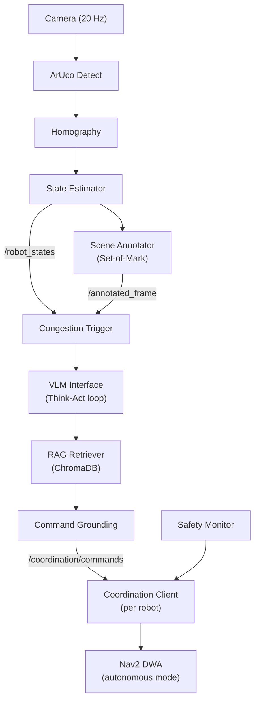

# Isaac Sim + Remote VLM Pipeline Setup and Spec

This document defines the first integration target for the project: run
NVIDIA Isaac Sim on one machine and VLM inference on another machine, then test
the perception-to-reasoning pipeline before implementing the full RAG and robot
execution loop.

## 1. Pipeline Analysis

### 1.1 Target Architecture

The first test should keep simulation, ROS2 orchestration, and VLM inference
decoupled:

```text
┌──────────────────────────────┐                 ┌──────────────────────────┐
│ Machine A: Isaac / ROS2       │                 │ Machine B: VLM Inference │
│                              │                 │                          │
│ Isaac Sim warehouse scene     │                 │ VLM runtime              │
│ Isaac ROS2 bridge             │                 │ HTTP inference server    │
│ ROS2 perception/orchestrator  │  HTTP request   │ model backend            │
│ annotated frame + state ──────┼────────────────▶ JSON decision            │
│ decision consumer / logger ◀──┼─────────────────                         │
└──────────────────────────────┘  HTTP response  └──────────────────────────┘
```



Recommended boundary for the first test:

- **Use ROS2 locally on Machine A** for Isaac Sim, simulated sensors, robot
  state, and orchestration.
- **Use HTTP between Machine A and Machine B** for VLM inference.
- Do not require the VLM machine to join the ROS2 DDS graph for the first test.
  This avoids cross-machine DDS discovery, firewall, and domain issues while the
  VLM contract is still being stabilized.

Later, the VLM service can be wrapped by a ROS2 node if needed, but the first
pipeline should validate the data contract and latency with the simplest network
boundary.

### 1.2 Why This Split

Isaac Sim is GPU-heavy and interactive. VLM inference is also GPU-heavy and may
use a different CUDA/runtime stack. Running them on separate machines prevents
dependency conflicts and allows independent scaling.

The project already has a model-agnostic VLM interface in
`reasoning/vlm/backend_base.py`. The remote VLM server should behave like one
backend implementation: it receives a prompt plus an image and returns model
text that must validate against `reasoning/schemas/vlm_decision.schema.json`.

### 1.3 First Test Scope

In scope for the first test:

- Start Isaac Sim with ROS2 bridge enabled.
- Spawn or load a simple warehouse scene.
- Publish or extract a camera frame and robot states from the simulation.
- Produce an annotated frame or a temporary test image.
- Send `{prompt, image, robot_states}` from Machine A to the VLM server on
  Machine B.
- Receive a VLM decision JSON.
- Validate the decision against the local schema.
- Log the request, response, latency, and validation result.

Out of scope for the first test:

- RAG grounding.
- Nav2 command execution.
- Safety monitor behavior.
- Full benchmark automation.
- Multi-scenario evaluation.

## 2. Machine Roles

### 2.1 Machine A — Isaac Sim / ROS2

Responsibilities:

- Run Isaac Sim.
- Enable Isaac ROS2 bridge.
- Publish or expose simulated camera data.
- Maintain robot state in ROS2.
- Build the prompt and choose the image to send to VLM.
- Call the remote VLM inference endpoint.
- Validate and log the returned decision.

Required software:

- NVIDIA driver compatible with Isaac Sim.
- NVIDIA Isaac Sim.
- ROS2 Humble or Jazzy.
- Project repository.
- Python dependencies from `requirements-dev.txt`.

Recommended network:

- Same LAN as the VLM machine.
- Stable IP address or hostname for Machine B.
- Firewall allows outbound HTTP from Machine A to Machine B.

### 2.2 Machine B — VLM Inference

Responsibilities:

- Run the selected VLM runtime.
- Expose a small HTTP API for inference.
- Accept image + prompt input.
- Return model output text or structured JSON.

Required software:

- NVIDIA driver and CUDA stack required by the chosen VLM.
- Python runtime for the inference server.
- Model weights or hosted-model credentials.
- Enough GPU memory for the selected VLM.

Recommended network:

- Static IP or stable hostname.
- Firewall allows inbound HTTP on the selected inference port.
- No ROS2 requirement for the first test.

## 3. Network Contract

### 3.1 Default Transport

Use HTTP for the first integration.

Default endpoint:

```text
POST http://<vlm-machine-host>:8000/v1/analyze_scene
```

Recommended timeout:

```text
30 seconds
```

Recommended payload format:

- `multipart/form-data` when sending a real image file.
- JSON-only payload is acceptable for mock testing when `image_base64` is used.

### 3.2 Request Shape

Minimum request fields:

```json
{
  "request_id": "req-0001",
  "prompt": "Analyze the warehouse swarm scene...",
  "robot_states": [
    {
      "robot_id": "robot_1",
      "x": 1.2,
      "y": 0.4,
      "theta": 1.57,
      "linear_velocity": 0.0,
      "angular_velocity": 0.0,
      "task": "go_to_loading_bay",
      "status": "waiting"
    }
  ],
  "metadata": {
    "source": "isaac_sim",
    "frame_id": "overhead_camera",
    "stamp": 0.0
  }
}
```

Image field:

- `image`: annotated PNG/JPEG file in multipart requests, preferred for real
  integration.
- `image_base64`: optional JSON field for simple mock testing.

### 3.3 Response Shape

The VLM server should return:

```json
{
  "request_id": "req-0001",
  "model": "selected-vlm-name",
  "latency_ms": 1234,
  "text": "{\"congestion_detected\": true, \"type\": \"deadlock\", \"involved_robots\": [\"robot_1\", \"robot_2\"], \"root_cause\": \"robots block each other in a narrow aisle\", \"strategy\": \"yield\", \"justification\": \"robot_1 can wait while robot_2 clears the aisle\"}"
}
```

The `text` field is parsed by `reasoning.vlm.output_parser.parse_vlm_decision`.
For the first pipeline, keep this parser as the source of truth. The parsed JSON
must match `reasoning/schemas/vlm_decision.schema.json`.

Expected decision object:

```json
{
  "congestion_detected": true,
  "type": "deadlock",
  "involved_robots": ["robot_1", "robot_2"],
  "root_cause": "robots block each other in a narrow aisle",
  "strategy": "yield",
  "justification": "robot_1 can wait while robot_2 clears the aisle"
}
```

Allowed `type` values:

- `none`
- `deadlock`
- `bottleneck`
- `crowding`
- `anomaly`

Allowed `strategy` values:

- `none`
- `yield`
- `reroute`
- `convoy`
- `priority_override`
- `temporary_wait`
- `reverse`

## 4. Isaac Sim Setup Path

### 4.1 Isaac Sim Startup

On Machine A:

1. Install Isaac Sim following NVIDIA's current installation instructions.
2. Install or source ROS2 Humble/Jazzy.
3. Enable the Isaac ROS2 bridge extension.
4. Launch the warehouse scene.
5. Confirm ROS2 topics are visible from a terminal on Machine A.

Expected checks:

```bash
ros2 topic list
ros2 node list
```

The exact topic names depend on the Isaac Sim scene graph and ROS2 bridge
configuration. Record final topic names in the experiment notes once the scene
is created.

### 4.2 Initial Sensor Topics

The first pipeline needs one image stream and one robot-state source.

Recommended topic intent:

| Data | Preferred ROS2 Type | Purpose |
| --- | --- | --- |
| Overhead RGB image | `sensor_msgs/msg/Image` | Input for annotation and VLM |
| Robot poses | TF, odometry, or custom state | Source for prompt robot states |
| Annotated frame | `sensor_msgs/msg/Image` or local PNG | Image sent to VLM |
| VLM decision log | local JSONL file first | Debug and validation output |

For the first test, local file logging is enough. Publishing the VLM decision
back to ROS2 can be added after the HTTP path is stable.

## 5. VLM Server Setup Path

### 5.1 Minimal API

Machine B should run an HTTP service with one endpoint:

```text
POST /v1/analyze_scene
```

Implementation requirements:

- Accept prompt text.
- Accept one image.
- Run VLM inference.
- Return response JSON with `request_id`, `model`, `latency_ms`, and `text`.
- If inference fails, return non-2xx with an error message.

The first implementation may use a mock model that returns fixed valid JSON.
This is useful for testing networking and schema validation before model runtime
issues are introduced.

### 5.2 VLM Output Requirements

The model must be prompted to return only JSON matching this contract:

```json
{
  "congestion_detected": "boolean",
  "type": "none | deadlock | bottleneck | crowding | anomaly",
  "involved_robots": ["robot_id"],
  "root_cause": "string",
  "strategy": "none | yield | reroute | convoy | priority_override | temporary_wait | reverse",
  "justification": "string"
}
```

For `congestion_detected=false`:

- `type` should be `none`.
- `strategy` should be `none`.
- `involved_robots` should be an empty array.

## 6. First End-to-End Test Procedure

### 6.1 Connectivity Test

From Machine A:

```bash
curl http://<vlm-machine-host>:8000/health
```

Expected result:

```json
{"status":"ok"}
```

### 6.2 Mock VLM Test

1. Start the VLM server in mock mode.
2. Send a static test image and hardcoded robot states.
3. Confirm Machine A receives valid JSON.
4. Validate using `parse_vlm_decision`.

Pass criteria:

- HTTP request succeeds.
- Response arrives within timeout.
- Decision validates against schema.
- Request and response are logged.

### 6.3 Isaac Frame Test

1. Start Isaac Sim and ROS2 bridge.
2. Capture one overhead frame from the simulated camera.
3. Build a prompt from current robot states.
4. Send the frame and prompt to Machine B.
5. Validate and log the VLM response.

Pass criteria:

- Frame is captured from Isaac Sim.
- Robot states are included in the prompt.
- VLM server returns a decision.
- Decision is schema-valid.

### 6.4 Scenario Test

1. Create a simple two-robot conflict in Isaac Sim.
2. Capture an annotated frame.
3. Send to VLM.
4. Confirm output identifies the relevant robots and a plausible strategy.

Pass criteria:

- `congestion_detected=true`.
- `type` is `deadlock` or `bottleneck`.
- `involved_robots` references only known robot IDs.
- `strategy` is one of the allowed strategy values.

## 7. Observability and Logs

For each request, Machine A should log one JSONL record:

```json
{
  "request_id": "req-0001",
  "stamp": 0.0,
  "image_path": "data/logs/req-0001.png",
  "robot_count": 2,
  "vlm_host": "192.168.1.20",
  "latency_ms": 1234,
  "valid": true,
  "decision": {
    "congestion_detected": true,
    "type": "deadlock",
    "involved_robots": ["robot_1", "robot_2"],
    "strategy": "yield"
  }
}
```

Minimum metrics for the first pipeline:

- HTTP latency.
- VLM latency.
- Validation pass/fail.
- Parse error text, if any.
- Robot count.
- Image resolution.

## 8. Failure Modes

| Failure | Likely Cause | First Debug Step |
| --- | --- | --- |
| Machine A cannot reach VLM server | Firewall, wrong IP, server not running | Test `/health` with `curl` |
| Isaac topics missing | ROS2 bridge not enabled or wrong ROS2 environment | Check Isaac extension and `ros2 topic list` |
| VLM returns prose instead of JSON | Prompt too weak or backend lacks structured output | Tighten prompt and validate `text` field |
| Unknown robot IDs in VLM output | Model hallucination | Reject response and include valid IDs in re-ask |
| High latency | Large image, slow model, network overhead | Downscale image and log latency by stage |
| DDS cross-machine issues | ROS2 discovery/firewall/domain mismatch | Keep VLM outside DDS for first test |

## 9. Acceptance Criteria for This Pipeline

The first pipeline is considered working when:

- Isaac Sim runs on Machine A.
- Machine B exposes a reachable VLM inference endpoint.
- Machine A can send an Isaac-derived image and robot-state prompt to Machine B.
- Machine A receives a VLM decision within the configured timeout.
- The decision validates with `parse_vlm_decision`.
- At least one conflict-like scene returns `congestion_detected=true`.
- Logs contain request ID, image path, state summary, latency, raw response, and
  validation result.

## 10. Follow-up Implementation Tasks

After this document is accepted, implement in this order:

1. Add a remote HTTP backend under `reasoning/vlm/`.
2. Add a small VLM server contract example or mock server.
3. Add a command-line client for sending one image + state JSON to the VLM
   server.
4. Add Isaac/ROS2 capture utilities on Machine A.
5. Add JSONL request logging under `data/logs/`.
6. Add integration tests using the mock VLM server.
7. Only after the above works, connect VLM decisions to RAG and ROS2 execution.

## 11. Official References

- NVIDIA Isaac Sim ROS2 documentation:
  <https://docs.isaacsim.omniverse.nvidia.com/latest/ros2_tutorials/ros2_landing_page.html>
- NVIDIA Isaac Sim ROS2 installation notes:
  <https://docs.isaacsim.omniverse.nvidia.com/5.0.0/installation/install_ros.html>
- NVIDIA Isaac Sim livestreaming clients:
  <https://docs.isaacsim.omniverse.nvidia.com/latest/installation/manual_livestream_clients.html>
- ROS2 Humble documentation:
  <https://docs.ros.org/en/humble/>
