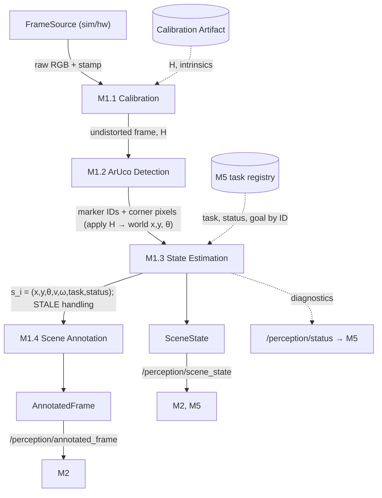

# Module 1 — Perception & Robot ID Tracking — Spec

**Status:** Draft · **Level:** Design · **Source:** `project_proposal.md` §4.2
**Layer:** 1 (perception input) · **Consumers:** M2 (VLM), M3 (RAG, indirectly), M5 (Orchestrator)

---

## 1. Overview

M1 converts a stream of overhead camera frames into (a) a set of per-robot
**world-frame state vectors** and (b) a **VLM-ready annotated frame**. It is the
sole source of ground-truth scene state for the reasoning layer.

**In scope:** image acquisition, camera calibration, fiducial-based robot
localization and ID tracking, kinematic state estimation, scene annotation.

**Out of scope:** congestion detection/classification (M2), command generation
(M3), motion control (M4), task assignment (M5 owns the task registry; M1 only
consumes it to populate state).

**Source abstraction:** the frame source is an interface (`FrameSource`). A
simulated overhead RGB sensor (Gazebo/Webots, §5) and a physical ceiling camera
are interchangeable implementations behind it. All downstream sub-modules are
source-agnostic; only calibration parameters and FPS differ.

---

## 2. Inputs & Outputs

**Inputs**
- RGB frames from `FrameSource` (sim or hardware), nominal 15–30 FPS.
- Calibration artifact (intrinsics + homography `H`), produced offline.
- Task/status registry from M5 (per robot ID).

**Outputs**
- `SceneState`: timestamped list of `RobotState` vectors (world frame).
- `AnnotatedFrame`: the RGB frame with Set-of-Mark overlays.
- Detection health/diagnostics (per-frame: # markers seen, dropped IDs).

Outputs are published to ROS2 (see §5) and conform to schemas in §4 (shared
contract C1).

### 2.1 Data Flow

Internal pipeline (per frame), source-agnostic via `FrameSource`:

`SceneState` and `AnnotatedFrame` share one timestamp so M2 reasons over a
consistent image/state pair (§7 determinism).

---

## 3. Functional Requirements

### M1.1 Camera & Calibration
- FR1.1.1 Acquire frames from `FrameSource` at a configured target FPS; expose
  frame + capture timestamp.
- FR1.1.2 Support offline intrinsic calibration via checkerboard; persist
  intrinsics + distortion to the calibration artifact.
- FR1.1.3 Compute a ground-plane homography `H` mapping pixel `(u, v)` → world
  `(x_w, y_w)`. Stored in the artifact; loaded at startup.
- FR1.1.4 Undistort frames (or document why raw frames are acceptable for the
  configured sensor, e.g. ideal pinhole sim camera).

### M1.2 ArUco Detection
- FR1.2.1 Detect markers from `DICT_4X4_50`; one unique marker ID per robot.
- FR1.2.2 Return marker ID, four corner pixel coordinates, and (where used)
  pose estimate per detection.
- FR1.2.3 Transform marker corners/center via `H` to world `(x_w, y_w)`.
- FR1.2.4 Derive heading `θ` from marker corner ordering (orientation in plane).
- FR1.2.5 Maintain ID→robot association across frames; flag IDs absent in the
  current frame.

### M1.3 State Estimation
- FR1.3.1 Maintain per robot `i` the state vector
  `s_i = (x, y, θ, v, ω, task, status)` (§4).
- FR1.3.2 Estimate linear velocity `v` and angular velocity `ω` from
  finite differences of pose across frames, low-pass filtered.
- FR1.3.3 Populate `task` and `status` from the M5 registry by robot ID.
- FR1.3.4 Derive a coarse motion `status` label {MOVING, SLOW, STOPPED} from
  filtered speed against configured thresholds (used by annotation + M2).
- FR1.3.5 Carry forward last-known state for transiently undetected robots up to
  a staleness limit; mark as STALE thereafter.

### M1.4 Scene Annotation
- FR1.4.1 Draw status-colored bounding boxes: green=MOVING, yellow=SLOW,
  red=STOPPED (Set-of-Mark style, Yang et al. 2023).
- FR1.4.2 Render robot ID text labels.
- FR1.4.3 Draw velocity vectors as arrows.
- FR1.4.4 Mark goal positions with target icons (goal from M5 task).
- FR1.4.5 Emit the annotated frame keeping a 1:1 correspondence with the
  `SceneState` of the same timestamp.

---

## 4. Data Structures / Schemas (contract C1)

`RobotState`
| field    | type        | unit/notes                                  |
|----------|-------------|---------------------------------------------|
| id       | int         | == ArUco marker ID                          |
| x, y     | float       | world frame, meters                         |
| theta    | float       | radians, world frame                        |
| v        | float       | m/s, filtered                               |
| omega    | float       | rad/s, filtered                             |
| task     | string/null | from M5 registry                            |
| status   | enum        | MOVING \| SLOW \| STOPPED \| STALE          |
| goal     | {x,y}/null  | from M5 task, for annotation                |
| stamp    | float       | capture timestamp (s)                       |

`SceneState` = `{ stamp, frame_id, robots: [RobotState], diagnostics }`.

**Calibration artifact** = `{ intrinsics, distortion, homography_H, image_size,
created_at, source_id }` (serialized, e.g. YAML/JSON).

`diagnostics` = `{ markers_detected, ids_missing: [int], dropped_frame: bool }`.

---

## 5. Interfaces

**ROS2 (indicative; final names in C1)**
- Publishes `SceneState` → `/perception/scene_state`.
- Publishes `AnnotatedFrame` → `/perception/annotated_frame`.
- Publishes diagnostics → `/perception/status`.
- Subscribes task/status registry from M5 (e.g. `/coordination/tasks`).

**Programmatic**
- `FrameSource.read() -> (frame, stamp)` — implemented by sim and hardware.
- `Calibrator` — produces/loads the calibration artifact.
- `Tracker.update(frame, stamp) -> SceneState` — the M1.2+M1.3 core.
- `Annotator.render(frame, scene_state) -> AnnotatedFrame`.

**Config inputs** — target FPS, image size, marker dictionary + physical marker
size, homography source path, speed thresholds (SLOW/STOPPED), low-pass filter
cutoff, staleness limit.

---

## 6. Algorithms & Parameters

- **Homography:** estimate `H` from ≥4 known pixel↔world correspondences;
  apply as `[x_w, y_w, 1]^T ∝ H [u, v, 1]^T`.
- **Heading:** vector from a designated marker-corner pair midpoints, atan2 in
  world frame after transform.
- **Velocity filter:** finite difference over consecutive poses, then first-order
  low-pass (configurable cutoff) to suppress detection jitter.
- **Status thresholds:** `STOPPED` if `v < v_stop`, `SLOW` if `v < v_slow`,
  else `MOVING` (values configurable; defaults tuned to TurtleBot3 `v≤0.22 m/s`).
- **Reference parameters (proposal §4.2):** camera ≈2.5–3 m height, sensor
  1280×960, 15–30 FPS, `DICT_4X4_50`.

---

## 7. Non-Functional Requirements

- **Latency:** end-to-end (capture → published `SceneState`) within the Layer-2
  budget (reasoning runs 0.5–2 Hz); target perception ≤ 1 frame-period.
- **Throughput:** sustain configured FPS without frame backlog growth.
- **Localization accuracy:** world-position error small relative to aisle width
  (1.2 m) so deadlock/bottleneck geometry is distinguishable; target acceptance
  threshold to be fixed in §11.
- **ID stability:** no ID swaps between distinct robots across a run.
- **Determinism:** annotation and state share one timestamp (no skew).

---

## 8. Error Handling & Edge Cases

- Marker not detected (occlusion, motion blur) → carry-forward + STALE per
  FR1.3.5; report in diagnostics.
- Duplicate/ghost ID in a frame → reject lower-confidence detection; log.
- Calibration missing/invalid at startup → fail fast with explicit error.
- Calibration drift (hardware) → out-of-plane sanity bounds on world coords;
  warn when positions fall outside the known workspace.
- Dropped/late frame → flag `dropped_frame`; do not extrapolate velocity past
  staleness limit.
- Lighting variation (hardware) → expose detector params; document sim assumes
  ideal lighting.

---

## 9. Dependencies

- OpenCV (`cv2.aruco`, calibration, homography, drawing).
- ROS2 (transport, message types) + image transport / `cv_bridge`.
- `FrameSource` backends: Gazebo/Webots camera plugin (sim) or a camera driver
  (hardware).
- M5 task/status registry (consumed).

---

## 10. Testing & Validation

- **Unit:** homography correctness on synthetic correspondences; heading from
  known corner layouts; velocity filter on canned pose sequences; status
  threshold logic.
- **Integration:** sim camera → full pipeline → `SceneState` matches Gazebo
  ground-truth poses within tolerance.
- **Robustness:** induced occlusion / dropped frames exercise STALE path;
  multi-robot ID-stability run (N ∈ {4,8,12,16}).
- **Acceptance:** localization error and ID-stability meet §7 targets across all
  fleet sizes; annotated frames render all overlays correctly.

---

## 11. Open Questions / Assumptions

- Quantitative localization-accuracy and latency acceptance thresholds — TBD.
- Whether pose comes from full ArUco pose estimation or corner-homography only
  (affects marker-size config and `θ` robustness).
- Source of `goal` coordinates and exact M5 task-registry message shape (depends
  on C1 finalization).
- Hardware calibration cadence / drift handling, if real deployment is pursued.
