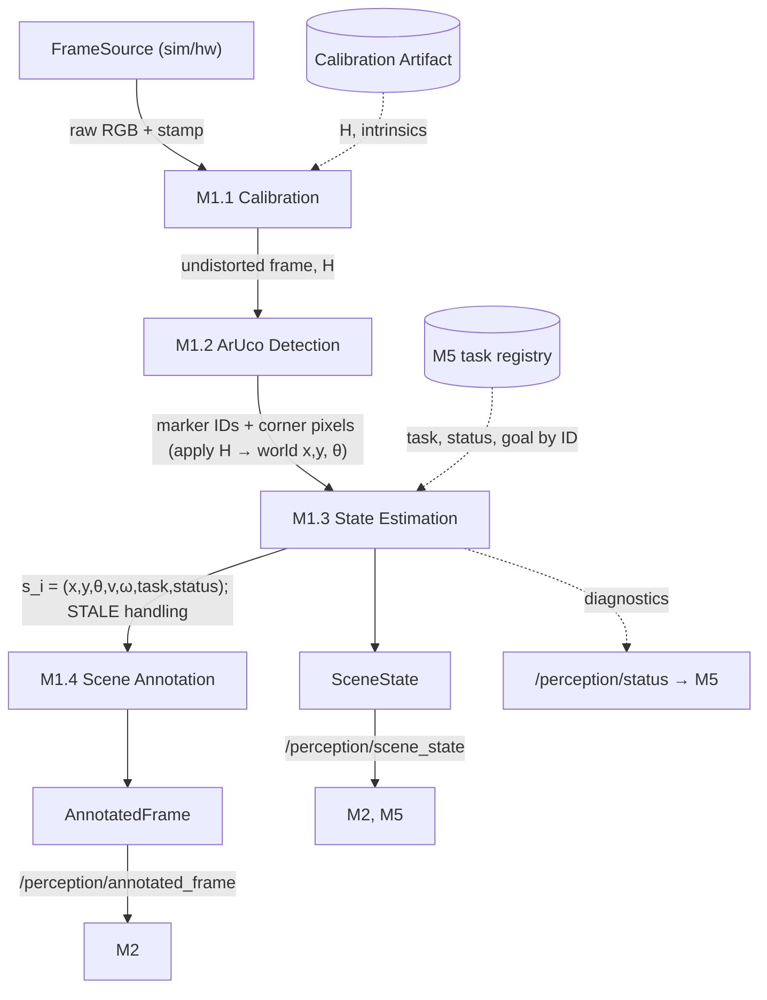

# Module 1 — Perception & Robot ID Tracking — Spec

**Status:** Draft · **Level:** Design · **Source:** `project_proposal.md` §4.2
**Layer:** 1 (perception input) · **Consumers:** M2 (VLM), M3 (RAG, indirectly), M5 (Orchestrator)

---

## 1. Overview

M1 converts a stream of overhead camera frames into (a) a set of per-robot
**world-frame state vectors** and (b) a **VLM-ready annotated frame**. It is the
sole source of ground-truth scene state for the reasoning layer.

**In scope:** image acquisition, camera calibration, fiducial-based robot
localization and ID tracking, kinematic state estimation, scene annotation.

**Out of scope:** congestion detection/classification (M2), command generation
(M3), motion control (M4), task assignment (M5 owns the task registry; M1 only
consumes it to populate state).

**Source abstraction:** the frame source is an interface (`FrameSource`). A
simulated overhead RGB sensor (Isaac Sim/Gazebo/Webots) and a physical ceiling
camera are interchangeable implementations behind it. All downstream
sub-modules are source-agnostic; only calibration parameters and FPS differ.

---

## 2. Inputs & Outputs

**Inputs**
- RGB frames from `FrameSource` (sim or hardware), nominal 15–30 FPS.
- Calibration artifact (intrinsics + homography `H`), produced offline.
- Task/status registry from M5 (per robot ID).

**Outputs**
- `SceneState`: timestamped list of `RobotState` vectors (world frame).
- `AnnotatedFrame` (`np.ndarray`): the RGB frame with Set-of-Mark overlays (see §4).
- Detection health/diagnostics (per-frame: # markers seen, dropped IDs).

Outputs are published to ROS2 (see §5) and conform to schemas in §4 (shared
contract C1).

### 2.1 Data Flow

Internal pipeline (per frame), source-agnostic via `FrameSource`:



`SceneState` and `AnnotatedFrame` share one timestamp so M2 reasons over a
consistent image/state pair (§8 determinism).

---

## 3. Functional Requirements

### M1.1 Camera & Calibration
- FR1.1.1 Acquire frames from `FrameSource` at a configured target FPS; expose
  frame + capture timestamp.
- FR1.1.2 Support offline intrinsic calibration via checkerboard; persist
  intrinsics + distortion to the calibration artifact.
- FR1.1.3 Compute a ground-plane homography `H` mapping pixel `(u, v)` → world
  `(x_w, y_w)`. Stored in the artifact; loaded at startup.
- FR1.1.4 Undistort frames (or document why raw frames are acceptable for the
  configured sensor, e.g. ideal pinhole sim camera).

### M1.2 ArUco Detection
- FR1.2.1 Detect markers from `DICT_4X4_50`; one unique marker ID per robot.
- FR1.2.2 Return marker ID, four corner pixel coordinates, and (where used)
  pose estimate per detection.
- FR1.2.3 Transform marker corners/center via `H` to world `(x_w, y_w)`.
- FR1.2.4 Derive heading `θ` from marker corner ordering (orientation in plane).
- FR1.2.5 Maintain ID→robot association across frames; flag IDs absent in the
  current frame.

### M1.3 State Estimation
- FR1.3.1 Maintain per robot `i` the state vector
  `s_i = (x, y, θ, linear_velocity, angular_velocity, task, status)` (§4).
- FR1.3.2 Estimate linear velocity `v` and angular velocity `ω` from
  finite differences of pose across frames, low-pass filtered.
- FR1.3.3 Populate `task` from the M5 registry by robot ID. The `status`
  field (MOVING | SLOW | STOPPED | STALE) is derived locally from velocity
  and staleness; it is not sourced from M5. M5 task-execution status (e.g.
  `waiting`, `in_progress`) maps into the `task` field, not `status`.
- FR1.3.4 Derive a coarse motion `status` label {MOVING, SLOW, STOPPED} from
  filtered speed against configured thresholds (used by annotation + M2).
- FR1.3.5 Carry forward last-known state for transiently undetected robots up to
  a staleness limit; mark as STALE thereafter.

### M1.4 Scene Annotation
- FR1.4.1 Draw status-colored bounding boxes: green=MOVING, yellow=SLOW,
  red=STOPPED, gray=STALE (Set-of-Mark style, Yang et al. 2023).
- FR1.4.2 Render robot ID text labels.
- FR1.4.3 Draw velocity vectors as arrows.
- FR1.4.4 Mark goal positions with target icons (goal from M5 task).
- FR1.4.5 Emit the annotated frame keeping a 1:1 correspondence with the
  `SceneState` of the same timestamp.

---

## 4. Data Structures / Schemas (contract C1)

`RobotState`
| field          | type        | unit/notes                                              |
|----------------|-------------|---------------------------------------------------------|
| robot_id       | str         | `f"robot_{marker_id}"` e.g. `"robot_3"` for ArUco ID 3 |
| x, y           | float       | world frame, meters                                     |
| theta          | float       | radians, world frame                                    |
| linear_velocity| float       | m/s, filtered                                           |
| angular_velocity| float      | rad/s, filtered                                         |
| task           | string/null | from M5 registry                                        |
| status         | enum        | MOVING \| SLOW \| STOPPED \| STALE                      |
| goal           | {x,y}/null  | from M5 task, for annotation                            |
| stamp          | float       | capture timestamp (s)                                   |

`SceneState` = `{ stamp, frame_id, robots: [RobotState], diagnostics }`.

`AnnotatedFrame` = `np.ndarray` — RGB image of the same shape as the input
frame, with Set-of-Mark overlays drawn. Not a distinct Pydantic model; the
type alias exists to clarify intent in interfaces.

**Calibration artifact** = `{ intrinsics, distortion, homography_H, image_size,
created_at, source_id }` (serialized, e.g. YAML/JSON).

`diagnostics` = `{ markers_detected: int, ids_missing: [str], dropped_frame: bool }`.
`ids_missing` contains `robot_id` strings (e.g. `["robot_2"]`), not raw ArUco
integer IDs.

---

## 5. Interfaces

**ROS2 (indicative; final names in C1)**
- Publishes `SceneState` → `/perception/scene_state`.
- Publishes `AnnotatedFrame` → `/perception/annotated_frame`.
- Publishes diagnostics → `/perception/status`.
- Subscribes task/status registry from M5 (e.g. `/coordination/tasks`).

**Programmatic**
- `FrameSource` protocol — `open() / read(timeout_sec) -> Frame / close()`;
  stamp is embedded in `Frame`, not a separate return value.
- `load_calibration(path) -> CalibrationArtifact` /
  `save_calibration(artifact, path)` — produce and load the calibration artifact.
- `StateEstimator.update(detections, stamp, task_registry, expected_robot_ids, dropped_frame) -> SceneState` —
  M1.2+M1.3 core; builds diagnostics internally via `build_scene_diagnostics`
  and embeds them in the returned `SceneState` at construction time.
- `render_annotated_frame(image, scene_state, calibration, style) -> np.ndarray` —
  M1.4; returns annotated copy without mutating `image`.
- `process_frame(frame, calibration, state_estimator, ...) -> (SceneState, np.ndarray)` —
  pure end-to-end function; preferred test entrypoint (no ROS2 side effects).

**Config inputs** — target FPS, image size, marker dictionary + physical marker
size, homography source path, speed thresholds (SLOW/STOPPED), low-pass filter
cutoff, staleness limit.

---

## 6. Function Specifications

Target package: `ros2_ws/src/swarm_perception/swarm_perception`.

The signatures below are the implementation contract for M1. They are written as
Python type-hinted APIs using **Pydantic v2** for validated data contracts. ROS2
nodes should call these functions/classes rather than embedding perception logic
directly in node callbacks.

Shared model convention:

```python
from typing import Literal

import numpy as np
from pydantic import BaseModel, ConfigDict, Field, field_validator
```

Pydantic models that contain `np.ndarray` must set
`arbitrary_types_allowed=True`. Use `.model_dump()` when serializing models for
JSON logs, and provide explicit conversion for arrays because NumPy arrays are
not JSON-native.

### 6.1 Shared Data Types

#### `Frame`

**Description:** Raw camera frame with source metadata.

```python
class Frame(BaseModel):
    model_config = ConfigDict(frozen=True, arbitrary_types_allowed=True)

    image: np.ndarray
    stamp: float = Field(ge=0)
    frame_id: str = Field(min_length=1)
    source_id: str = Field(min_length=1)

    @field_validator("image")
    @classmethod
    def _image_shape(cls, v: np.ndarray) -> np.ndarray:
        if v.ndim != 3 or v.shape[2] != 3:
            raise ValueError(f"image must be (H, W, 3); got {v.shape}")
        return v
```

Fields:

- `image`: RGB image array shaped `(height, width, 3)`.
- `stamp`: capture timestamp in seconds.
- `frame_id`: camera frame, e.g. `overhead_camera`.
- `source_id`: source backend, e.g. `isaac_sim`, `gazebo`, `usb_camera`.

#### `CalibrationArtifact`

**Description:** Intrinsics, distortion, and homography loaded at startup.

```python
class CalibrationArtifact(BaseModel):
    model_config = ConfigDict(frozen=True, arbitrary_types_allowed=True)

    intrinsics: np.ndarray
    distortion: np.ndarray
    homography: np.ndarray
    image_size: tuple[int, int]
    source_id: str = Field(min_length=1)
    created_at: float = Field(ge=0)

    @field_validator("intrinsics")
    @classmethod
    def _intrinsics_shape(cls, v: np.ndarray) -> np.ndarray:
        if v.shape != (3, 3):
            raise ValueError(f"intrinsics must be (3, 3); got {v.shape}")
        return v

    @field_validator("homography")
    @classmethod
    def _homography_shape(cls, v: np.ndarray) -> np.ndarray:
        if v.shape != (3, 3):
            raise ValueError(f"homography must be (3, 3); got {v.shape}")
        return v
```

Fields:

- `created_at`: Unix timestamp (seconds) when the artifact was produced. Used
  to detect stale calibrations at startup.

#### `MarkerDetection`

**Description:** One detected ArUco marker in image and world coordinates.

```python
class MarkerDetection(BaseModel):
    model_config = ConfigDict(frozen=True, arbitrary_types_allowed=True)

    marker_id: int = Field(ge=0)
    corner_pixels: np.ndarray
    center_pixel: tuple[float, float]
    center_world: tuple[float, float]
    theta: float
    confidence: float = Field(ge=0.0, le=1.0)

    @field_validator("corner_pixels")
    @classmethod
    def _corners_shape(cls, v: np.ndarray) -> np.ndarray:
        if v.shape != (4, 2):
            raise ValueError(f"corner_pixels must be (4, 2); got {v.shape}")
        return v
```

Fields:

- `confidence`: OpenCV ArUco does not return a detection score. Set to `1.0`
  for every successfully decoded marker. Reserved for future scoring heuristics
  (e.g. corner reprojection error). `filter_duplicate_detections` uses this to
  pick among duplicate IDs — with all values at `1.0`, order of appearance in
  the frame is the effective tiebreaker.

#### `RobotState`

**Description:** Internal M1 robot state used to build `SceneState`.

```python
class RobotState(BaseModel):
    model_config = ConfigDict(frozen=True)

    robot_id: str = Field(min_length=1)
    x: float
    y: float
    theta: float
    linear_velocity: float
    angular_velocity: float
    task: str | None
    status: Literal["MOVING", "SLOW", "STOPPED", "STALE"]
    goal: tuple[float, float] | None
    stamp: float = Field(ge=0)
```

#### `SceneState`

**Description:** Timestamped perception output consumed by M2 and M5.

```python
class SceneState(BaseModel):
    model_config = ConfigDict(frozen=True)

    stamp: float = Field(ge=0)
    frame_id: str = Field(min_length=1)
    robots: list[RobotState]
    diagnostics: dict[str, object]
```

Serialization rule:

```python
def scene_state_to_json_dict(scene_state: SceneState) -> dict[str, object]:
    return scene_state.model_dump(mode="json")
```

For models containing arrays (`Frame`, `CalibrationArtifact`,
`MarkerDetection`), callers must convert arrays to lists or files before JSON
serialization.

### 6.2 Frame Source Functions

#### `FrameSource`

**Description:** Protocol implemented by all camera and simulation frame
sources. The three methods form one class; implementations must satisfy all
three.

```python
class FrameSource(Protocol):
    def open(self) -> None: ...
    def read(self, timeout_sec: float | None = None) -> Frame: ...
    def close(self) -> None: ...
```

**`open`** behavior:

- Allocate source-specific resources.
- Fail fast if the camera, ROS2 topic, or simulation stream is unavailable.

**`read`** behavior:

- Blocks until one frame is available or timeout expires.
- Returns RGB image data, not BGR.
- Raises `FrameSourceTimeoutError` if no frame arrives before `timeout_sec`.

**`close`** behavior:

- Release source-specific resources.

### 6.3 Calibration Functions

#### `load_calibration`

**Description:** Load and validate camera calibration from YAML or JSON.

```python
def load_calibration(path: str | Path) -> CalibrationArtifact:
    ...
```

Behavior:

- Requires intrinsics, distortion, homography, image size, and source id.
- Validates homography shape is `(3, 3)`.
- Raises `CalibrationError` on missing or invalid fields.

#### `save_calibration`

**Description:** Persist a calibration artifact to disk.

```python
def save_calibration(artifact: CalibrationArtifact, path: str | Path) -> None:
    ...
```

Behavior:

- Writes a deterministic YAML or JSON artifact.
- Creates parent directories only when explicitly requested by the caller.

#### `calibrate_intrinsics_from_checkerboard`

**Description:** Estimate camera intrinsics and distortion from checkerboard
images.

```python
def calibrate_intrinsics_from_checkerboard(
    image_paths: Sequence[str | Path],
    board_size: tuple[int, int],
    square_size_m: float,
) -> tuple[np.ndarray, np.ndarray, float]:
    ...
```

Returns:

- Intrinsic matrix.
- Distortion coefficients.
- Reprojection error.

#### `estimate_homography`

**Description:** Estimate ground-plane homography from pixel/world point pairs.

```python
def estimate_homography(
    pixel_points: np.ndarray,
    world_points: np.ndarray,
) -> np.ndarray:
    ...
```

Behavior:

- Requires at least four point correspondences.
- Returns `H` mapping pixel coordinates to world coordinates.

#### `undistort_frame`

**Description:** Apply intrinsic undistortion to a frame image.

```python
def undistort_frame(
    image: np.ndarray,
    calibration: CalibrationArtifact,
) -> np.ndarray:
    ...
```

### 6.4 Geometry Functions

#### `pixel_to_world`

**Description:** Transform one pixel coordinate into world-frame meters.

```python
def pixel_to_world(
    pixel: tuple[float, float],
    homography: np.ndarray,
) -> tuple[float, float]:
    ...
```

#### `world_to_pixel`

**Description:** Transform one world-frame coordinate back to pixel coordinates
using the inverse homography. Required by annotation functions to draw
world-position labels, velocity arrows, and goal markers at the correct image
location.

```python
def world_to_pixel(
    world_point: tuple[float, float],
    homography: np.ndarray,
) -> tuple[int, int]:
    ...
```

Behavior:

- Computes `H_inv = np.linalg.inv(homography)` and applies it to the
  homogeneous world point.
- Returns integer pixel coordinates clamped to valid image bounds when an
  image size is available; callers clamp themselves otherwise.

#### `pixels_to_world`

**Description:** Transform multiple pixel coordinates into world-frame meters.

```python
def pixels_to_world(
    pixels: np.ndarray,
    homography: np.ndarray,
) -> np.ndarray:
    ...
```

Behavior:

- `pixels` shape: `(N, 2)` where each row is `(u, v)`.
- Returns array of shape `(N, 2)` where each row is `(x_w, y_w)`.

#### `estimate_marker_heading`

**Description:** Estimate planar robot heading from ordered ArUco marker corners.

```python
def estimate_marker_heading(
    corner_world: np.ndarray,
) -> float:
    ...
```

Behavior:

- `corner_world` shape: `(4, 2)`, corners in OpenCV ArUco order:
  `[top-left, top-right, bottom-right, bottom-left]` after homography
  transform to world coordinates.
- The robot faces toward the **top edge** of its marker. Heading vector
  points from the bottom-edge midpoint to the top-edge midpoint:
  `dv = top_midpoint − bottom_midpoint`, where
  `top_midpoint = (corners[0] + corners[1]) / 2` and
  `bottom_midpoint = (corners[3] + corners[2]) / 2`.
- Returns `theta = atan2(dv[1], dv[0])` in radians in the world frame.

### 6.5 ArUco Detection Functions

#### `detect_aruco_markers`

**Description:** Detect ArUco markers and return raw marker IDs and corners.

```python
def detect_aruco_markers(
    image: np.ndarray,
    dictionary_name: str = "DICT_4X4_50",
    detector_params: dict[str, object] | None = None,
) -> tuple[list[int], list[np.ndarray]]:
    ...
```

Behavior:

- Uses OpenCV ArUco detection.
- Returns marker IDs and pixel corners in the same order.
- Returns empty lists when no marker is detected.

#### `build_marker_detections`

**Description:** Convert raw ArUco detections into world-frame marker detections.

```python
def build_marker_detections(
    marker_ids: Sequence[int],
    marker_corners: Sequence[np.ndarray],
    calibration: CalibrationArtifact,
) -> list[MarkerDetection]:
    ...
```

Behavior:

- Computes marker center in pixel and world coordinates.
- Computes heading from ordered corners.
- Drops malformed detections and reports them through diagnostics in the caller.

#### `filter_duplicate_detections`

**Description:** Keep one detection per marker ID.

```python
def filter_duplicate_detections(
    detections: Sequence[MarkerDetection],
) -> list[MarkerDetection]:
    ...
```

Behavior:

- If duplicate IDs exist, keeps the highest-confidence detection.

### 6.6 State Estimation Functions

#### `StateEstimator.update`

**Description:** Update tracked robot states from marker detections.

```python
class StateEstimator:
    def update(
        self,
        detections: Sequence[MarkerDetection],
        stamp: float,
        task_registry: Mapping[str, Mapping[str, object]] | None = None,
        expected_robot_ids: set[str] | None = None,
        dropped_frame: bool = False,
    ) -> SceneState:
        ...
```

Behavior:

- Converts each `marker_id: int` to `robot_id: str` using
  `f"robot_{marker_id}"` (e.g. ArUco ID `3` → `"robot_3"`). This string is
  the canonical robot identifier used in `SceneState`, VLM prompts, and
  `involved_robots` validation.
- Estimates linear and angular velocity from previous state.
- Applies low-pass filtering.
- Injects `task` and `goal` from the task registry when available. `status` is
  derived locally from velocity and staleness; it is never sourced from the
  registry.
- Carries forward missing robots until staleness timeout is exceeded.
- Calls `build_scene_diagnostics(detections, expected_robot_ids or set(), dropped_frame)`
  internally and passes the result as the `diagnostics` field when constructing
  the frozen `SceneState`. Callers must not call `build_scene_diagnostics`
  separately; they pass `expected_robot_ids` and `dropped_frame` directly.

#### `estimate_velocity`

**Description:** Compute linear and angular velocity from two robot states.

```python
def estimate_velocity(
    previous: RobotState,
    current_pose: tuple[float, float, float],
    current_stamp: float,
) -> tuple[float, float]:
    ...
```

Returns:

- `linear_velocity` in m/s.
- `angular_velocity` in rad/s.
- Returns `(0.0, 0.0)` when `current_stamp == previous.stamp` (zero time
  delta); does not raise.

#### `low_pass_filter`

**Description:** Smooth noisy velocity estimates.

```python
def low_pass_filter(
    previous_value: float,
    measured_value: float,
    alpha: float,
) -> float:
    ...
```

Behavior:

- `alpha=1.0` returns the measured value.
- `alpha=0.0` returns the previous value.

#### `classify_motion_status`

**Description:** Convert speed and tracking freshness into a status label.

```python
def classify_motion_status(
    linear_velocity: float,
    age_sec: float,
    stopped_threshold_mps: float,
    slow_threshold_mps: float,
    stale_after_sec: float,
) -> Literal["MOVING", "SLOW", "STOPPED", "STALE"]:
    ...
```

Returns:

- `STALE` when `age_sec >= stale_after_sec`.
- `STOPPED` when speed is below stopped threshold.
- `SLOW` when speed is below slow threshold.
- `MOVING` otherwise.

#### `build_scene_diagnostics`

**Description:** Build per-frame diagnostics for health monitoring.

```python
def build_scene_diagnostics(
    detections: Sequence[MarkerDetection],
    expected_robot_ids: set[str],
    dropped_frame: bool = False,
) -> dict[str, object]:
    ...
```

Behavior:

- Called by `StateEstimator.update` to produce the `diagnostics` field before
  the frozen `SceneState` is constructed. External callers should not call this
  directly; pass `expected_robot_ids` and `dropped_frame` to `update` instead.
- `markers_detected`: count of detections after duplicate filtering.
- `ids_missing`: `expected_robot_ids` minus detected IDs, as a sorted list.
- `dropped_frame`: passed through from the frame source.

### 6.7 Annotation Functions

#### `render_annotated_frame`

**Description:** Draw Set-of-Mark overlays for one frame and scene state.

```python
def render_annotated_frame(
    image: np.ndarray,
    scene_state: SceneState,
    calibration: CalibrationArtifact,
    style: Mapping[str, object] | None = None,
) -> np.ndarray:
    ...
```

Behavior:

- Makes a copy of `image` before drawing; the input array is not modified.
- Calls `draw_robot_overlay(copy, robot, color, calibration)` for each robot
  in `scene_state`, passing `calibration` so overlays are projected correctly.
- Draws status-colored boxes or marker outlines.
- Draws robot ID labels.
- Draws velocity arrows.
- Draws goal markers when available.
- Returns the annotated copy as an RGB array with the same dimensions as `image`.

#### `status_to_color`

**Description:** Map robot status to overlay color.

```python
def status_to_color(status: str) -> tuple[int, int, int]:
    ...
```

Recommended colors:

- `MOVING`: green.
- `SLOW`: yellow.
- `STOPPED`: red.
- `STALE`: gray.

#### `draw_robot_overlay`

**Description:** Draw one robot overlay on an image.

```python
def draw_robot_overlay(
    image: np.ndarray,
    robot: RobotState,
    color: tuple[int, int, int],
    calibration: CalibrationArtifact,
) -> None:
    ...
```

Behavior:

- Mutates `image` in place.
- Does not return a new image.
- Uses `world_to_pixel(robot_world_pos, calibration.homography)` to convert
  world-frame position, velocity arrow tip, and goal coordinates into image
  coordinates before drawing.

### 6.8 ROS2 Node-Level Functions

#### `PerceptionNode.on_frame`

**Description:** ROS2 callback-level pipeline for one frame.

```python
class PerceptionNode(Node):
    def on_frame(self, frame: Frame) -> None:
        ...
```

Behavior:

- `on_frame` receives an already-converted `Frame`, not a raw
  `sensor_msgs/Image`. The ROS2 subscription callback converts
  `sensor_msgs/Image` → `Frame` via `cv_bridge` before calling `on_frame`,
  keeping perception logic free of ROS2 message types.
- Undistorts the frame.
- Detects ArUco markers.
- Updates scene state via `StateEstimator.update`, passing `expected_robot_ids`
  and `dropped_frame`; diagnostics are built internally by `update`.
- Renders annotation.
- Publishes state, annotated frame, and diagnostics.

#### `publish_scene_state`

**Description:** Publish `SceneState` to ROS2.

```python
def publish_scene_state(
    publisher: rclpy.publisher.Publisher,
    scene_state: SceneState,
) -> None:
    ...
```

#### `publish_annotated_frame`

**Description:** Publish annotated image to ROS2.

```python
def publish_annotated_frame(
    publisher: rclpy.publisher.Publisher,
    annotated_image: np.ndarray,
    stamp: float,
    frame_id: str,
) -> None:
    ...
```

#### `publish_diagnostics`

**Description:** Publish diagnostics for M5 and operator debugging.

```python
def publish_diagnostics(
    publisher: rclpy.publisher.Publisher,
    diagnostics: Mapping[str, object],
    stamp: float,
) -> None:
    ...
```

### 6.9 End-to-End Function

#### `process_frame`

**Description:** Pure function for one complete perception pass. This is the
preferred unit/integration test entrypoint because it avoids ROS2 side effects.

```python
def process_frame(
    frame: Frame,
    calibration: CalibrationArtifact,
    state_estimator: StateEstimator,
    task_registry: Mapping[str, Mapping[str, object]] | None = None,
    detector_params: Mapping[str, object] | None = None,
    annotation_style: Mapping[str, object] | None = None,
) -> tuple[SceneState, np.ndarray]:
    ...
```

Behavior:

- Runs undistortion, marker detection, state estimation, diagnostics, and
  annotation.
- Returns `SceneState` and annotated RGB image.
- Does not publish to ROS2.
- Raises only configuration/calibration errors; per-frame detection failures are
  represented in diagnostics.

---

## 7. Algorithms & Parameters

- **Homography:** estimate `H` from ≥4 known pixel↔world correspondences;
  apply as `[x_w, y_w, 1]^T ∝ H [u, v, 1]^T`.
- **Heading:** robot faces the **top edge**; heading vector points from
  bottom-edge midpoint → top-edge midpoint (`top_mid − bottom_mid`), using
  OpenCV ArUco corner order `[TL, TR, BR, BL]`; `θ = atan2(dy, dx)` in world
  frame. See `estimate_marker_heading` in §6.4 for the exact formula.
- **Velocity filter:** finite difference over consecutive poses, then first-order
  low-pass (configurable cutoff) to suppress detection jitter.
- **Status thresholds:** `STOPPED` if `linear_velocity < v_stop`, `SLOW` if
  `linear_velocity < v_slow`, else `MOVING`. Default values tuned to
  TurtleBot3 max speed (0.22 m/s): `v_slow = 0.05 m/s`, `v_stop = 0.01 m/s`
  (both configurable).
- **Reference parameters (proposal §4.2):** camera ≈2.5–3 m height, sensor
  1280×960, 15–30 FPS, `DICT_4X4_50`.

---

## 8. Non-Functional Requirements

- **Latency:** end-to-end (capture → published `SceneState`) within the Layer-2
  budget (reasoning runs 0.5–2 Hz); target perception ≤ 1 frame-period.
- **Throughput:** sustain configured FPS without frame backlog growth.
- **Localization accuracy:** world-position RMS error ≤ 5 cm at nominal 2.5 m
  camera height, so deadlock/bottleneck geometry across a 1.2 m aisle is
  distinguishable. Exact threshold TBD (see §12); 5 cm is the working target
  for test acceptance.
- **ID stability:** no ID swaps between distinct robots across a run.
- **Determinism:** annotation and state share one timestamp (no skew).

---

## 9. Error Handling & Edge Cases

- Marker not detected (occlusion, motion blur) → carry-forward + STALE per
  FR1.3.5; report in diagnostics.
- Duplicate/ghost ID in a frame → OpenCV ArUco does not return a confidence
  score; `confidence` is always 1.0. Keep the first-appearing detection;
  drop subsequent duplicates and log the occurrence.
- Calibration missing/invalid at startup → fail fast with explicit error.
- Calibration drift (hardware) → apply sanity bounds on world (x, y)
  coordinates; warn when positions fall outside the configured workspace
  envelope.
- Dropped/late frame → flag `dropped_frame`; do not extrapolate velocity past
  staleness limit.
- Lighting variation (hardware) → expose detector params; document sim assumes
  ideal lighting.

---

## 10. Dependencies

- `opencv-contrib-python` (provides `cv2.aruco`; the standard `opencv-python`
  package does not include ArUco). Also used for calibration, homography, and
  drawing.
- NumPy (array operations throughout).
- Pydantic v2 (data contracts for all `BaseModel` types in §6).
- ROS2 (transport, message types) + image transport / `cv_bridge`.
- `FrameSource` backends: Isaac Sim ROS2 bridge (primary sim), Gazebo/Webots
  camera plugin (alternative sim), or a camera driver (hardware). Note: ArUco
  detection is **not** a native Isaac Sim capability. Isaac Sim publishes camera
  frames over ROS2 (`sensor_msgs/Image`); all ArUco detection and state
  estimation runs in our OpenCV perception node.
- M5 task/status registry (consumed).

---

## 11. Testing & Validation

- **Unit:** homography correctness on synthetic correspondences; heading from
  known corner layouts (verify top-edge convention matches `estimate_marker_heading`
  spec); velocity filter on canned pose sequences; `classify_motion_status`
  threshold logic; `build_scene_diagnostics` field derivation (`ids_missing`
  as `[str]`, `markers_detected` count); `robot_id` format conversion
  (`f"robot_{marker_id}"`).
- **Integration:** sim camera → full `process_frame` pipeline → `SceneState`
  matches Isaac Sim ground-truth poses within the §8 localization tolerance.
- **Robustness:** induced occlusion / dropped frames exercise STALE carry-forward;
  multi-robot ID-stability run (N ∈ {4,8,12,16}).
- **Acceptance:** localization RMS error ≤ 5 cm (§8 working target); zero ID
  swaps across a full run; annotated frames render MOVING/SLOW/STOPPED/STALE
  colors correctly.

---

## 12. Open Questions / Assumptions

- Quantitative localization-accuracy acceptance threshold — working target is
  ≤ 5 cm RMS (§8); to be confirmed against first Isaac Sim integration run.
- Latency acceptance threshold — TBD; working assumption is ≤ 1 frame-period
  (33–66 ms at 15–30 FPS).
- **Resolved:** pose uses corner-homography only (not full ArUco 3-D pose
  estimation). Heading is derived from the top-edge corner pair after homography
  transform (see §6.4 `estimate_marker_heading`). Full pose estimation can be
  revisited if `θ` robustness is insufficient.
- Source of `goal` coordinates and exact M5 task-registry message shape (depends
  on C1 finalization).
- Hardware calibration cadence / drift handling, if real deployment is pursued.
