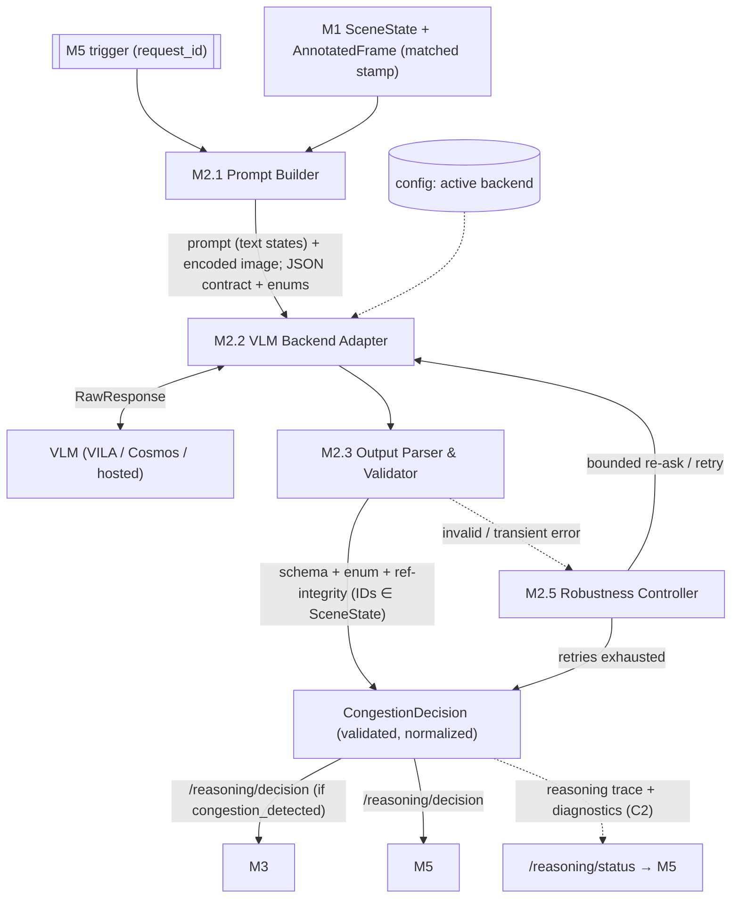

# Module 2 — VLM Semantic Reasoning — Spec

**Status:** Draft · **Level:** Design · **Source:** `project_proposal.md` §4.3
**Layer:** 2 (semantic reasoning) · **Producer:** M1 (perception) · **Consumers:** M3 (RAG), M5 (Orchestrator)

---

## 1. Overview

M2 is the "Think" stage of the Think–Act loop. Given an annotated overhead frame
and the textual robot states from M1, it asks a Vision-Language Model to decide
**whether congestion exists, classify it, identify involved robots, infer the
root cause, and recommend a coordination strategy** — emitting a single validated
JSON decision for M3 to ground.

**In scope:** prompt construction, VLM backend invocation behind a model-agnostic
adapter, output parsing/validation, and decision-quality safeguards (retries,
schema enforcement, confidence/abstention handling).

**Out of scope:** perception/state estimation (M1), translating the decision into
executable commands (M3), execution/safety (M4), and *when* to invoke M2 — the
orchestrator (M5) owns the trigger policy (Layer 2 intervenes only when Layer 1
fails within a time threshold, §4.1). M2 is a stateless request/response service.

**Model-agnostic principle (§4.3):** the VLM is pluggable. Candidate backends
include VILA-1.5 (efficiency) and NVIDIA Cosmos Reasoner (spatial reasoning),
plus hosted VLMs for benchmarking. All sit behind one standardized adapter API.

---

## 2. Inputs & Outputs

**Inputs**
- `AnnotatedFrame` from M1 (`/perception/annotated_frame`).
- `SceneState` from M1 (`/perception/scene_state`) — robot positions, headings,
  status, task strings.
- Invocation request from M5 (trigger + correlation/request ID).

**Outputs**
- `CongestionDecision` (validated JSON, §4) → M3 and M5.
- Reasoning trace (raw model text + `justification`) for interpretability (C2).
- Diagnostics: backend used, latency, token usage, retry count, parse status.

### 2.1 Data Flow

Internal request/response pipeline (one invocation), stateless:

When `congestion_detected=false`, the decision still flows to M5 but no M3
grounding call is made — Layer 1 stays in control (FR2.4.1).

---

## 3. Functional Requirements

### M2.1 Prompt Builder
- FR2.1.1 Assemble a structured scene-analysis prompt combining the annotated
  image and a textual robot-state list (id, position, heading, status, task).
- FR2.1.2 Render robot states deterministically from `SceneState` (stable
  ordering, fixed precision) so prompts are reproducible.
- FR2.1.3 Embed the response contract: required JSON fields and the closed
  enumerations for `type` and `strategy` (see §4).
- FR2.1.4 Keep the system role fixed ("warehouse traffic controller") and
  separate the static template from the per-frame dynamic payload.
- FR2.1.5 Respect backend constraints (image encoding/size, token budget) via the
  adapter's declared capabilities.

### M2.2 VLM Backend Adapter
- FR2.2.1 Expose one interface `analyze(prompt, image) -> RawResponse` independent
  of backend (local VILA/Cosmos or hosted API).
- FR2.2.2 Each backend declares capabilities: max image resolution, context/token
  limits, JSON/structured-output support, latency class.
- FR2.2.3 Backend selectable via config without changes to M2.1/M2.3.
- FR2.2.4 Apply deterministic-leaning decoding defaults (low temperature) for
  reproducible classification; configurable per backend.
- FR2.2.5 Enforce a per-call timeout and surface token-usage/latency telemetry.

### M2.3 Output Parser & Validator
- FR2.3.1 Extract JSON from raw model output (tolerant of surrounding prose /
  code fences).
- FR2.3.2 Validate against the `CongestionDecision` schema (§4): required fields,
  types, and closed enums for `type` and `strategy`.
- FR2.3.3 Validate referential integrity: every `involved_robots` ID exists in
  the input `SceneState`.
- FR2.3.4 On parse/validation failure, trigger a bounded re-ask (M2.5) before
  declaring failure.
- FR2.3.5 Normalize output (canonical enum casing, dedup robot IDs) before
  emitting.

### M2.4 Decision Semantics
- FR2.4.1 `congestion_detected=false` is a valid, first-class outcome — emit it
  cleanly so M5 can leave Layer 1 in control (no M3 call needed).
- FR2.4.2 Carry `root_cause` and `justification` verbatim into the decision for
  the interpretability contract (C2).
- FR2.4.3 Optionally expose a confidence/abstention signal; if low, allow M5 to
  fall back (e.g. escalate or hold) per §6.

### M2.5 Robustness Controller
- FR2.5.1 Retry on transient backend errors (timeout, rate limit) with backoff,
  bounded by config.
- FR2.5.2 Re-ask with a corrective prompt on schema-invalid output, bounded.
- FR2.5.3 On exhausted retries, emit a well-formed failure decision
  (`congestion_detected=null`/error flag) rather than raising into the pipeline.

---

## 4. Data Structures / Schemas (contract C1)

`CongestionDecision`
| field               | type            | notes                                              |
|---------------------|-----------------|----------------------------------------------------|
| congestion_detected | bool \| null    | null/error indicates analysis failure              |
| type                | enum \| null    | deadlock \| bottleneck \| crowding \| anomaly      |
| involved_robots     | [int]           | IDs must exist in input `SceneState`               |
| root_cause          | string          | natural language                                   |
| strategy            | enum \| null    | yield \| reroute \| convoy \| priority_override \| temporary_wait \| reverse |
| justification       | string          | natural language (interpretability, C2)            |
| confidence          | float \| null   | optional, 0–1                                      |
| request_id          | string          | correlates to M5 trigger / M1 frame stamp          |
| backend             | string          | model identifier used                              |
| stamp               | float           | decision timestamp (s)                             |

Mirrors the proposal's JSON (§4.3) plus pipeline-plumbing fields (`request_id`,
`backend`, `stamp`, optional `confidence`). Enumerations are closed sets;
unknown values are a validation failure.

---

## 5. Interfaces

**ROS2 (indicative; final names in C1)**
- Subscribes `/perception/scene_state`, `/perception/annotated_frame`.
- Subscribes M5 trigger (e.g. `/reasoning/request`).
- Publishes `CongestionDecision` → `/reasoning/decision`.
- Publishes diagnostics → `/reasoning/status`.

**Programmatic**
- `PromptBuilder.build(scene_state, annotated_frame) -> Prompt`.
- `VLMBackend.analyze(prompt, image) -> RawResponse` (+ `capabilities`).
- `DecisionParser.parse(raw, scene_state) -> CongestionDecision`.
- `Reasoner.run(request) -> CongestionDecision` — orchestrates 2.1→2.2→2.3→2.5.

**Config inputs** — active backend id + endpoint/weights, decoding params
(temperature, max tokens), image max resolution, per-call timeout, retry/re-ask
limits, confidence threshold, prompt template path.

---

## 6. Algorithms & Parameters

- **Think–Act loop (§4.3):** M2 = Think (produce decision JSON); the Act handoff
  is simply forwarding the validated decision to M3.
- **Decoding:** low temperature for stable classification; cap max output tokens
  (decision JSON is small).
- **Re-ask strategy:** on invalid JSON, resend with the validation error appended
  and an explicit "return only valid JSON" instruction; bounded attempts.
- **Set-of-Mark leverage:** prompt assumes M1's annotated overlays (IDs, status
  colors, vectors, goals) and instructs the model to reference robots by ID,
  improving spatial grounding (Yang et al. 2023).
- **Reference cadence:** Layer 2 runs 0.5–2 Hz (§4.1); a single decision must fit
  within that period including retries.

---

## 7. Non-Functional Requirements

- **Latency:** decision returned within the Layer-2 period (≤ ~2 s at 0.5 Hz
  worst case) including one re-ask; backend-dependent, recorded in diagnostics.
- **Determinism:** identical input → stable classification across runs (low-temp
  decoding); prompt rendering is deterministic.
- **Backend portability:** swapping backends requires config only, no code change
  in M2.1/M2.3 (enables the proposal's model comparison).
- **Validity:** 100% of emitted decisions are schema-valid or explicit failures —
  no malformed JSON ever reaches M3 (a core motivation for RAG grounding).
- **Cost/observability:** token usage and latency logged per call for the
  efficiency analysis (constant token budget claim, §3.2 Garg et al.).

---

## 8. Error Handling & Edge Cases

- Backend timeout / rate limit / network error → bounded retry, then failure
  decision (FR2.5.3).
- Hallucinated robot IDs not in `SceneState` → referential-integrity failure →
  re-ask, then drop unknown IDs or fail.
- Model returns prose / wrong enum / missing field → schema validation failure →
  re-ask.
- Empty scene or single robot → valid `congestion_detected=false`.
- Ambiguous/low-confidence scene → emit with low `confidence`; M5 decides.
- Stale/missing annotated frame for the requested stamp → reject request with
  diagnostic; do not analyze mismatched image/state.

---

## 9. Dependencies

- A VLM backend runtime: local (VILA-1.5, NVIDIA Cosmos Reasoner) and/or hosted
  VLM API client(s).
- JSON schema validation library.
- ROS2 transport + image handling (`cv_bridge` / image transport) for inputs.
- M1 (`SceneState`, `AnnotatedFrame`) and M5 (trigger) contracts.

---

## 10. Testing & Validation

- **Unit:** prompt rendering determinism; parser tolerance (fenced/prose-wrapped
  JSON); enum + referential-integrity validation; re-ask trigger logic.
- **Backend conformance:** a shared fixture suite each backend adapter must pass
  (capabilities honored, timeout respected, telemetry emitted).
- **Scenario tests:** curated annotated frames for the three eval scenarios
  (head-on deadlock, intersection bottleneck, dynamic anomaly) → assert expected
  `type`/`strategy` distribution.
- **Robustness:** fault-injected malformed/slow responses exercise M2.5 paths.
- **Acceptance:** no malformed decision escapes; classification accuracy on the
  labeled scenario set meets a target threshold (§11); latency within §7 budget.

---

## 11. Open Questions / Assumptions

- Quantitative classification-accuracy and latency acceptance thresholds — TBD.
- Whether grounding generation (M3.4) reuses the same VLM or a lighter LLM
  (§4.4) — affects whether M2's adapter is shared with M3.
- Final `confidence`/abstention semantics and how M5 acts on them.
- Prompt template versioning strategy (prompts affect reproducibility of results).
- Single-shot vs. multi-turn reasoning per decision (current design: single-shot
  with bounded re-ask).
