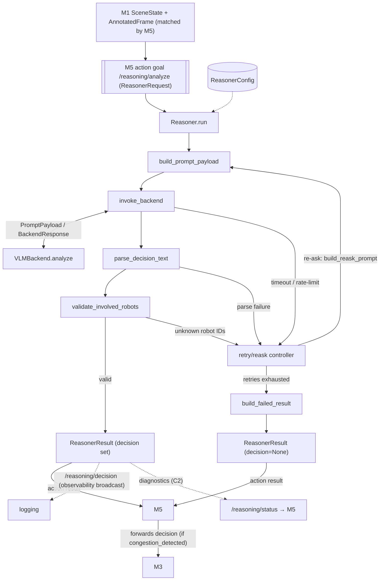

# Module 2 — VLM Semantic Reasoning — Implementation Spec

**Status:** Implementation target — code migration in progress · **Level:** Implementation · **Source:** `project_proposal.md` §4.3
**Layer:** 2 (semantic reasoning) · **Producer:** M1 (perception) · **Consumers:** M3 (RAG), M5 (Orchestrator)

---

## 1. Overview

M2 is the "Think" stage of the Think–Act loop. Given an annotated overhead frame
and the textual robot states from M1, it asks a Vision-Language Model to decide
**whether congestion exists, classify it, identify involved robots, infer the
root cause, and recommend a coordination strategy** — emitting a single validated
Pydantic decision for M3 to ground.

**In scope:** prompt construction, VLM backend invocation behind a model-agnostic
adapter, output parsing/validation, and decision-quality safeguards (retries,
schema enforcement, referential-integrity checking). Confidence/abstention scoring
is deferred to a later milestone.

**Out of scope:** perception/state estimation (M1), translating the decision into
executable commands (M3), execution/safety (M4), and *when* to invoke M2 — the
orchestrator (M5) owns the trigger policy. M2 is a stateless request/response service.

**Model-agnostic principle (§4.3):** the VLM is pluggable. The primary backend
is NVIDIA Cosmos Reason2 served via `llama-server` (llama.cpp), with a
`MockBackend` for offline testing. All sit behind one standardized `VLMBackend`
Protocol (§6.5). Swapping backends requires config only — `ReasonerConfig.backend_id`
selects the backend; backend-specific connection parameters (`base_url`,
`model_id`, `mmproj_path`, etc.) are supplied via a `BackendConfig` union (§7.1)
and a backend factory function, keeping the prompt builder and parser
backend-agnostic.

---

## 2. Inputs & Outputs

**Inputs**
- `AnnotatedFrame` from M1 (`/perception/annotated_frame`), saved as a PNG file
  on disk that the backend can read. The image path is included in `ReasonerRequest`.
- `SceneState` from M1 (`/perception/scene_state`) — robot positions, headings,
  status, task strings — projected into `RobotStateInput` list.
- Invocation request from M5: action goal on `/reasoning/analyze` carrying the
  serialized `ReasonerRequest` (§5). M5 assembles the request from matched
  M1 outputs; M2 does not subscribe to perception topics directly.

**Outputs**
- `ReasonerResult` containing a validated `CongestionDecision` (or `None` on
  failure) → M5 as the action result; M5 forwards the decision to M3 when
  grounding is required.
- Reasoning trace (`raw_text`) for interpretability (C2).
- `ReasonerDiagnostics`: backend used, latency, token usage, retry count, parse
  status.

### 2.1 Data Flow

Internal request/response pipeline (one invocation), stateless:



When `congestion_detected=false` (or `decision=None`), the result still flows
to M5 as the action result but M5 makes no M3 grounding call — Layer 1 stays
in control.

---

## 3. Functional Requirements

### M2.1 Prompt Builder
- FR2.1.1 Assemble a structured scene-analysis prompt from a `ReasonerRequest`:
  system role text, robot state list, closed enum contracts, and a no-prose
  instruction.
- FR2.1.2 Render robot states deterministically: sort by `robot_id`, fixed
  decimal precision (`:.2f` for floats), so prompts are reproducible across runs.
- FR2.1.3 Embed the closed enumerations for `type` and `strategy` inline in the
  user prompt so the model has no excuse to invent values.
- FR2.1.4 Keep the system prompt fixed ("warehouse traffic controller") and
  separate it from the dynamic user payload. The system prompt text must not
  change per-request.
- FR2.1.5 Include the full list of known robot IDs in the user prompt for
  hallucination control (instruction: "only use IDs from this list").
- FR2.1.6 (2026-09-17) When `ReasonerRequest.failure_context` is set, render a
  "Previous attempt in this episode" block (strategy, yielder if any, outcome,
  detail) between the known-ID list and the guidance, closed by two sentences:
  report `congestion_detected=false` if the congestion is no longer present;
  otherwise, if the previous strategy did not clear it, prefer a different
  strategy unless the scene has changed. The detail names the maneuver M3
  actually executed when it differs from the decided strategy (`"… (executed
  as temporary_wait)"`). When absent the prompt is byte-identical to the
  context-less prompt. Prompt context only; the output fields and enum
  vocabulary are unchanged.
- FR2.1.7 (2026-09-17) State the pairwise geometry explicitly: for every robot
  pair (ID order) one line with the distance (`:.2f` m) and whether each robot
  *faces* the other (heading within 60° of the direction to it), between the
  state block and the known-ID list; omitted with fewer than two robots. The
  guidance defines head-on as *within ~0.5 m AND each facing the other* —
  opposite headings alone are explicitly not head-on — and instructs the
  model to use these lines rather than re-derive geometry. **Why:** run 3
  (2026-09-17) classified two robots 1.1 m apart and driving away from each
  other as a deadlock because `|Δθ| ≈ π` matched the old heuristic. The block
  is a modality condition: `ReasonerRequest.include_pairwise_geometry=False`
  (M5 config `prompt_pairwise_geometry`) omits it and reverts the guidance to
  "compute distances and facing from the coordinates"; the facing + distance
  definition of head-on applies in both conditions (rev-8 spec 8.5).
- FR2.1.8 (2026-09-19) When `ReasonerRequest.include_static_obstacles=True`
  (M5 config `prompt_static_obstacles`, default **false**), render a "Static
  obstacles (world-frame axis-aligned boxes):" block between the pairwise-
  geometry block and the known-ID list, one `format_static_obstacle_lines`
  line per entry in `ReasonerRequest.static_obstacles` (`StaticObstacleInput`:
  `obstacle_id`, `x`, `y`, `size_x_m`, `size_y_m`), sorted by `obstacle_id` —
  e.g. `obstacle_1: centre (-1.85, 0.00) m, extent 0.30 x 0.30 m`. Id,
  centre, and extent only — the same bare-coordinate treatment robot states
  get; no wording may name a robot, a maneuver, a retreat, or a blocked side,
  since that is the inference the modality exists to measure. When the
  modality is on **and** at least one obstacle is supplied, one guidance
  clause is appended asserting the listed set is complete and that a robot
  can neither occupy nor drive through one; the clause is gated on the
  rendered obstacle lines, not on the flag alone, so `include_static_obstacles
  =True` with an empty `static_obstacles` list does not falsely assert an
  empty scene. When the modality is off (the shipped default) or no obstacles
  are supplied, the block renders as the empty string — not a placeholder
  line — so the rendered prompt is **byte-identical** to the pre-modality
  prompt; this is pinned by a length + SHA-256 test
  (`tests/unit/test_prompt_builder.py`,
  `test_build_prompt_payload_off_prompt_is_byte_identical_to_pre_feature_prompt`,
  provenance commit `056fa22`). What this guarantees is narrower than it may
  read: it isolates the obstacle modality itself — OFF at HEAD is
  byte-identical to HEAD without this feature — and that is the correct,
  useful thing for ablating this modality. It does **not** establish
  comparability with the 524 decision artifacts collected before 2026-09-19:
  FR2.1.9's `yield_robot` field landed in the same window and permanently
  changed the prompt for every condition (see FR2.1.9), so the OFF condition
  at HEAD is not the stimulus that produced those earlier artifacts. Obstacle
  ids are configuration, not scenario names —
  `ros2_ws/src/swarm_orchestrator/config/orchestrator.yaml`'s `static_obstacles`
  block ships neutral ids (`obstacle_1`, not `blocker_west`) precisely because
  an id naming the object's role or side would render into the prompt and
  hand the model the answer; a leakage test asserts the shipped config's ids
  contain none of `west`/`east`/`blocker`/etc. and that the rendered block
  never mentions space, retreat, clearance, or arrival. This is an Arm A
  change (rev-8 spec rev 8.6): every decision artifact collected before
  2026-09-19 was produced with the modality off by construction (the field
  did not exist), and the default stays off so future runs at HEAD remain
  comparable to each other and to this OFF baseline unless a run explicitly
  opts in — that comparability claim is scoped to runs collected under this
  modality's OFF default, not to the pre-2026-09-19 corpus (see above).
- FR2.1.9 (2026-09-19) `CongestionDecision.yield_robot: str | None = None` is
  the model's stated choice of which robot should yield, only meaningful when
  `strategy == "yield"`. It is **never required** — a decision with
  `strategy="yield"` and no `yield_robot` still parses, so every artifact
  collected before this field existed, and any backend that omits it, keeps
  parsing unchanged. A `model_validator(mode="after")` rejects a `yield_robot`
  that names a robot outside `involved_robots` (both names appear in the
  error). `reasoning/rag/command_grounder.resolve_robot_order(decision)`
  moves `yield_robot` to the front of `involved_robots` (remaining robots
  keep their relative order) but **only when `strategy == "yield"`**; every
  other strategy (including `reroute`, where `command_grounder` reads
  `robot_ids[0]` as the rerouter and the rest as waiters) ignores a stray or
  hallucinated `yield_robot` and uses `involved_robots` unchanged, so this
  field cannot silently swap who reroutes and who waits. Unlike FR2.1.8's
  obstacle modality, this field has **no OFF condition** — it is a
  permanent change to the prompt, applied to every request from this commit
  onward: the output-format section always documents `yield_robot`, the
  `<think>` step is extended to ask for it, and the old
  `strategy="yield" (first listed robot backs up)` clause is **removed**.
  Rendering the shared `_request()` fixture at branch base `e21326f` (3171
  chars, sha `5a57c937…`) versus HEAD with the obstacle modality off (3338
  chars, sha `3b77d224…`) shows the 167-char delta these edits introduced.
  The byte-identity test cited under FR2.1.8 pins the OFF obstacle condition
  against the tree *after* these edits (`056fa22`), so it does not, and
  cannot, establish that the OFF condition at HEAD matches the pre-2026-09-19
  stimulus. Before this field, `command_grounder.py` treated list position in
  `involved_robots` as the yielder channel; a census of 524 decision
  artifacts found `robot_1` listed first in 44/44 `yield` decisions, i.e.
  position was never observed to carry a choice (design review,
  `docs/superpowers/specs/2026-09-19-head-on-asymmetric-family-design-review.md`,
  Finding 2). That census was collected under a prompt that *instructed*
  "first listed robot backs up" — so 44/44 `robot_1`-first is substantially
  evidence of compliance with an explicit instruction, not only evidence that
  an unused channel went unused. The prompt's output-format section documents
  `yield_robot` as a field to fill in and its `<think>` step asks which robot
  should yield and why, but states no selection criteria (no mention of
  space, retreat, clearance, or arrival order) — the point of the field is to
  measure the model's choice, not to prime it toward one.

### M2.2 VLM Backend Adapter
- FR2.2.1 Expose one Protocol `VLMBackend` with a single method
  `analyze(payload, config) -> BackendResponse`, independent of backend.
- FR2.2.2 Backend selectable via `ReasonerConfig.backend_id` without changes to
  the prompt builder or parser.
- FR2.2.3 Apply `temperature=0.0` by default for reproducible classification.
  Sampling is resolved per backend (`resolve_reasoner_config`): the shared
  `vlm.reasoner` block in `config/models.yaml` may be overridden by a
  `reasoner:` mapping nested under the backend's own section. `openai` is
  pinned to 0.0; `llama_server` keeps the Cosmos Reason 2 chain-of-thought
  preset (0.6 / 0.95 / 20), which degrades at 0.0.
- FR2.2.4 Enforce per-call timeout (`ReasonerConfig.timeout_sec`) via a
  `concurrent.futures` thread pool; raise `BackendTimeoutError` on expiry.
- FR2.2.5 Surface `latency_ms` and `token_usage` in `BackendResponse`.

### M2.3 Output Parser & Validator
- FR2.3.1 Extract JSON from raw model output tolerant of surrounding prose and
  markdown code fences (` ```json ... ``` `).
- FR2.3.2 Validate extracted JSON against the `CongestionDecision` Pydantic model
  (closed enums, required fields, correct types).
- FR2.3.3 Validate referential integrity: every ID in `involved_robots` must
  appear in `ReasonerRequest.robot_states[*].robot_id`.
- FR2.3.4 On parse or validation failure, trigger a bounded re-ask (M2.5).
- FR2.3.5 Normalize output: lowercase `type`/`strategy` before enum validation
  and deduplicate `involved_robots` preserving first-occurrence order — both
  via `field_validator` on `CongestionDecision` (§7.1).

### M2.4 Decision Semantics
- FR2.4.1 `congestion_detected=false` is a valid, first-class outcome — emit it
  cleanly so M5 can leave Layer 1 in control. When false: `type="none"`,
  `strategy="none"`, `involved_robots=[]`.
- FR2.4.2 Carry `root_cause` and `justification` verbatim into the decision for
  the interpretability contract (C2).
- FR2.4.3 `ReasonerResult.decision=None` (not a failure `CongestionDecision`) when
  retries are exhausted — callers must check for `None` before forwarding to M3.

### M2.5 Robustness Controller
- FR2.5.1 Retry the same payload on transient backend errors (timeout, HTTP 429,
  connection error) with a bounded attempt count from `ReasonerConfig.max_attempts`.
  Like temperature (FR2.2.3), `max_attempts` is resolved per backend: `openai`
  overrides it to 4 (shared default 2) because its refusal-class failures are
  frame-triggered and clear on retry (`docs/reports/2026-09-25-frame-replay.md`
  Rev 2, Arm M).
- FR2.5.2 Re-ask with a corrective prompt on schema-invalid output or referential-
  integrity failure, when `ReasonerConfig.allow_reask=True` and attempts remain.
- FR2.5.3 On exhausted retries, return `build_failed_result(...)` with
  `decision=None` and `diagnostics.parse_status="failed"` rather than raising.

---

## 4. Data Structures / Schemas (contract C1)

`CongestionDecision` Pydantic model (mirrors
`reasoning/schemas/vlm_decision.schema.json`):

| field               | type            | notes                                                    |
|---------------------|-----------------|----------------------------------------------------------|
| congestion_detected | bool            | `false` is a first-class valid state                     |
| type                | enum            | `none \| deadlock \| bottleneck \| crowding \| anomaly` |
| involved_robots     | list[str]       | IDs must exist in input `SceneState`; empty when no congestion |
| root_cause          | str             | natural language                                         |
| strategy            | enum            | `none \| yield \| reroute \| convoy \| priority_override \| temporary_wait \| reverse` |
| justification       | str             | natural language (interpretability, C2)                  |
| yield_robot         | str \| null     | (2026-09-19) meaningful only when `strategy == "yield"`; never required — omitted/`null` for every pre-2026-09-19 artifact and any decision that doesn't set it (FR2.1.9) |

Pipeline metadata is carried in `ReasonerDiagnostics` (not in the decision JSON),
to keep `CongestionDecision` schema-stable and M3-friendly.

---

## 5. Interfaces

**ROS2 (indicative; final names in C1)**

M2 is exposed as a ROS2 **Action server** rather than a request/response topic
pair. One reasoning pass takes seconds (up to `timeout_sec` per attempt), so the
Action profile fits: goal/result correlation replaces manual `request_id`
matching across topics, feedback lets M5 distinguish "slow" from "dead," and
cancellation lets M5 abandon a pass whose scene has gone stale.

> **Deployment note (2026-06-12):** the approved M5 design
> (`docs/specs/module5_orchestrator.md` §1) invokes M2 **in-process** via
> `Reasoner.run` on a background executor. The `/reasoning/analyze` action server
> below is an alternative deployment (e.g., reasoning on a separate host) and is
> not used by M5 this milestone.

- **Action server** `/reasoning/analyze` — `swarm_interfaces/action/AnalyzeScene`:
  - **Goal:** serialized `ReasonerRequest` (JSON string): `request_id`,
    `image_path`, `frame_id`, `stamp`, `robot_states`. M5 assembles the request
    (it owns SceneState/frame stamp matching, §11); the M2 node does not
    subscribe to perception topics.
  - **Feedback:** `attempt` (int), `phase` (`"invoking" | "parsing" | "re-asking"`).
  - **Result:** serialized `ReasonerResult` (JSON string): decision (`null` on
    failure) + diagnostics. Action status `SUCCEEDED` covers both outcomes —
    `decision=None` is a valid result, not an aborted goal.
  - **Cancellation:** cooperative — a cancel discards the pending result and
    transitions the goal to `CANCELED`; it cannot abort an in-flight backend
    HTTP call (the worker thread is abandoned, same as the timeout path).
- Publishes `CongestionDecision` JSON → `/reasoning/decision` — passive
  broadcast for logging/observability only. M3 does **not** subscribe; M5
  receives the action result and invokes M3 itself.
- Publishes diagnostics → `/reasoning/status`.

Node implementation: run `Reasoner.run` in a separate callback group (or
executor thread) so goal execution never blocks the node's default callbacks;
at most one goal executes at a time — a new goal received while one is active
is rejected (M5 is the sole caller and must not overlap requests).

**Programmatic**
- `Reasoner.run(request: ReasonerRequest) -> ReasonerResult` — sole public
  entrypoint; all of M2.1–M2.5 orchestrated inside.
- `build_prompt_payload(request) -> PromptPayload` — pure, testable.
- `invoke_backend(backend, payload, config) -> BackendResponse` — adds timeout.
- `parse_decision_text(text) -> CongestionDecision` — tolerant JSON extraction.
- `validate_involved_robots(decision, known_robot_ids)` — raises
  `DecisionValidationError` on unknown IDs.
- `build_reask_prompt(payload, error_message) -> PromptPayload` — corrective.
- `build_failed_result(...) -> ReasonerResult` — safe failure wrapper.
- `write_reasoner_log(output_path, request, result)` — JSONL append.

**Config inputs** — `backend_id`, `timeout_sec`, `max_attempts`, `temperature`,
`max_tokens`, `allow_reask`.

---

## 6. Package Layout

Target package: `reasoning/vlm/`.

```
reasoning/vlm/
├── __init__.py          # public re-exports
├── models.py            # all Pydantic v2 data models (§6.1, §6.3)
├── errors.py            # VLMOutputParseError, DecisionValidationError,
│                        #   BackendTimeoutError (shared by parser, reasoner, backends)
├── backend_base.py      # VLMBackend Protocol (§6.5)
├── prompt_builder.py    # build_prompt_payload, format_robot_state_lines (§6.4)
├── output_parser.py     # parse_decision_text, validate_involved_robots,
│                        #   parse_vlm_decision (legacy dict path)
├── reasoner.py          # Reasoner.run, invoke_backend, build_reask_prompt,
│                        #   build_failed_result, write_reasoner_log (§6.2, §6.4, §6.6)
├── mock_backend.py           # MockBackend (§6.7)
└── llama_server_backend.py  # LlamaServerBackend — llama.cpp HTTP/OpenAI-compat (§6.8)
```

All modules use **Pydantic v2** with `ConfigDict(frozen=True)`. The shared import
convention is:

```python
from typing import Literal
from pydantic import BaseModel, ConfigDict, Field
```

---

## 7. Function Specifications

### 7.1 Data Models (`reasoning/vlm/models.py`)

#### `RobotStateInput`

**Description:** Minimal robot-state projection of M1's `RobotState` required for
prompt rendering and referential-integrity validation.

```python
class RobotStateInput(BaseModel):
    model_config = ConfigDict(frozen=True)

    robot_id: str = Field(min_length=1)
    x: float
    y: float
    theta: float
    linear_velocity: float | None = None
    angular_velocity: float | None = None
    task: str | None = None
    status: str | None = None
```

Fields:

- `robot_id`: must match the `f"robot_{marker_id}"` convention from M1 so
  referential-integrity validation uses identical strings to M1's schema.
- `theta`: radians, world frame; rendered as `:.2f` in prompts.
- `linear_velocity`, `angular_velocity`, `task`, `status`: optional; rendered
  in prompt when present, omitted when `None`.

#### `ReasonerRequest`

**Description:** Complete, validated input for one VLM reasoning invocation.

```python
class ReasonerRequest(BaseModel):
    model_config = ConfigDict(frozen=True)

    request_id: str = Field(min_length=1)
    image_path: str = Field(min_length=1)
    frame_id: str = Field(min_length=1)
    stamp: float = Field(ge=0)
    robot_states: list[RobotStateInput]
    failure_context: FailureContext | None = None
    include_pairwise_geometry: bool = True          # rev-8.5 modality axis, FR2.1.7
    static_obstacles: list[StaticObstacleInput] = []
    include_static_obstacles: bool = False           # FR2.1.8; default off
```

`StaticObstacleInput` (frozen): `obstacle_id: str`, `x: float`, `y: float`,
`size_x_m: float` (`> 0`), `size_y_m: float` (`> 0`) — one fixed, axis-aligned
world-frame obstacle (FR2.1.8).

Validation rules (caller responsibility, enforced at construction):

- `image_path` must point to an existing readable PNG/JPEG file; validated by
  `Reasoner.run` before the first backend call, not at Pydantic construction time
  (path may not exist at deserialization time).
- `robot_states[*].robot_id` values must be unique; duplicate IDs indicate an
  M1 bug; `Reasoner.run` raises `ValueError` and does not invoke the backend.
- `stamp` matches the annotated frame timestamp; M5 must not send mismatched
  image/state pairs.
- `request_id` convention: UUID4 string from `str(uuid.uuid4())`.
- `failure_context` is supplied by M5 only on re-analysis of an episode with a
  resolved prior attempt (M5 FR5.4.6); M2 treats it as prompt context.

#### `PromptPayload`

**Description:** Fully-rendered prompt text and image reference passed into
`VLMBackend.analyze`.

```python
class PromptPayload(BaseModel):
    model_config = ConfigDict(frozen=True)

    system_prompt: str
    user_prompt: str
    image_path: str
    known_robot_ids: list[str]
```

Fields:

- `system_prompt`: fixed warehouse-controller persona text (see §8.1).
- `user_prompt`: per-request dynamic payload including robot states, enum
  contracts, and no-prose instruction (see §8.2).
- `image_path`: same path as in `ReasonerRequest`; passed to the backend so
  backends control how they encode/transport the image.
- `known_robot_ids`: sorted list of all `robot_id` strings from the request,
  for referential-integrity validation after parsing.

#### `BackendResponse`

**Description:** Raw backend output before parsing. `latency_ms` is filled by
`invoke_backend` from wall-clock timing; backends may also fill it internally.

```python
class BackendResponse(BaseModel):
    model_config = ConfigDict(frozen=True)

    text: str
    backend_id: str
    latency_ms: int | None = Field(default=None, ge=0)
    token_usage: dict[str, int] | None = None
    raw: dict[str, object] = Field(default_factory=dict)
```

Fields:

- `text`: the raw assistant/model text; may contain prose, markdown fences, or
  bare JSON — `parse_decision_text` handles all forms.
- `backend_id`: the model identifier string used for this call; included in
  diagnostics.
- `token_usage`: keys `prompt_tokens`, `completion_tokens`, `total_tokens` where
  the backend exposes them; `None` if unavailable.
- `raw`: provider-specific response dict for debugging; must not be forwarded
  to M3 or M5.

#### `CongestionDecision`

**Description:** Parsed and schema-validated VLM decision. Mirrors
`reasoning/schemas/vlm_decision.schema.json` as a Pydantic model.

```python
class CongestionDecision(BaseModel):
    model_config = ConfigDict(frozen=True)

    congestion_detected: bool
    type: Literal["none", "deadlock", "bottleneck", "crowding", "anomaly"]
    involved_robots: list[str]
    root_cause: str
    strategy: Literal[
        "none",
        "yield",
        "reroute",
        "convoy",
        "priority_override",
        "temporary_wait",
        "reverse",
    ]
    justification: str
    # The model's stated choice of yielder; meaningful only when
    # strategy == "yield". Never required (FR2.1.9, 2026-09-19).
    yield_robot: str | None = None
```

Field validators (Pydantic v2):

- `type`, `strategy`: lowercase the raw string before `Literal` validation
  (`field_validator(..., mode="before")`) so casing variants like `"DEADLOCK"`
  normalize instead of burning a re-ask attempt. Values outside the enum still
  fail validation.
- `involved_robots`: deduplicate preserving first-occurrence order
  (`field_validator(..., mode="after")`).
- `yield_robot`: a `model_validator(mode="after")` rejects a value that is not
  `None` and not a member of `involved_robots` (FR2.1.9).

Cross-field invariant (checked in `parse_decision_text` after model validation,
both directions):

- `congestion_detected=False` → `type="none"`, `strategy="none"`,
  `involved_robots=[]`.
- `congestion_detected=True` → `type != "none"`, `strategy != "none"`, and
  `involved_robots` non-empty — a congestion claim that names no robots gives
  M3 nothing to ground and is treated as invalid output.

Any violation is a parse failure (`VLMOutputParseError`) and triggers a re-ask.

#### `ReasonerDiagnostics`

**Description:** Runtime metadata attached to every `ReasonerResult` for
observability and debugging.

```python
class ReasonerDiagnostics(BaseModel):
    model_config = ConfigDict(frozen=True)

    request_id: str
    backend_id: str
    attempts: int = Field(ge=1)
    latency_ms: int | None = Field(default=None, ge=0)
    token_usage: dict[str, int] | None = None
    parse_status: Literal["valid", "invalid", "failed"]
    error_type: str | None = None
    error_message: str | None = None
```

Fields:

- `attempts`: total number of backend calls made, including re-asks.
- `latency_ms`: wall-clock time of the *last* backend call, in milliseconds.
  When multiple attempts occur, log individual latencies via `write_reasoner_log`.
- `token_usage`: copied from the *last* `BackendResponse.token_usage`; `None`
  when the backend does not report usage or no backend call completed.
- `parse_status`:
  - `"valid"` — decision was parsed and validated successfully.
  - `"invalid"` — at least one attempt produced a parse/validation failure, but
    a subsequent re-ask succeeded (decision is still set).
  - `"failed"` — all attempts exhausted without a valid decision; `decision=None`.
- `error_type` / `error_message`: last error class name and message when
  `parse_status` is `"invalid"` or `"failed"`; `None` on full success.

#### `ReasonerResult`

**Description:** Return value of `Reasoner.run`. Callers must check
`decision is not None` before forwarding to M3.

```python
class ReasonerResult(BaseModel):
    model_config = ConfigDict(frozen=True)

    request_id: str
    decision: CongestionDecision | None
    raw_text: str | None
    diagnostics: ReasonerDiagnostics
```

Fields:

- `decision`: set when at least one attempt succeeded; `None` on complete failure.
- `raw_text`: the last raw assistant text received, for audit/debugging.
  Preserved even when `decision=None`.

#### `LlamaServerBackendConfig`

**Description:** Connection parameters for `LlamaServerBackend`. Kept separate
from `ReasonerConfig` so the prompt builder and parser stay backend-agnostic.

```python
class LlamaServerBackendConfig(BaseModel):
    model_config = ConfigDict(frozen=True)

    base_url: str = "http://127.0.0.1:8080/v1"  # llama-server OpenAI-compat endpoint
    model_id: str = Field(min_length=1)           # label for diagnostics; server ignores it
    mmproj_path: str | None = None                # placeholder: path to Cosmos mmproj GGUF
```

`mmproj_path` is **a server-startup concern**, not a per-request parameter. When
set, it documents the `--mmproj` path that `llama-server` must be started with for
vision support. The backend uses this field to determine whether to include
base64-encoded image content in the request:

- `mmproj_path is None` → text-only mode; image content omitted from request.
- `mmproj_path is not None` → vision mode; image included as `image_url` part.

Leave as `null` in `config/models.yaml` until a Cosmos Reason2 mmproj GGUF is
available. Do not hardcode the path.

#### `BackendConfig`

**Description:** Type alias for backend-specific config; becomes a Pydantic
discriminated union (with a discriminator field) when a second backend config
type is added. `backend_id` selects which backend to instantiate; a factory
function `build_backend` constructs the concrete backend.

```python
BackendConfig = LlamaServerBackendConfig  # extend as union when more backends added
```

`build_backend` lives in `reasoning/vlm/backend_factory.py`. `backend_config`
is optional because `mock` needs none; backends that require config raise
`ValueError` when it is missing:

```python
def build_backend(
    backend_id: str,
    backend_config: BackendConfig | None = None,
) -> VLMBackend:
    if backend_id == "llama_server":
        if backend_config is None:
            raise ValueError("llama_server backend requires a LlamaServerBackendConfig")
        return LlamaServerBackend(
            base_url=backend_config.base_url,
            model_id=backend_config.model_id,
            mmproj_path=backend_config.mmproj_path,
        )
    if backend_id == "mock":
        return MockBackend()
    raise ValueError(f"Unknown backend_id: {backend_id!r}")
```

#### `ReasonerConfig`

**Description:** Runtime settings for deterministic and bounded VLM reasoning.
Does **not** contain backend connection parameters — those live in `BackendConfig`.

```python
class ReasonerConfig(BaseModel):
    model_config = ConfigDict(frozen=True)

    backend_id: str = Field(min_length=1)
    timeout_sec: float = Field(default=15.0, gt=0)
    max_attempts: int = Field(default=2, ge=1)
    temperature: float = Field(default=0.0, ge=0.0, le=2.0)
    max_tokens: int = Field(default=1024, ge=1)
    allow_reask: bool = True
```

Config loading convention:

```python
import yaml
from reasoning.vlm.models import ReasonerConfig, LlamaServerBackendConfig
from reasoning.vlm.backend_factory import build_backend

with open("config/models.yaml") as f:
    raw = yaml.safe_load(f)
config = ReasonerConfig(**raw["vlm"]["reasoner"])
backend_config = LlamaServerBackendConfig(**raw["vlm"]["llama_server"])
backend = build_backend(config.backend_id, backend_config)
```

---

### 7.2 Main Function (`reasoning/vlm/reasoner.py`)

#### `Reasoner.run`

**Description:** Execute one complete M2 reasoning pass: validate request, build
prompt, invoke backend, parse, validate integrity, retry/re-ask on failure,
return result and diagnostics.

```python
class Reasoner:
    def __init__(self, backend: VLMBackend, config: ReasonerConfig) -> None: ...

    def run(self, request: ReasonerRequest) -> ReasonerResult:
        ...
```

Behavior (step-by-step algorithm):

```
1. Validate request:
   a. Assert robot_states[*].robot_id values are unique; raise ValueError otherwise.
   b. Assert image_path exists and is readable; raise FileNotFoundError otherwise.

2. Build initial payload:
   payload ← build_prompt_payload(request)
   known_ids ← set(r.robot_id for r in request.robot_states)
   attempts ← 0
   last_raw ← None
   last_error_type, last_error_msg ← None, None
   had_parse_failure ← False

3. Retry loop (while attempts < config.max_attempts):
   a. attempts += 1
   b. try:
        response ← invoke_backend(backend, payload, config)
        last_raw ← response.text
        decision ← parse_decision_text(response.text)
        validate_involved_robots(decision, known_ids)
        # success
        parse_status ← "invalid" if had_parse_failure else "valid"
        return ReasonerResult(
            request_id=request.request_id,
            decision=decision,
            raw_text=last_raw,
            diagnostics=ReasonerDiagnostics(
                request_id=request.request_id,
                backend_id=response.backend_id,
                attempts=attempts,
                latency_ms=response.latency_ms,
                token_usage=response.token_usage,
                parse_status=parse_status,
            ),
        )
      except (BackendTimeoutError, ConnectionError) as e:
        last_error_type, last_error_msg ← type(e).__name__, str(e)
        # transient transport error: retry the same payload, no re-ask
        continue
      except (VLMOutputParseError, DecisionValidationError) as e:
        had_parse_failure ← True
        last_error_type, last_error_msg ← type(e).__name__, str(e)
        if config.allow_reask and attempts < config.max_attempts:
            payload ← build_reask_prompt(payload, str(e))
        # else: fall through and exhaust attempts

4. Return failure:
   return build_failed_result(
       request=request,
       backend_id=config.backend_id,
       attempts=attempts,
       error_type=last_error_type,
       error_message=last_error_msg,
       raw_text=last_raw,
   )
```

Side effects:

- Does not publish ROS2 messages.
- Does not call M3.
- Does not write logs unless `logger_path` is explicitly configured at
  construction time and `write_reasoner_log` is wired in.

---

### 7.3 Helper Functions (`reasoning/vlm/reasoner.py`)

#### `invoke_backend`

**Description:** Call the configured VLM backend with timeout enforcement and
wall-clock latency measurement.

```python
def invoke_backend(
    backend: VLMBackend,
    payload: PromptPayload,
    config: ReasonerConfig,
) -> BackendResponse:
    ...
```

Behavior:

- Submit `backend.analyze(payload, config)` to a single-worker
  `concurrent.futures.ThreadPoolExecutor`.
- Block up to `config.timeout_sec`; if the future does not complete in time,
  raise `BackendTimeoutError(f"Backend timed out after {config.timeout_sec}s")`.
- Measure wall-clock latency with `time.monotonic()` around the `future.result()`
  call.
- If `response.latency_ms is None`, return a copy with the measured value:
  `response.model_copy(update={"latency_ms": int(elapsed * 1000)})`.
- Propagate any other exception from `backend.analyze` as-is (backends raise
  their own typed errors).

#### `build_reask_prompt`

**Description:** Build a corrective `PromptPayload` after invalid JSON or
invalid robot IDs.

```python
def build_reask_prompt(
    payload: PromptPayload,
    error_message: str,
) -> PromptPayload:
    ...
```

Behavior:

- Keep `system_prompt`, `image_path`, and `known_robot_ids` unchanged.
- Append the following text to `user_prompt`:

  ```
  \n\nYour previous response was invalid: {error_message}
  Please return ONLY a valid JSON object. Do not include any text, markdown, or explanation outside the JSON.
  ```

- Return a new frozen `PromptPayload` (do not mutate the original).

#### `build_failed_result`

**Description:** Construct a safe failure `ReasonerResult` after retries are
exhausted.

```python
def build_failed_result(
    request: ReasonerRequest,
    backend_id: str,
    attempts: int,
    error_type: str,
    error_message: str,
    raw_text: str | None = None,
) -> ReasonerResult:
    ...
```

Behavior:

- Returns `ReasonerResult` with `decision=None` and
  `diagnostics.parse_status="failed"`.
- `raw_text` is preserved even when the decision is `None`.
- `backend_id` is `config.backend_id` (the configured backend), not necessarily
  a backend that responded — on timeout the backend may not have replied.

#### `write_reasoner_log`

**Description:** Persist one request/response record to a JSONL file for
experiment traceability.

```python
def write_reasoner_log(
    output_path: str | Path,
    request: ReasonerRequest,
    result: ReasonerResult,
) -> None:
    ...
```

Behavior:

- Opens `output_path` in append mode (creates file if absent; does not create
  parent directories).
- Writes one JSON object per call, followed by a newline.
- Record schema:

  ```json
  {
    "request_id": "...",
    "image_path": "...",
    "frame_id": "...",
    "stamp": 0.0,
    "robot_ids": ["robot_1", "robot_2"],
    "backend_id": "...",
    "attempts": 1,
    "latency_ms": 1800,
    "token_usage": {"prompt_tokens": 0, "completion_tokens": 0, "total_tokens": 0},
    "parse_status": "valid",
    "raw_text": "...",
    "decision": { ... } | null,
    "error_type": null,
    "error_message": null
  }
  ```

- Uses `.model_dump(mode="json")` for Pydantic models.
- Does not raise on serialization of unexpected types — convert to `str` fallback.

---

### 7.4 Prompt Builder (`reasoning/vlm/prompt_builder.py`)

#### `build_prompt_payload`

**Description:** Build a deterministic, fully-rendered `PromptPayload` from a
`ReasonerRequest`.

```python
def build_prompt_payload(request: ReasonerRequest) -> PromptPayload:
    ...
```

Behavior:

- Sort `request.robot_states` by `robot_id` (lexicographic) before rendering.
- Call `format_robot_state_lines` on the sorted list.
- Assemble the user prompt from the template in §8.2.
- `known_robot_ids` = sorted list of all `robot_id` values.
- Return a frozen `PromptPayload`.

#### `format_robot_state_lines`

**Description:** Render a list of robot states as human-readable lines for
prompt insertion.

```python
def format_robot_state_lines(
    robot_states: list[RobotStateInput],
) -> list[str]:
    ...
```

Behavior:

- Each robot produces one line.
- Required fields: `robot_id`, `x` (`.2f`), `y` (`.2f`), `theta` (`.2f`).
- Optional fields appended when not `None`: `status`, `task`,
  `linear_velocity` (`.2f`), `angular_velocity` (`.2f`).
- Format (all on one line, comma-separated key=value):

  ```
  robot_id=robot_1, x=1.20, y=0.40, theta=1.57, status=MOVING, task=deliver_A, linear_velocity=0.15, angular_velocity=0.00
  ```

- If all optional fields are `None`, omit them entirely (no trailing commas).
- Empty input list: return `["no robots observed"]` so the caller's `"- "`
  prefix renders the placeholder line from §11.
- Returns one string per robot; the caller joins with `"\n"` and prefixes each
  line with `"- "`.

---

### 7.5 Output Parser (`reasoning/vlm/output_parser.py`)

#### `parse_decision_text`

**Description:** Extract JSON from raw VLM text (tolerant of markdown fences and
surrounding prose) and validate as `CongestionDecision`.

```python
def parse_decision_text(text: str) -> CongestionDecision:
    ...
```

Behavior:

1. Strip markdown code fences:
   ```python
   import re
   text = re.sub(r"^```(?:json)?\s*|\s*```$", "", text.strip(), flags=re.DOTALL)
   ```
2. If the result is not a bare JSON object, apply a broader extraction:
   - Search for the first `{` and last `}` pair in the text.
   - Use that substring as the JSON candidate.
3. Parse with `json.loads`; raise `VLMOutputParseError` on decode failure.
4. Validate via `CongestionDecision(**parsed)` (Pydantic); the model's field
   validators lowercase `type`/`strategy` and deduplicate `involved_robots`
   (§7.1). Raise `VLMOutputParseError` wrapping the `ValidationError` on failure.
5. Check the cross-field invariant (both directions, §7.1):
   - If `congestion_detected=False`: `type` must be `"none"`, `strategy` must be
     `"none"`, `involved_robots` must be `[]`.
   - If `congestion_detected=True`: `type` must not be `"none"`, `strategy` must
     not be `"none"`, `involved_robots` must be non-empty.
   - Any violation: raise `VLMOutputParseError`.
6. Return the validated, normalized `CongestionDecision`.

Raises:

- `VLMOutputParseError` (subclass of `ValueError`) on all parse/validation
  failures. Message contains the specific failure reason.

#### `validate_involved_robots`

**Description:** Enforce that every robot ID referenced by the VLM exists in the
input scene.

```python
def validate_involved_robots(
    decision: CongestionDecision,
    known_robot_ids: set[str],
) -> None:
    ...
```

Behavior:

- Compute `unknown = set(decision.involved_robots) - known_robot_ids`.
- If `unknown` is non-empty, raise
  `DecisionValidationError(f"Unknown robot IDs: {sorted(unknown)}")`.
- An empty `involved_robots` when `congestion_detected=False` is always valid.

Raises:

- `DecisionValidationError` (subclass of `ValueError`) when unknown IDs found.

#### `parse_vlm_decision` (legacy dict path)

**Description:** Parse and validate a VLM decision JSON string, returning a raw
`dict`. Preserved for backward compatibility with existing tests and
`CommandGrounder`.

```python
def parse_vlm_decision(text: str) -> dict[str, Any]:
    ...
```

Behavior:

- Uses `json.loads` + `jsonschema.Draft202012Validator` against
  `reasoning/schemas/vlm_decision.schema.json`.
- Does **not** strip markdown fences; callers that receive fenced model output
  must strip before calling.
- Raises `VLMOutputParseError` on JSON decode failure or schema validation
  failure.

Note: new code should prefer `parse_decision_text` (Pydantic path) over
`parse_vlm_decision` (dict path). `parse_decision_text` strips fences, applies
the `congestion_detected` invariant, and deduplicates `involved_robots`.
Deprecation condition: remove `parse_vlm_decision` once `CommandGrounder` (M3)
migrates to consuming `CongestionDecision` directly.

#### Exception Classes (`reasoning/vlm/errors.py`)

Defined in their own module so transport code (`reasoner.py`, backends) does
not import errors from the parser:

```python
class VLMOutputParseError(ValueError):
    """Raised when VLM text cannot be parsed or fails schema validation."""

class DecisionValidationError(ValueError):
    """Raised when a parsed decision references unknown robot IDs."""

class BackendTimeoutError(RuntimeError):
    """Raised by invoke_backend when the backend call exceeds timeout_sec."""
```

---

### 7.6 VLMBackend Protocol (`reasoning/vlm/backend_base.py`)

```python
from typing import Protocol
from reasoning.vlm.models import BackendResponse, PromptPayload, ReasonerConfig


class VLMBackend(Protocol):
    def analyze(
        self,
        payload: PromptPayload,
        config: ReasonerConfig,
    ) -> BackendResponse:
        ...
```

Contract:

- Must respect `config.timeout_sec` internally where the transport supports it;
  `invoke_backend` enforces an outer thread-level timeout regardless.
- Must return `BackendResponse.text` as the raw assistant/model text.
- Must include `BackendResponse.backend_id` as the model identifier used for the
  call (not the backend class name).
- Must include `BackendResponse.raw` as the provider response dict when available.
- Must not raise on ordinary model errors (empty output, refusal) — return the
  text and let the parser handle it.
- May raise `BackendTimeoutError`, `ConnectionError`, or other typed errors on
  transport-level failures; `invoke_backend` propagates them and the
  `Reasoner.run` retry loop catches and retries (§7.2).

---

### 7.7 Mock Backend (`reasoning/vlm/mock_backend.py`)

**Description:** Deterministic test backend that returns a pre-configured JSON
response without calling any real VLM.

```python
class MockBackend:
    def __init__(
        self,
        response_text: str | None = None,
        backend_id: str = "mock",
        latency_ms: int = 0,
    ) -> None:
        ...

    def analyze(
        self,
        payload: PromptPayload,
        config: ReasonerConfig,
    ) -> BackendResponse:
        ...
```

Behavior:

- If `response_text` is set, return it as `BackendResponse.text`.
- If `response_text` is `None`, return a default valid no-congestion JSON string:

  ```json
  {
    "congestion_detected": false,
    "type": "none",
    "involved_robots": [],
    "root_cause": "No congestion detected.",
    "strategy": "none",
    "justification": "Scene is clear."
  }
  ```

- Always returns `backend_id` as configured.
- Stores last-received `payload` and `config` as instance attributes
  (`last_payload`, `last_config`) for assertion in unit tests.
- Sequence mode: optionally accept `response_sequence: list[str]` at construction;
  return responses in order, cycling to the last one when exhausted. Useful for
  testing re-ask flow (first call returns bad JSON, second returns valid).

---

### 7.8 llama-server Backend (`reasoning/vlm/llama_server_backend.py`)

**Description:** HTTP adapter for NVIDIA Cosmos Reason2 served via `llama-server`
(llama.cpp). Targets the OpenAI-compatible `/v1/chat/completions` endpoint exposed
by llama-server on `127.0.0.1:8080`.

**Server startup (run before using this backend):**

```bash
# Text-only mode (mmproj not yet available)
llama-server \
  -m /path/to/nvidia.Cosmos-Reason2-8B.f16.gguf.Q6_K.gguf \
  --port 8080 --host 127.0.0.1 \
  --ctx-size 4096 -ngl 99

# Vision mode (once Cosmos mmproj GGUF is available)
llama-server \
  -m /path/to/nvidia.Cosmos-Reason2-8B.f16.gguf.Q6_K.gguf \
  --mmproj /path/to/mmproj-cosmos-reason2-8b.gguf \
  --port 8080 --host 127.0.0.1 \
  --ctx-size 4096 -ngl 99
```

`--mmproj` is a server startup flag — the projector is loaded once at server start
and applies to all subsequent requests. It is not passed per-request.

```python
class LlamaServerBackend:
    def __init__(
        self,
        base_url: str = "http://127.0.0.1:8080/v1",
        model_id: str = "cosmos-reason2-8b",
        mmproj_path: str | None = None,
    ) -> None:
        ...

    def analyze(
        self,
        payload: PromptPayload,
        config: ReasonerConfig,
    ) -> BackendResponse:
        ...
```

Constructor:

- `base_url`: llama-server base URL. Default `"http://127.0.0.1:8080/v1"`. Must
  not have a trailing slash.
- `model_id`: label used in `BackendResponse.backend_id` for diagnostics. llama-server
  ignores the `model` field in the request body (it serves the one model loaded at
  startup), so this is a documentation/tracing string only.
- `mmproj_path`: if set, indicates the server was started with `--mmproj` and vision
  requests should include the base64 image. If `None`, text-only mode is used.

`analyze` behavior:

1. **Vision mode** (`mmproj_path is not None`):
   - Read image from `payload.image_path` and base64-encode as
     `data:image/png;base64,...` (or `data:image/jpeg;base64,...` for `.jpg`/`.jpeg`).
   - Assemble multimodal messages:
     - `{"role": "system", "content": payload.system_prompt}`
     - `{"role": "user", "content": [text_part, image_url_part]}`
     - `text_part`: `{"type": "text", "text": payload.user_prompt}`
     - `image_url_part`: `{"type": "image_url", "image_url": {"url": data_url}}`

2. **Text-only mode** (`mmproj_path is None`):
   - Assemble text-only messages:
     - `{"role": "system", "content": payload.system_prompt}`
     - `{"role": "user", "content": payload.user_prompt}`
   - Image is not sent. Prompt text carries all scene context.

3. POST to `{base_url}/chat/completions` with:
   - `model`: `self.model_id` (accepted but ignored by llama-server)
   - `temperature`: `config.temperature`
   - `max_tokens`: `config.max_tokens`
   - `stream`: `false`
   - `response_format`: `{"type": "json_object"}` — llama-server grammar-based
     JSON enforcement; eliminates markdown fences and prose wrapping at the source.
   - `requests` transport `timeout=config.timeout_sec` (primary guard; prevents
     the thread from blocking past the executor deadline and accumulating zombie
     requests).

4. Extract `choices[0].message.content` as the text.
5. Extract `usage` dict as `token_usage` (keys `prompt_tokens`, `completion_tokens`,
   `total_tokens`) when present.
6. Store the full response dict in `BackendResponse.raw`.
7. Set `backend_id` to `self.model_id`.
8. On HTTP error (status ≥ 400), raise `ConnectionError` with the status code
   and response body.
9. Do not set `latency_ms`; `invoke_backend` fills it in.

Readiness check (call at startup to confirm server is loaded):

```python
def is_ready(self) -> bool:
    """Return True if llama-server health endpoint responds OK."""
    base = self.base_url.removesuffix("/v1")
    resp = requests.get(f"{base}/health", timeout=5)
    return resp.status_code == 200 and resp.json().get("status") == "ok"
```

Dependencies:

- `requests` (already in `requirements.txt` or add it).
- `base64`, `pathlib`, `json` from standard library.

---

## 8. Prompt Templates

### 8.1 System Prompt (fixed across all requests)

```
You are a warehouse swarm robotics traffic controller.
Your task is to analyze overhead camera views of autonomous mobile robots
and detect congestion patterns such as deadlocks, bottlenecks, crowding,
and anomalies. You always respond with only valid JSON — no other text.
```

This string is the value of `PromptPayload.system_prompt` for all backends.

### 8.2 User Prompt Template

The user prompt is assembled from these parts in order (the authoritative text
is `_USER_TEMPLATE` in `reasoning/vlm/prompt_builder.py`; this is its
structure as of 2026-09-17):

```text
You are a warehouse swarm robotics traffic controller. Analyze the overhead
camera view together with the robot states below and detect congestion
patterns such as deadlocks, bottlenecks, crowding, or anomalies.

Robot states (sorted by ID):
{robot_state_block}
{pairwise_geometry_block}{static_obstacle_block}
Known robot IDs: {known_robot_ids_json}
{failure_context_block}
Guidance:
- Robots are roughly 0.3 m wide; ~0.5 m = physically conflicting. Use the
  pairwise geometry above; do not re-derive distances or facing.
- theta convention. Opposite headings alone do NOT mean head-on: head-on =
  each faces the other (pairwise geometry) AND within ~0.5 m; robots heading
  away from each other are diverging.
- deadlock / bottleneck / crowding / anomaly definitions; two stopped robots
  farther apart than ~0.5 m or not facing each other are NOT deadlocked.
- strategy hints per pattern; decide from coordinates and image.

Produce a JSON object with exactly these fields: congestion_detected, type,
involved_robots, root_cause, strategy, justification, yield_robot (closed
enums; yield_robot is the robot that should yield, or null when strategy is
not "yield").

Rules: known IDs only; congestion_detected=false ⇒ type/strategy "none" and
involved_robots []; true ⇒ non-"none" type/strategy and ≥ 1 robot.

Answer using the following format:
<think> ... </think>
then ONLY the final JSON object.
```

Where:

- `{robot_state_block}`: lines from `format_robot_state_lines`, each prefixed
  with `"- "`, joined by `"\n"`.
- `{pairwise_geometry_block}`: empty with fewer than two robots; otherwise a
  blank line, the header `Pairwise geometry (faces = heading within 60° of the
  direction to the other robot):`, and one `"- "` line per pair from
  `format_pairwise_geometry_lines` (FR2.1.7).
- `{static_obstacle_block}`: empty string when `include_static_obstacles` is
  `False` or `static_obstacles` is empty; otherwise a blank line, the header
  `Static obstacles (world-frame axis-aligned boxes):`, and one `"- "` line
  per obstacle from `format_static_obstacle_lines`, sorted by `obstacle_id`
  (FR2.1.8).
- `{known_robot_ids_json}`: `json.dumps(sorted_robot_ids)` e.g.
  `["robot_1", "robot_2"]`.
- `{failure_context_block}`: empty, or the previous-attempt block
  (`render_failure_context_block`, FR2.1.6) wrapped in blank lines.

### 8.3 Re-ask Suffix (appended to user prompt on failure)

```
\n\nYour previous response was invalid: {error_message}
Please return ONLY a valid JSON object matching the schema above.
Do not include any text, markdown, or explanation outside the JSON.
```

---

## 9. Algorithms & Parameters

- **Think–Act cadence (§4.1):** Layer 2 is event-driven (M5 triggers on
  congestion timeout), not fixed-rate. Layer 1 keeps the robots safe while a
  reasoning pass is in flight, so M2 latency is a responsiveness target, not a
  control deadline. Budget: `timeout_sec=15` per backend call, `max_attempts=2`
  → worst case ~30 s per invocation including one re-ask. Target ≤ 15 s for a
  single attempt on the reference hardware (Cosmos Reason2 8B Q6_K via
  llama-server on Apple M1 Pro).
- **Decoding:** `temperature=0.0` by default for deterministic classification.
  `max_tokens=1024` is sufficient for the decision JSON (~300 tokens).
- **Retry vs re-ask separation:**
  - `BackendTimeoutError` → retry the same payload (transient transport issue).
  - `VLMOutputParseError` / `DecisionValidationError` → re-ask with corrective
    prompt (model produced bad output, rephrase helps).
- **JSON extraction:** strip fences → extract first `{...}` span → `json.loads`
  → Pydantic validation → invariant check → deduplicate `involved_robots`.
- **Determinism check:** identical `ReasonerRequest` + `temperature=0.0` should
  produce identical `CongestionDecision` across runs. Log any divergence.
- **Image encoding:** PNG preferred. For high-latency backends, downscale to
  1024 × 768 or use JPEG (quality 90) before base64 encoding.

---

## 10. Non-Functional Requirements

- **Latency:** ≤ 15 s typical single attempt; ≤ 30 s worst case including one
  re-ask (`max_attempts × timeout_sec`; `openai` overrides to 4 attempts, see
  FR2.5.1). Recorded in `ReasonerDiagnostics.latency_ms`. Layer 1 retains
  control while M2 reasons, so this is a responsiveness target, not a safety
  deadline.
- **Determinism:** identical input → stable classification across runs (low-temp
  decoding + deterministic prompt rendering).
- **Backend portability:** swapping backends (mock → llama_server) requires
  `ReasonerConfig.backend_id` change only; no changes to prompt builder or parser.
- **Validity guarantee:** 100% of emitted decisions are schema-valid `CongestionDecision`
  or explicit `decision=None` — no malformed JSON ever reaches M3.
- **Observability:** token usage and latency logged per call; JSONL records support
  offline analysis of classification accuracy and efficiency.

---

## 11. Error Handling & Edge Cases

| Situation | Expected behavior |
|-----------|------------------|
| Backend timeout | `BackendTimeoutError` caught; retry same payload; if exhausted, `build_failed_result` |
| HTTP 429 (rate limit) | Treat as transient backend error; retry same payload |
| HTTP 4xx/5xx | Raise `ConnectionError`; caught by retry loop; retry |
| Model returns prose only (no JSON) | `parse_decision_text` falls back to brace-extraction; fails → re-ask |
| Model wraps JSON in code fence | `parse_decision_text` strips fence; continues normally |
| Hallucinated robot ID | `validate_involved_robots` raises `DecisionValidationError`; re-ask |
| `congestion_detected=True` but `type="none"` | Invariant check in `parse_decision_text` raises `VLMOutputParseError`; re-ask |
| Empty `robot_states` list | Valid request (single-robot or empty scene); prompt renders `"- no robots observed"` |
| Single robot in scene | Valid; `congestion_detected=false` expected |
| Duplicate `robot_id` in request | `Reasoner.run` raises `ValueError` before any backend call |
| `image_path` does not exist | `Reasoner.run` raises `FileNotFoundError` before any backend call |
| All retries exhausted | `build_failed_result` returns `decision=None`; M5 must not trigger M3 |
| Mismatched image/state stamps | M5 responsibility to reject; M2 only checks image existence |

---

## 12. Dependencies

- **Pydantic v2** — all data models (`pip install pydantic>=2.0`).
- **`requests`** — HTTP calls in `LlamaServerBackend`.
- **`jsonschema`** — legacy `parse_vlm_decision` and schema validation tests.
- **`concurrent.futures`** — timeout enforcement in `invoke_backend` (stdlib).
- **ROS2** (transport layer, for node integration) — M2 core is ROS2-free.
  The node wrapper additionally requires `swarm_interfaces/action/AnalyzeScene`
  (new `.action` definition; shared contract — update specs, tests, and M5 when
  changing it).
- M1 contracts: `SceneState`, `AnnotatedFrame` (consumed by M5 before passing
  to M2 as `ReasonerRequest`).

---

## 13. Testing & Validation

### Unit Tests (`tests/unit/`)

#### `test_vlm_output_parser.py` (extend existing)

- Accept valid no-congestion JSON (existing test).
- Reject invalid JSON (existing test).
- Accept JSON wrapped in ` ```json ... ``` ` fences (new).
- Accept JSON embedded in prose after `"Here is my answer:"` (new).
- Reject enum value not in `type` set (new).
- Reject `involved_robots` with non-string element (new).
- Reject `congestion_detected=true` with `type="none"` (invariant check, new).
- Reject `congestion_detected=true` with `involved_robots=[]` (invariant check, new).
- Reject `congestion_detected=false` with `involved_robots=["robot_1"]` (new).
- Normalize `type="DEADLOCK"` → `"deadlock"` (casing validator, new).
- Deduplicate `involved_robots=["robot_1", "robot_1"]` → `["robot_1"]` (new).

#### `test_prompt_builder.py` (new)

- Render deterministically: same request → same `user_prompt`.
- Robot states sorted by `robot_id` lexicographically.
- Optional fields (`task`, `status`, etc.) omitted when `None`.
- `known_robot_ids` matches sorted `robot_states[*].robot_id`.

#### `test_reasoner.py` (new)

- `MockBackend` with valid response → `ReasonerResult.decision` is set.
- `MockBackend` with invalid JSON first, valid second → re-ask triggered,
  final decision set, `diagnostics.attempts=2`.
- `MockBackend` sequence `[invalid, invalid]` with `max_attempts=2` →
  `decision=None`, `parse_status="failed"`.
- `allow_reask=False` → first parse failure immediately returns `decision=None`.
- `BackendTimeoutError` on first call → retry same payload, not re-ask.
- `ConnectionError` on first call → retry same payload; exhausted → `decision=None`.
- Timeout on first call, success on second → `parse_status="valid"` (no parse
  failure occurred), `attempts=2`.
- Duplicate `robot_id` in request → `ValueError` before backend call.
- Missing `image_path` → `FileNotFoundError` before backend call.
- Diagnostics carry `token_usage` from the last `BackendResponse`.

#### `test_validate_involved_robots.py` (new)

- Known IDs → no exception.
- One unknown ID → `DecisionValidationError`.
- Empty `involved_robots` when `congestion_detected=False` → no exception.

### Node Integration Tests (`tests/integration/`, ROS2 required)

For the `AnalyzeScene` action server wrapper (§5); may land with M5 integration:

- Valid goal → result delivered, goal status `SUCCEEDED`.
- All-attempts-failed run → goal still `SUCCEEDED` with `decision=null` in the
  result (failure is a valid result, not an aborted goal).
- Second goal sent while one executes → rejected.
- Cancel during execution → goal transitions to `CANCELED`; no result forwarded.
- Feedback messages report `attempt`/`phase` during a re-ask run.

### Backend Conformance Tests

Each backend implementation must pass a shared fixture suite:

- Returns `BackendResponse` with non-empty `text`.
- Returns `backend_id` as a non-empty string.
- Respects `max_tokens` (output token count ≤ configured value + small buffer).
- `BackendTimeoutError` raised when `timeout_sec=0.001` (near-zero timeout).

### Scenario Tests (`tests/simulation/`)

Curated annotated frames for the three eval scenarios must produce expected
classification when run against a live or mocked backend:

| Scenario | Expected `type` | Expected `strategy` |
|----------|----------------|---------------------|
| Head-on deadlock | `deadlock` | `yield` or `reverse` |
| Intersection bottleneck | `bottleneck` | `reroute` or `temporary_wait` |
| Dynamic anomaly | `anomaly` | `priority_override` or `reroute` |

Tests assert the expected values appear in the distribution across `N≥5` runs
(classification stability). Single-run determinism at `temperature=0.0`.

### Acceptance Criteria

- 100% of emitted `CongestionDecision` objects are schema-valid (no exception
  escapes to caller).
- `decision=None` is the only failure mode — no malformed JSON reaches M3.
- Classification accuracy ≥ TBD threshold on the labeled scenario set (§14).
- End-to-end latency ≤ 30 s worst case per invocation (including one re-ask);
  ≤ 15 s typical single attempt on the target hardware.
- `write_reasoner_log` produces valid JSONL for all outcomes (success and failure).

---

## 14. Open Questions / Resolved Decisions

**Resolved:**

- `involved_robots` elements are `str` (not `int`); the M1 convention
  `f"robot_{marker_id}"` applies. Schema updated accordingly.
- `congestion_detected=null` (error flag) from earlier design is dropped in
  favor of `decision=None` in `ReasonerResult`. `CongestionDecision` always has
  a proper `bool`.
- JSON fence stripping is the parser's responsibility (`parse_decision_text`),
  not the caller's. `parse_vlm_decision` (legacy dict path) still requires the
  caller to strip — documented in `§7.5`.
- Backend timeout is enforced at the `invoke_backend` level via
  `concurrent.futures`; individual backends need not implement timeout logic.
- `confidence` field from earlier design spec is deferred — not in
  `CongestionDecision`; may be added in a later milestone without breaking M3.
- `llama-server` (llama.cpp, installed via Homebrew) is the serving framework for
  early-phase inference. Cosmos Reason2 8B Q6_K GGUF loads on Apple M1 Pro via
  Metal (`-ngl 99`). The backend runs in text-only mode until a Cosmos mmproj GGUF
  is available; `mmproj_path` in `LlamaServerBackendConfig` is the placeholder for
  enabling full vision support. The `response_format: json_object` parameter is used
  to enforce structured JSON output at the grammar level.
- M5 → M2 trigger is a ROS2 Action (`/reasoning/analyze`,
  `swarm_interfaces/action/AnalyzeScene`), not a topic pair. M5 receives the
  action result and forwards to M3; `/reasoning/decision` is an observability
  broadcast only.
- Latency budget: ≤ 15 s typical single attempt, ≤ 30 s worst case including
  one re-ask (`timeout_sec=15`, `max_attempts=2`). The earlier ≤ 2 s target was
  unachievable on the reference hardware; Layer 1 retains control during a
  pass, so latency is a responsiveness target, not a safety deadline.
- `congestion_detected=true` requires non-empty `involved_robots` (and
  `type`/`strategy` ≠ `"none"`); enforced as a parse invariant — a congestion
  claim naming no robots is not actionable by M3.
- Enum casing is normalized (lowercased) by `field_validator` before `Literal`
  validation; `Literal` alone is case-sensitive and would reject `"DEADLOCK"`.
- `prompt_context` field removed from `ReasonerRequest` — it had no consumer.
  Reintroduce with a specified use if scenario metadata is ever needed in prompts.

**Open:**

- Quantitative classification-accuracy acceptance threshold — TBD pending first
  labeled scenario run.
- Whether M3 reuses the M2 VLM adapter for grounding text generation (§4.4) —
  deferred to M3 spec.
- Prompt template versioning strategy — consider embedding a `prompt_version`
  string in `ReasonerDiagnostics` for reproducibility tracking.
- Whether `confidence` should be added to `CongestionDecision` to allow M5
  abstention — deferred.
