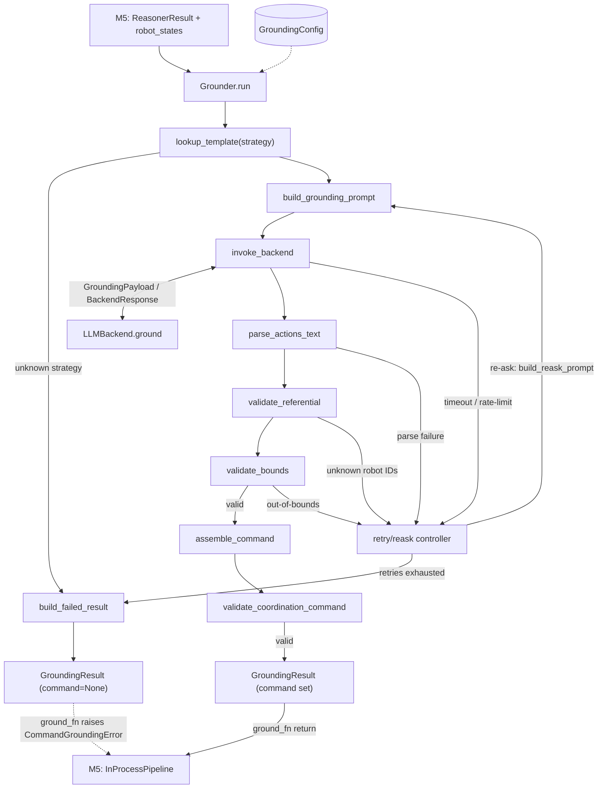

# Module 3 — RAG Action Grounding — Implementation Spec

**Status:** Implementation target — design approved · **Level:** Implementation · **Source:** `project_proposal.md` §4.4
**Layer:** 2 (semantic reasoning) · **Producer:** M2 (VLM Reasoning) · **Consumers:** M5 (Orchestrator)

---

## 1. Overview

M3 is the "Ground" stage of the Think–Ground–Act loop. Given a validated
`CongestionDecision` from M2 (congestion type, involved robots, root cause,
strategy, justification), it translates the chosen **strategy** into a concrete,
schema-valid `CoordinationCommand`: per-robot actions and parameters that M4 can
dispatch.

**In scope:** strategy-template lookup, LLM-based parameter filling for
per-robot actions, referential-integrity and bounds validation of those
parameters, deterministic assembly of the command envelope
(`command_id`, `expected_resolution_time_sec`, `fallback`), and the same
retry/re-ask robustness pattern as M2.

**Out of scope:** the VLM decision itself (M2), command dispatch and execution
safety (M4), *when* to invoke M3 — the orchestrator (M5) owns that, and the
schema-validation function `validate_coordination_command` (already implemented
in `reasoning/rag/command_grounder.py`, unchanged by this spec). M3 is a
stateless request/response service, like M2.

**Retrieval principle:** M3 retains the name "RAG" from the architecture
proposal, but retrieval is **not** vector search. There are exactly six
strategies, already chosen by M2 as a closed enum (`yield`, `reroute`, `convoy`,
`priority_override`, `temporary_wait`, `reverse`); retrieval is a direct
dictionary lookup of `strategy -> Template` loaded once from the existing YAML
files in `reasoning/rag/templates/`. `reasoning/rag/vector_store.py`,
`embeddings.py`, and `index_knowledge_base.py` are removed — embedding-based
retrieval has no role while the template set is fixed and small; if templates
grow into the dozens, reintroduce vector search behind the same `Template`
contract without touching the grounding pipeline.

**Model-agnostic principle:** mirrors M2 §4.3. M3's LLM is pluggable behind one
`LLMBackend` Protocol (§6.5), distinct from M2's `VLMBackend` — M3's calls are
text-only (no image). Swapping backends requires config only.

---

## 2. Inputs & Outputs

**Inputs**
- `ReasonerResult` from M2, specifically `decision: CongestionDecision` where
  `congestion_detected=True` and `strategy != "none"`. M5 must not call M3 with
  any other `ReasonerResult` (mirrors M2's contract that `decision=None` and
  `congestion_detected=False` stay in M5).
- `robot_states: list[RobotStateInput]` — the same scene snapshot passed to M2,
  forwarded by M5 so M3 can reference robot positions when filling parameters
  (e.g. plausible waypoints) and run referential checks against the same robot
  ID universe M2 used.

**Outputs**
- `GroundingResult` containing a validated `CoordinationCommand` dict (or
  `None` on failure) → M5, which raises `CommandGroundingError` on `None` and
  forwards the dict to its existing fan-out/dispatch path on success.
- Reasoning trace (`raw_text`) for interpretability, mirroring M2.
- `GroundingDiagnostics`: backend used, latency, token usage, retry count,
  parse status.

### 2.1 Data Flow

Internal request/response pipeline (one invocation), stateless:



When retries are exhausted, `Grounder.run` returns `GroundingResult(command=None)`
rather than raising — the thin `ground_fn` adapter at the M5 boundary (§5) is the
only place an exception is raised, so `InProcessPipeline.run`'s existing
exception-catching path (unchanged) produces the `GROUNDING`-stage failure
outcome.

---

## 3. Functional Requirements

### M3.1 Template Lookup
- FR3.1.1 Load all six strategy templates from `reasoning/rag/templates/*.yaml`
  once at `Grounder` construction into a `dict[str, Template]` keyed by
  `strategy`.
- FR3.1.2 `lookup_template(strategy)` raises `UnknownStrategyError` (subclass of
  `ValueError`) for any strategy not in the loaded set, including `"none"` —
  M5 must never call M3 with `strategy="none"`, but M3 fails fast and safely if
  it happens.
- FR3.1.3 Each `Template` carries `name`, `strategy`, `description`, and
  `parameters: list[str]` (expected parameter keys for that strategy) — same
  fields already present in the YAML files, loaded as-is without format changes.

### M3.2 LLM Backend Adapter
- FR3.2.1 Expose one Protocol `LLMBackend` with a single method
  `ground(payload, config) -> BackendResponse`, independent of backend.
- FR3.2.2 Backend selectable via `GroundingConfig.backend_id` without changes to
  the prompt builder or parser.
- FR3.2.3 Apply `temperature=0.0` by default for reproducible parameter filling.
- FR3.2.4 Enforce per-call timeout (`GroundingConfig.timeout_sec`) via a
  `concurrent.futures` thread pool; raise `BackendTimeoutError` on expiry.
- FR3.2.5 Surface `latency_ms` and `token_usage` in `BackendResponse` — reuses
  the same `BackendResponse` shape as M2's (`reasoning/vlm/models.py`), since
  the contract (text + backend_id + latency + token usage + raw) is identical
  for a text-only call.

### M3.3 Prompt Builder
- FR3.3.1 Assemble a grounding prompt from the matched `Template`, the
  `CongestionDecision` fields (`type`, `involved_robots`, `root_cause`,
  `strategy`, `justification`), and the sorted `robot_states` (same
  `format_robot_state_lines` rendering M2 uses, imported from `reasoning.vlm`).
- FR3.3.2 Instruct the model to return **only** a JSON array of actions
  (`robot_id`, `action`, `parameters`) — never the full command envelope.
- FR3.3.3 Embed the template's `parameters` list inline so the model knows
  which parameter keys are expected for the chosen strategy.
- FR3.3.4 Include the known robot ID list (from `involved_robots`, not the full
  scene) for hallucination control — only robots already implicated by M2's
  decision are eligible action targets.

### M3.4 Output Parser & Validator
- FR3.4.1 Extract JSON from raw model output tolerant of surrounding prose and
  markdown code fences, mirroring M2's `parse_decision_text` fence-stripping.
- FR3.4.2 Validate extracted JSON as a list of `GroundedAction` Pydantic models
  (closed shape: `robot_id: str`, `action: str`, `parameters: dict[str, Any]`).
- FR3.4.3 Validate referential integrity: every `robot_id` in the parsed actions
  must appear in `decision.involved_robots`.
- FR3.4.4 Validate bounds: numeric parameter values present in
  `GroundingConfig` bounds tables (durations, distances, spacing) must fall
  within `[min, max]` for the active strategy; out-of-range values fail
  validation rather than being silently clamped.
- FR3.4.5 On parse, referential, or bounds failure, trigger a bounded re-ask
  (M3.6).

### M3.5 Command Envelope Assembly (deterministic, no LLM)
- FR3.5.1 `assemble_command(request_id, strategy, actions)` builds the final
  `CoordinationCommand` dict: `command_id = f"cmd_{request_id}"`,
  `actions` = validated `GroundedAction` list serialized to dicts,
  `expected_resolution_time_sec` = `GroundingConfig.resolution_defaults[strategy]`,
  `fallback` = `GroundingConfig.fallback_strings[strategy]`.
- FR3.5.2 The assembled dict is passed through the existing
  `validate_coordination_command` (schema check) before being returned in
  `GroundingResult.command` — unchanged second safety net, catches
  envelope-assembly bugs independent of the LLM.

### M3.6 Robustness Controller
- FR3.6.1 Retry the same payload on transient backend errors (timeout, HTTP
  429, connection error) with a bounded attempt count from
  `GroundingConfig.max_attempts` — identical policy to M2 FR2.5.1.
- FR3.6.2 Re-ask with a corrective prompt on parse, referential, or bounds
  failure, when `GroundingConfig.allow_reask=True` and attempts remain —
  identical policy to M2 FR2.5.2.
- FR3.6.3 On exhausted retries, return `GroundingResult(command=None,
  diagnostics.parse_status="failed")` rather than raising — identical policy to
  M2 FR2.5.3.

---

## 4. Data Structures / Schemas (contract C1)

`GroundedAction` (intermediate, not the final wire schema):

| field      | type            | notes                                              |
|------------|-----------------|-----------------------------------------------------|
| robot_id   | str             | must be in `decision.involved_robots`               |
| action     | str             | free-form action label filled by the LLM             |
| parameters | dict[str, Any]  | keys should match the matched `Template.parameters` |

Final output mirrors `reasoning/schemas/coordination_command.schema.json`
(unchanged, already implemented):

| field                        | type   | notes                                          |
|-------------------------------|--------|------------------------------------------------|
| command_id                   | str    | deterministic, derived from `request_id`        |
| actions                       | list   | `[{robot_id, action, parameters}]`, ≥ 1 item    |
| expected_resolution_time_sec | number | from `GroundingConfig.resolution_defaults`      |
| fallback                      | str    | from `GroundingConfig.fallback_strings`         |

Pipeline metadata is carried in `GroundingDiagnostics` (not in the command
JSON), to keep `CoordinationCommand` schema-stable and M4-friendly — mirrors
M2's separation of `CongestionDecision` from `ReasonerDiagnostics`.

---

## 5. Interfaces

**Programmatic** (M3 is in-process only, like M2's M5 deployment — no ROS2
action server; M5 invokes M3 synchronously inside `InProcessPipeline.run`):

- `Grounder.run(result: ReasonerResult, robot_states: list[RobotStateInput]) ->
  GroundingResult` — sole public entrypoint; all of M3.1–M3.6 orchestrated
  inside.
- `lookup_template(strategy: str, templates: dict[str, Template]) -> Template`
  — pure, testable.
- `build_grounding_prompt(decision, template, robot_states) ->
  GroundingPayload` — pure, testable.
- `invoke_backend(backend, payload, config) -> BackendResponse` — adds timeout;
  structurally identical to M2's `invoke_backend`.
- `parse_actions_text(text) -> list[GroundedAction]` — tolerant JSON extraction.
- `validate_referential(actions, involved_robots)` — raises
  `GroundingValidationError` on unknown robot IDs.
- `validate_bounds(actions, template, config)` — raises
  `GroundingValidationError` on out-of-range numeric parameters.
- `build_reask_prompt(payload, error_message) -> GroundingPayload` — corrective.
- `assemble_command(request_id, strategy, actions, config) -> dict[str, Any]`.
- `build_failed_result(...) -> GroundingResult` — safe failure wrapper.

**M5 integration boundary** — replaces the `NotImplementedError` stub in
`swarm_orchestrator/orchestrator_node.py:_build_default_pipeline`. No changes
to `InProcessPipeline` itself:

```python
def ground(result: ReasonerResult) -> dict[str, Any]:
    grounding_result = grounder.run(result, robot_states=last_robot_states)
    if grounding_result.command is None:
        raise CommandGroundingError(grounding_result.diagnostics.error_message)
    return grounding_result.command
```

`InProcessPipeline.run` already catches exceptions from `ground_fn` and wraps
them as a `GROUNDING`-stage `PipelineOutcome` failure; it already calls
`validate_coordination_command` on the returned dict as a second safety net.
Both behaviors are pre-existing and unchanged by this spec.

**Config inputs** — `backend_id`, `timeout_sec`, `max_attempts`, `temperature`,
`max_tokens`, `allow_reask`, plus per-strategy `resolution_defaults`,
`fallback_strings`, and bounds tables (§7).

---

## 6. Package Layout

Target package: `reasoning/rag/`. Replaces the current placeholder modules.

```
reasoning/rag/
├── __init__.py              # public re-exports: Grounder, GroundingConfig, GroundingResult
├── models.py                 # GroundingRequest-adjacent Pydantic models (§7.1)
├── errors.py                  # GroundingOutputParseError, GroundingValidationError,
│                             #   UnknownStrategyError, BackendTimeoutError
├── templates.py               # Template model, load_templates(), lookup_template()
├── llm_backend_base.py        # LLMBackend Protocol (§7.6)
├── prompt_builder.py          # build_grounding_prompt, build_reask_prompt (§7.4)
├── output_parser.py           # parse_actions_text, validate_referential, validate_bounds (§7.5)
├── envelope.py                 # assemble_command (§7.3)
├── grounder.py                 # Grounder.run, invoke_backend, build_failed_result (§7.2)
├── mock_llm_backend.py         # MockLLMBackend (§7.7)
├── command_grounder.py         # unchanged: validate_coordination_command
└── templates/                  # unchanged: convoy.yaml, yield.yaml, reroute.yaml,
                                 #   reverse.yaml, temporary_wait.yaml, priority_override.yaml
```

Removed: `vector_store.py`, `embeddings.py`, `index_knowledge_base.py` — see
§1 Retrieval principle.

All modules use **Pydantic v2** with `ConfigDict(frozen=True)`, matching M2's
convention.

---

## 7. Function Specifications

### 7.1 Data Models (`reasoning/rag/models.py`)

#### `Template`

```python
class Template(BaseModel):
    model_config = ConfigDict(frozen=True)

    name: str = Field(min_length=1)
    strategy: str = Field(min_length=1)
    description: str
    parameters: list[str]
```

Loaded verbatim from each YAML file in `reasoning/rag/templates/`; field names
match the existing YAML keys exactly — no schema change to the template files.

#### `GroundedAction`

```python
class GroundedAction(BaseModel):
    model_config = ConfigDict(frozen=True)

    robot_id: str = Field(min_length=1)
    action: str = Field(min_length=1)
    parameters: dict[str, Any] = Field(default_factory=dict)
```

#### `GroundingPayload`

```python
class GroundingPayload(BaseModel):
    model_config = ConfigDict(frozen=True)

    system_prompt: str
    user_prompt: str
    known_robot_ids: list[str]
```

No `image_path` field — M3's LLM call is text-only by design (§1).

#### `GroundingDiagnostics`

```python
class GroundingDiagnostics(BaseModel):
    model_config = ConfigDict(frozen=True)

    request_id: str
    backend_id: str
    attempts: int = Field(ge=1)
    latency_ms: int | None = Field(default=None, ge=0)
    token_usage: dict[str, int] | None = None
    parse_status: Literal["valid", "invalid", "failed"]
    error_type: str | None = None
    error_message: str | None = None
```

Semantics identical to M2's `ReasonerDiagnostics` (§7.1 of the M2 spec).

#### `GroundingResult`

```python
class GroundingResult(BaseModel):
    model_config = ConfigDict(frozen=True)

    request_id: str
    command: dict[str, Any] | None
    raw_text: str | None
    diagnostics: GroundingDiagnostics
```

`command` is the schema-validated `CoordinationCommand` dict (not a typed
Pydantic model — M4 consumes it as a dict via `swarm_interfaces` fan-out, and
the existing `validate_coordination_command` already operates on dicts).

#### `GroundingConfig`

```python
class GroundingConfig(BaseModel):
    model_config = ConfigDict(frozen=True)

    backend_id: str = Field(min_length=1)
    timeout_sec: float = Field(default=15.0, gt=0)
    max_attempts: int = Field(default=2, ge=1)
    temperature: float = Field(default=0.0, ge=0.0, le=2.0)
    max_tokens: int = Field(default=512, ge=1)
    allow_reask: bool = True
    resolution_defaults: dict[str, float] = Field(default_factory=dict)
    fallback_strings: dict[str, str] = Field(default_factory=dict)
    bounds: dict[str, dict[str, tuple[float, float]]] = Field(default_factory=dict)
```

`resolution_defaults`, `fallback_strings`, `bounds` are keyed by `strategy`.
`bounds[strategy]` maps a parameter key (e.g. `"duration_sec"`,
`"distance_m"`, `"spacing_m"`) to `(min, max)`. Loaded from
`config/models.yaml` (`rag.grounder` section) alongside M2's `vlm.reasoner`
section, following the existing config-loading convention in
`reasoning/vlm/backend_factory.py`.

---

### 7.2 Main Function (`reasoning/rag/grounder.py`)

#### `Grounder.run`

**Description:** Execute one complete M3 grounding pass: look up template,
build prompt, invoke backend, parse, validate, retry/re-ask on failure, assemble
and schema-validate the final command.

```python
class Grounder:
    def __init__(
        self,
        backend: LLMBackend,
        config: GroundingConfig,
        templates: dict[str, Template],
    ) -> None: ...

    def run(
        self,
        result: ReasonerResult,
        robot_states: list[RobotStateInput],
    ) -> GroundingResult:
        ...
```

Behavior (step-by-step algorithm):

```
1. Validate preconditions:
   a. Assert result.decision is not None; raise ValueError otherwise
      (M5 must not call M3 on a failed M2 result).
   b. Assert result.decision.congestion_detected is True and
      result.decision.strategy != "none"; raise ValueError otherwise.

2. Look up template:
   try:
       template ← lookup_template(result.decision.strategy, self._templates)
   except UnknownStrategyError as e:
       return build_failed_result(result.request_id, config.backend_id,
                                   attempts=0, error_type="UnknownStrategyError",
                                   error_message=str(e))

3. Build initial payload:
   payload ← build_grounding_prompt(result.decision, template, robot_states)
   known_ids ← set(result.decision.involved_robots)
   attempts ← 0
   last_raw ← None
   last_error_type, last_error_msg ← None, None
   had_parse_failure ← False

4. Retry loop (while attempts < config.max_attempts):
   a. attempts += 1
   b. try:
        response ← invoke_backend(backend, payload, config)
        last_raw ← response.text
        actions ← parse_actions_text(response.text)
        validate_referential(actions, known_ids)
        validate_bounds(actions, template, config)
        command ← assemble_command(result.request_id, template.strategy, actions, config)
        command ← validate_coordination_command(command)
        parse_status ← "invalid" if had_parse_failure else "valid"
        return GroundingResult(
            request_id=result.request_id,
            command=command,
            raw_text=last_raw,
            diagnostics=GroundingDiagnostics(
                request_id=result.request_id,
                backend_id=response.backend_id,
                attempts=attempts,
                latency_ms=response.latency_ms,
                token_usage=response.token_usage,
                parse_status=parse_status,
            ),
        )
      except (BackendTimeoutError, ConnectionError) as e:
        last_error_type, last_error_msg ← type(e).__name__, str(e)
        continue
      except (GroundingOutputParseError, GroundingValidationError, CommandGroundingError) as e:
        had_parse_failure ← True
        last_error_type, last_error_msg ← type(e).__name__, str(e)
        if config.allow_reask and attempts < config.max_attempts:
            payload ← build_reask_prompt(payload, str(e))

5. Return failure:
   return build_failed_result(
       request_id=result.request_id,
       backend_id=config.backend_id,
       attempts=attempts,
       error_type=last_error_type,
       error_message=last_error_msg,
       raw_text=last_raw,
   )
```

Side effects: none — no ROS2 messages, no dispatch, no logging unless wired by
the caller (mirrors M2's `Reasoner.run`).

---

### 7.3 Helper Functions

#### `invoke_backend` (`reasoning/rag/grounder.py`)

Identical structure to M2's `invoke_backend` (§7.3 of M2 spec): submits
`backend.ground(payload, config)` to a single-worker
`ThreadPoolExecutor`, enforces `config.timeout_sec`, fills `latency_ms` if the
backend left it unset.

#### `assemble_command` (`reasoning/rag/envelope.py`)

```python
def assemble_command(
    request_id: str,
    strategy: str,
    actions: list[GroundedAction],
    config: GroundingConfig,
) -> dict[str, Any]:
    ...
```

Behavior:

- `command_id = f"cmd_{request_id}"`.
- `actions` = `[a.model_dump(mode="json") for a in actions]`, preserving
  parser-assigned order (no re-sorting).
- `expected_resolution_time_sec = config.resolution_defaults.get(strategy, 0.0)`.
  A missing key is a config error, not a per-request failure — surfaces as
  `0.0` and fails the existing schema check (`minimum: 0` allows it, but M5's
  fan-out treats `0` as "use fallback timeout", per `reasoning_pipeline.py`'s
  `fan_out_command`) — operators must populate `resolution_defaults` for all
  six strategies in `config/models.yaml`.
- `fallback = config.fallback_strings.get(strategy, "")`. Same config-coverage
  expectation as above.
- Returns a plain `dict`, not a Pydantic model — passed directly to
  `validate_coordination_command`.

#### `build_failed_result` (`reasoning/rag/grounder.py`)

Identical structure to M2's `build_failed_result`: returns `GroundingResult`
with `command=None` and `diagnostics.parse_status="failed"`; `raw_text`
preserved.

---

### 7.4 Prompt Builder (`reasoning/rag/prompt_builder.py`)

#### `build_grounding_prompt`

```python
def build_grounding_prompt(
    decision: CongestionDecision,
    template: Template,
    robot_states: list[RobotStateInput],
) -> GroundingPayload:
    ...
```

Behavior:

- Filter `robot_states` to those whose `robot_id` is in `decision.involved_robots`
  (M3 only needs context for robots it can act on); sort by `robot_id`.
- Reuse `reasoning.vlm.prompt_builder.format_robot_state_lines` for rendering —
  no duplicated formatting logic between M2 and M3.
- Assemble the user prompt from the template in §8.2.
- `known_robot_ids` = sorted `decision.involved_robots` (not the full scene —
  see FR3.3.4).
- Return a frozen `GroundingPayload`.

#### `build_reask_prompt`

Identical structure to M2's `build_reask_prompt` (§7.3 of M2 spec): appends a
corrective suffix (§8.3) to `user_prompt`, leaves other fields unchanged,
returns a new frozen `GroundingPayload`.

---

### 7.5 Output Parser (`reasoning/rag/output_parser.py`)

#### `parse_actions_text`

```python
def parse_actions_text(text: str) -> list[GroundedAction]:
    ...
```

Behavior:

1. Strip markdown code fences (identical regex to M2's `parse_decision_text`).
2. If the result is not a bare JSON array, search for the first `[` and last
   `]` pair and use that substring as the candidate.
3. Parse with `json.loads`; raise `GroundingOutputParseError` on decode failure
   or if the result is not a list.
4. Validate each element via `GroundedAction(**item)`; raise
   `GroundingOutputParseError` wrapping the `ValidationError` on failure.
5. Raise `GroundingOutputParseError("empty actions list")` if the list is empty
   — a strategy with zero actions is not dispatchable.
6. Return the validated list, preserving order.

#### `validate_referential`

```python
def validate_referential(
    actions: list[GroundedAction],
    known_robot_ids: set[str],
) -> None:
    ...
```

Behavior: compute `unknown = {a.robot_id for a in actions} - known_robot_ids`;
raise `GroundingValidationError(f"Unknown robot IDs: {sorted(unknown)}")` if
non-empty.

#### `validate_bounds`

```python
def validate_bounds(
    actions: list[GroundedAction],
    template: Template,
    config: GroundingConfig,
) -> None:
    ...
```

Behavior:

- `strategy_bounds = config.bounds.get(template.strategy, {})`.
- For each action, for each `(key, value)` in `action.parameters` where `key`
  is in `strategy_bounds` and `value` is numeric: assert
  `lo <= value <= hi` where `(lo, hi) = strategy_bounds[key]`.
- Raise `GroundingValidationError` on the first violation found, naming the
  `robot_id`, parameter key, value, and bound.
- Parameters not present in `strategy_bounds` are not bounds-checked (e.g.
  free-form fields like `robot_order`, `waypoints` — only numeric
  duration/distance/spacing keys have bounds tables, per FR3.4.4).

---

### 7.6 LLMBackend Protocol (`reasoning/rag/llm_backend_base.py`)

```python
from typing import Protocol
from reasoning.rag.models import GroundingPayload, GroundingConfig
from reasoning.vlm.models import BackendResponse  # shared response shape


class LLMBackend(Protocol):
    def ground(
        self,
        payload: GroundingPayload,
        config: GroundingConfig,
    ) -> BackendResponse:
        ...
```

Contract: identical expectations to M2's `VLMBackend` (§7.6 of M2 spec) — must
respect `config.timeout_sec` where supported, return raw text in
`BackendResponse.text`, include `backend_id`, must not raise on ordinary model
errors (empty output, refusal), may raise `BackendTimeoutError`/
`ConnectionError` on transport failures.

---

### 7.7 Mock Backend (`reasoning/rag/mock_llm_backend.py`)

```python
class MockLLMBackend:
    def __init__(
        self,
        response_text: str | None = None,
        response_sequence: list[str] | None = None,
        backend_id: str = "mock",
        latency_ms: int = 0,
    ) -> None: ...

    def ground(
        self,
        payload: GroundingPayload,
        config: GroundingConfig,
    ) -> BackendResponse:
        ...
```

Behavior identical in shape to M2's `MockBackend` (§7.7): single fixed
response, or a `response_sequence` for testing the re-ask path; stores
`last_payload`/`last_config` for test assertions. Default response (when
neither `response_text` nor `response_sequence` is set) is a single valid
action for whichever strategy the test payload implies cannot be guessed
generically — tests must always supply `response_text`/`response_sequence`
explicitly; there is no implicit default JSON (unlike M2's `MockBackend`,
which has a sensible no-congestion default — M3 has no strategy-agnostic
default action).

---

## 8. Prompt Templates

### 8.1 System Prompt (fixed across all requests)

```
You are a warehouse swarm robotics coordination planner.
Your task is to convert a detected congestion strategy into concrete,
executable per-robot actions. You always respond with only a valid JSON
array — no other text.
```

### 8.2 User Prompt Template

```
A congestion event was detected and the chosen coordination strategy is: {strategy}

Congestion type: {type}
Root cause: {root_cause}
Justification: {justification}
Involved robots: {known_robot_ids_json}

Robot states (sorted by ID):
{robot_state_block}

Strategy template: {template_name}
Description: {template_description}
Expected parameter keys for this strategy: {template_parameters_json}

Return ONLY a JSON array, one entry per robot that must take action:
[
  {{
    "robot_id": "<must be one of the involved robots above>",
    "action": "<short action label, e.g. wait, reroute, reverse>",
    "parameters": {{ "<key from expected parameter keys>": <value>, ... }}
  }},
  ...
]

Rules:
- Only use robot IDs from the involved robots list above.
- Use only the parameter keys listed for this strategy where applicable.
- Return ONLY the JSON array. Do not include any text, markdown, or explanation.
```

Where:

- `{robot_state_block}`: lines from `format_robot_state_lines` (shared with
  M2), each prefixed with `"- "`, joined by `"\n"`.
- `{known_robot_ids_json}` / `{template_parameters_json}`:
  `json.dumps(sorted_list)`.

### 8.3 Re-ask Suffix (appended to user prompt on failure)

```
\n\nYour previous response was invalid: {error_message}
Please return ONLY a valid JSON array matching the schema above.
Do not include any text, markdown, or explanation outside the JSON.
```

---

## 9. Algorithms & Parameters

- **Latency budget:** `timeout_sec=15`, `max_attempts=2` → worst case ~30 s per
  invocation, identical budget to M2. M3 runs after M2 in the same M5 pipeline
  cycle, so the cycle's total worst-case latency is the sum of both (~60 s);
  Layer 1 remains in control throughout, per the M5 spec's trigger-policy
  ownership.
- **Decoding:** `temperature=0.0` by default. `max_tokens=512` — an actions
  array for at most a handful of robots is far smaller than M2's full decision
  JSON.
- **Retry vs re-ask separation:** identical to M2 §9 — transport errors retry
  the same payload; parse/referential/bounds errors re-ask with a corrective
  prompt.
- **JSON extraction:** strip fences → extract first `[...]` span → `json.loads`
  → per-element Pydantic validation → non-empty check.

---

## 10. Non-Functional Requirements

- **Latency:** ≤ 15 s typical single attempt; ≤ 30 s worst case including one
  re-ask, recorded in `GroundingDiagnostics.latency_ms`.
- **Determinism:** identical `(decision, robot_states)` input → stable action
  set across runs (low-temp decoding + deterministic prompt rendering).
- **Backend portability:** swapping backends requires `GroundingConfig.backend_id`
  change only; no changes to prompt builder or parser.
- **Validity guarantee:** 100% of emitted commands are schema-valid
  `CoordinationCommand` dicts or explicit `command=None` — no malformed command
  ever reaches M5's dispatch path.
- **Observability:** token usage and latency logged per call, same as M2.

---

## 11. Error Handling & Edge Cases

| Situation | Expected behavior |
|-----------|------------------|
| `result.decision is None` | `Grounder.run` raises `ValueError` before any backend call — caller (M5 boundary) bug |
| `congestion_detected=False` or `strategy="none"` | `Grounder.run` raises `ValueError` before any backend call — caller bug |
| Unknown/unsupported strategy string | `lookup_template` raises `UnknownStrategyError`; immediate `build_failed_result`, no retry |
| Backend timeout | `BackendTimeoutError` caught; retry same payload; if exhausted, `build_failed_result` |
| HTTP 429 / 4xx / 5xx | Treated as transient backend error; retry same payload |
| Model returns prose only (no JSON array) | `parse_actions_text` falls back to bracket-extraction; fails → re-ask |
| Model wraps JSON in code fence | Stripped; continues normally |
| Hallucinated robot ID (not in `involved_robots`) | `validate_referential` raises `GroundingValidationError`; re-ask |
| Parameter value outside configured bounds | `validate_bounds` raises `GroundingValidationError`; re-ask |
| Empty actions array | `parse_actions_text` raises `GroundingOutputParseError`; re-ask |
| Final schema check fails after envelope assembly | `CommandGroundingError` caught in the retry loop's validation branch; re-ask |
| All retries exhausted | `build_failed_result` returns `command=None`; `ground_fn` raises `CommandGroundingError`; M5's `InProcessPipeline` reports a `GROUNDING`-stage failure |
| Missing `resolution_defaults`/`fallback_strings` entry for a strategy in config | Config-coverage gap; envelope assembly falls back to `0.0`/`""`, which may still pass the schema but should be treated as a config bug — flagged in acceptance testing (§13) |

---

## 12. Dependencies

- **Pydantic v2** — all data models, same as M2.
- **`reasoning.vlm.prompt_builder.format_robot_state_lines`** — reused for
  consistent robot-state rendering between M2 and M3 prompts.
- **`reasoning.vlm.models.BackendResponse`** — reused response shape for
  `LLMBackend.ground`.
- **`jsonschema`** — existing dependency, used by the unchanged
  `validate_coordination_command`.
- **`concurrent.futures`** — timeout enforcement in `invoke_backend` (stdlib).
- **PyYAML** — existing dependency, used by `load_templates`.
- M2 contract: `ReasonerResult`/`CongestionDecision`/`RobotStateInput`
  (consumed directly; M3 does not duplicate these models).

---

## 13. Testing & Validation

### Unit Tests (`tests/unit/`)

#### `test_rag_templates.py` (new)
- `load_templates` returns all six strategies with correct `parameters` lists.
- `lookup_template` raises `UnknownStrategyError` for `"none"` and for an
  unrecognized string.

#### `test_rag_prompt_builder.py` (new)
- Render deterministically: same `(decision, template, robot_states)` → same
  `user_prompt`.
- `known_robot_ids` matches sorted `decision.involved_robots`, not the full
  scene's robot IDs.
- Robot states filtered to `involved_robots` only.

#### `test_rag_output_parser.py` (new)
- Accept a valid actions array.
- Reject invalid JSON.
- Accept JSON wrapped in code fences.
- Reject an empty array.
- Reject an action whose `robot_id` is not a string.
- `validate_referential`: unknown robot ID raises; all-known passes.
- `validate_bounds`: in-range passes; out-of-range raises with the offending
  key/value/bound named in the message; parameter absent from the bounds table
  is not checked.

#### `test_rag_envelope.py` (new)
- `assemble_command` produces a dict that passes `validate_coordination_command`
  for each of the six strategies given a minimal valid `GroundedAction` list.
- `command_id` is deterministic given `request_id`.

#### `test_grounder.py` (new)
- `MockLLMBackend` with a valid response → `GroundingResult.command` set,
  `parse_status="valid"`.
- Invalid JSON first, valid second → re-ask triggered, final command set,
  `diagnostics.attempts=2`.
- Sequence `[invalid, invalid]` with `max_attempts=2` → `command=None`,
  `parse_status="failed"`.
- `allow_reask=False` → first parse failure immediately returns `command=None`.
- `BackendTimeoutError` on first call → retry same payload, not re-ask.
- `decision is None` → `ValueError` before backend call.
- `congestion_detected=False` → `ValueError` before backend call.
- Unknown strategy → immediate failed result, zero backend calls.
- One test per `(strategy, fixture decision)` pair covering all six strategies,
  each asserting the resulting `command` passes
  `validate_coordination_command`.

### Integration Tests (`swarm_orchestrator` test suite, extends existing)

- Replace the `NotImplementedError` `ground` stub with the real
  `ground_fn` wrapper (§5) wired to a `Grounder` using `MockLLMBackend`; assert
  `InProcessPipeline.run` reaches `TerminalStage.OK` on a successful decision.
- `Grounder` stub returning `command=None` → `ground_fn` raises
  `CommandGroundingError` → `InProcessPipeline.run` reports a
  `GROUNDING`-stage failure outcome — extends the existing M5 reasoning
  pipeline test file, no new M5 product code beyond the stub replacement.

### Acceptance Criteria

- 100% of emitted commands are schema-valid `CoordinationCommand` dicts (no
  exception escapes `Grounder.run`).
- `command=None` is the only failure mode internal to `Grounder.run` — the
  `ground_fn` boundary is the sole place an exception is raised to M5.
- End-to-end latency ≤ 30 s worst case per invocation (including one re-ask).
- All six strategy templates produce at least one passing fixture test.

---

## 14. Open Questions / Resolved Decisions

**Resolved:**

- Retrieval is direct dict lookup by `strategy`, not vector/embedding search —
  `vector_store.py`, `embeddings.py`, `index_knowledge_base.py` are removed.
- M3 uses its own `LLMBackend` Protocol, not M2's `VLMBackend` — the calls are
  text-only and conceptually distinct (grounding vs. visual classification),
  though the `BackendResponse` data shape is reused from `reasoning.vlm.models`
  to avoid duplicating that contract.
- The LLM is scoped to producing only the `actions[]` array; `command_id`,
  `expected_resolution_time_sec`, and `fallback` are assembled deterministically
  in `assemble_command` from config, not generated by the model.
- M3 mirrors M2's full robustness controller (bounded retries, re-ask,
  `command=None` on exhaustion) rather than a simpler raise-only approach, for
  consistency between the two reasoning stages.
- The existing `validate_coordination_command` schema check
  (`reasoning/rag/command_grounder.py`) is unchanged and still runs as a final
  safety net inside `Grounder.run`, in addition to M3's own referential/bounds
  checks.
- The M5 `ground_fn` adapter is the sole exception-raising boundary between M3
  and M5; `InProcessPipeline` requires no changes.

**Open:**

- `resolution_defaults` and `fallback_strings` values per strategy are not yet
  populated in `config/models.yaml` — needed before this spec can be
  implemented against real config; TBD pending operator input on realistic
  per-strategy timeouts and fallback semantics.
- Bounds-table values (duration/distance/spacing min/max per strategy) are
  similarly TBD — depend on warehouse scale and robot speed limits from M4.
- Whether `action` (the free-form string label) should become a closed enum
  per strategy (e.g. `wait`, `reverse`, `reroute`) instead of free text —
  deferred; would reduce LLM-side ambiguity but couples M3 more tightly to M4's
  expected action vocabulary, which is not yet finalized.
- Real (non-mock) `LLMBackend` implementation choice (reuse llama-server /
  OpenAI / Anthropic text completion, or a dedicated small model) — deferred to
  implementation time, following M2's precedent of shipping `mock` first.
</content>
