# Module 4 — Execution & Safety — Spec Index

**Prepared:** 2026-06-19

**Revision history:**

- Initial draft: M4 module overview, current-state gap analysis, target Nav2
  architecture, cross-cutting interfaces/dependencies/risks, and the index of
  phase sub-specs. Split out of the single-file `module4_navigation.md`.

---

## 1. Overview

M4 is the **Execution & Safety** module — the Layer-1 (fast, reactive) actuator
of the hybrid architecture. It dispatches commands to robots, runs the per-robot
client, and enforces safety invariants (minimum distance, speed limits). The
Layer-2 reasoning loop (M1 → M5 → M2 → M3) decides *what* should happen; M4 is
*how* a robot then moves to a pose while locally avoiding obstacles.

M4 lives in `ros2_ws/src/swarm_execution/` with nodes `command_bus_node`,
`safety_monitor_node`, `coordination_client_node`, plus `nav2_adapter.py`.
`config/safety.yaml` defines `min_distance_m: 0.3`,
`max_linear_velocity_mps: 0.2`, `command_timeout_sec: 20.0`.

This folder holds the M4 sub-specs. **Navigation (Nav2) is the slice specified so
far.** Nav2 is not a new module — it is the actuator M4 drives: M4 consumes the
per-robot `CoordinationCommand` messages M5 fans out (M5 spec §9.2 / M5.4),
translates each into a Nav2 goal, enforces safety, and pre-empts/cancels, then
reports execution via `CoordinationStatus`. The safety monitor, command bus, and
coordination client get their own sub-specs later; this index references them
where they interface with Nav2.

**Intake contract (matches M5).** M5 — not M4 — performs the grounded-command
fan-out: it emits **N** `swarm_interfaces/CoordinationCommand` messages on
`/coordination/commands` (one per `actions[i].robot_id`; fields `command_id`,
`robot_id`, `action`, `parameters_json`, `timeout_sec`). M4's command bus
subscribes to that topic and reports per-robot execution on `/coordination/status`
(`swarm_interfaces/CoordinationStatus`: `command_id`, `robot_id`, `status`,
`detail`), which M5's `CommandTracker` consumes to resolve the command. M4 never
sees the raw M3 grounded blob.

---

## 2. Sub-spec index

| Spec | Scope | Status |
|---|---|---|
| [phase1-drive-chain.md](phase1-drive-chain.md) | Isaac `/cmd_vel` drive chain, TF, watchdog. Robots move; no Nav2. | Done |
| [phase2-nav2-stack.md](phase2-nav2-stack.md) | RTX lidar, map, localization, per-robot Nav2, `Nav2Adapter`. | Done |
| [phase3-closed-loop.md](phase3-closed-loop.md) | M3 grounding → M4 → Nav2 so an M2 decision re-commands robots. | Planned |
| `safety-monitor.md` | Safety invariants, command watchdog, e-stop. | Not written |
| `command-bus.md` | Command routing, lifecycle, M5 fan-out. | Not written |

Each phase is independently demonstrable; stop at any phase.

---

## 3. Current State (gap analysis)

### 3.1 What exists

- **Robot asset:** `turtlebot3_burger` USD with a single `ArticulationRootAPI`
  (ros_graphs.py:112) — the robots are physically drivable.
- **Isaac robot graph:** `create_robot_ros_graph` (ros_graphs.py:96) builds an
  **odometry-only** OmniGraph. It publishes `/<robot_id>/odom` and nothing else.
  The drive chain, TF, and lidar are intentionally omitted (ros_graphs.py:123)
  because the current capstone triggers M2 from a *static* scene.
- **M6 spec already designs the full sim interface** (not yet implemented):
  differential-drive constants (FR6.4.7), command watchdog (FR6.4.8), a 2D RTX
  lidar on `/<robot_id>/scan` (FR6.4.9), and the complete per-robot graph —
  `/cmd_vel` subscribe → differential controller → articulation, odometry, scan,
  and the `odom → base_footprint → base_link → base_scan` TF tree (FR6.7.4–6.7.6).
- **M4 package:** `swarm_execution` exists with node skeletons and a placeholder
  `Nav2Adapter`.

### 3.2 What is stubbed or missing

| Component | State | Needed for |
|---|---|---|
| Isaac `/cmd_vel` drive chain + TF | Done — Phase 1, host-verified | Phase 1 done |
| RTX 2D lidar on `/<robot_id>/scan` | Done — Phase 2, host-verified (§10 GO: height separation, no phantom hit) | Phase 2 done |
| Warehouse occupancy-grid map | Done — Phase 2, `generate_warehouse_map.py` (12×8 m, 5 cm/px) | Phase 2 done |
| Nav2 install + per-robot bringup | Done — Phase 2, `nav2_robot.launch.py`, all action servers verified on host | Phase 2 done |
| Localization (`map → odom`) | Done — Phase 2, spawn-pose static TF (PoC; see spec §5 Correction) | Phase 2 done |
| `Nav2Adapter` (`send_goal`, `send_waypoints`, `cancel`) | Done — Phase 2, action-client wrapper with unit tests | Phase 2 done |
| M3 grounding → M4 command path | M3 grounding `NotImplementedError` | Phase 3 |

---

## 4. Target Architecture

The full motion chain, per robot `robot_N`:

```mermaid
graph LR
  M2["M2 VLM decision"] --> M3["M3 grounding"]
  M3 --> M5["M5 orchestrator"]
  M5 -->|"/coordination/commands (N per-robot CoordinationCommand)"| BUS["M4 command bus"]
  BUS --> SAFE["M4 safety monitor"]
  SAFE --> ADP["M4 Nav2Adapter"]
  ADP -->|NavigateToPose action| NAV["Nav2 stack (per robot ns)"]
  NAV -->|/robot_N/cmd_vel| ISAAC["Isaac drive graph"]
  ISAAC -->|/robot_N/scan, /robot_N/odom, /tf| NAV
  ISAAC -->|/camera/image_raw| M1["M1 perception"]
  ADP -.->|"/coordination/status (CoordinationStatus)"| M5
```

Nav2 closes a *local* loop with Isaac (`scan`/`odom`/`tf` in, `cmd_vel` out) at
10–30 Hz. The reasoning modules close a *slow* loop on top (0.5–2 Hz) by issuing
new goals through `Nav2Adapter`. The two loops must not fight: M4 owns goal
issuance and pre-empts the active Nav2 goal rather than streaming `cmd_vel`
directly.

---

## 5. Interfaces & Topics

| Interface | Type | Direction | Owner |
|---|---|---|---|
| `/<robot_id>/cmd_vel` | `geometry_msgs/Twist` | Nav2 → Isaac | Nav2 controller |
| `/<robot_id>/odom` | `nav_msgs/Odometry` | Isaac → Nav2 | Isaac graph |
| `/<robot_id>/scan` | `sensor_msgs/LaserScan` | Isaac → Nav2 | Isaac graph |
| `/tf`, `/tf_static` | `tf2_msgs/TFMessage` | Isaac → Nav2 | Isaac graph |
| `/<robot_id>/navigate_to_pose` | `nav2_msgs/action/NavigateToPose` | M4 → Nav2 | Nav2 BT navigator |
| `map` | `nav_msgs/OccupancyGrid` | map_server → Nav2 | map_server |
| `/coordination/commands` | `swarm_interfaces/CoordinationCommand` | M5 → M4 | M5 fan-out (§9.2) |
| `/coordination/status` | `swarm_interfaces/CoordinationStatus` | M4 → M5 | M4 command bus |

QoS per M6 FR6.7.10. Nav2 sensor QoS must match the Isaac publisher QoS
(`/scan` best-effort, `/tf` reliable) or subscriptions silently fail.

---

## 6. Dependencies

- `ros-jazzy-navigation2`, `ros-jazzy-nav2-bringup` (heavy; container only — keep
  optional until Phase 2 per CLAUDE.md optional-heavyweight rule).
- `ros-jazzy-slam-toolbox` only if the online-SLAM map option is chosen.
- Isaac extensions `isaacsim.robot.wheeled_robots` and `isaacsim.sensors.rtx`
  (M6 FR6.7.1) — already required by the M6 design.

---

## 7. Risks & Open Questions

- **RTX lidar vs ArUco plate — RESOLVED (Phase 2, GO):** height separation
  (`base_scan` at z=0.172 m, marker at z=0.21 m) is sufficient — the plate sits
  above the single-elevation scan plane and no phantom hit appeared at its bearing
  in the host probe (`phase2-nav2-stack.md` §10). No RTX-visibility API was
  needed.
- **Per-robot Nav2 namespacing** is the second-hardest part; verify the Jazzy
  bringup convention rather than copying older-distro examples.
- **Two-loop contention:** define precisely when M4 may pre-empt a Nav2 goal vs.
  let it finish, so Layer-2 decisions don't thrash Layer-1.
- **Safety hard-stop path:** the boundary rule says M4 does not stream `cmd_vel`
  while Nav2 owns a robot, but a `min_distance_m` violation needs an *immediate*
  stop. Cancelling a Nav2 goal only decelerates via the controller, and the 0.5 s
  watchdog (FR6.4.8) is far too slow for a safety stop. Decide explicitly: either
  the safety monitor gets a direct zero-`Twist` override on `/<robot_id>/cmd_vel`
  (a deliberate exception to the no-direct-`cmd_vel` rule, taking priority over
  Nav2) or the design accepts non-instant stops. This belongs in
  `safety-monitor.md` and gates the Phase 3 safety handoff.
- **Localization fidelity:** ground-truth `map → odom` is a deliberate PoC
  shortcut. Document it as such; it is not a real-robot path.
- **Closed loop depends on M3**, which is unimplemented. Phase 3 cannot start
  until M3 grounding produces a concrete goal/waypoint contract.
- **Capstone design change:** moving from a static to a dynamic scene changes the
  M2 trigger semantics (the deadlock now emerges over time). The acceptance
  scenario and `m6` scenario configs must be updated accordingly.
