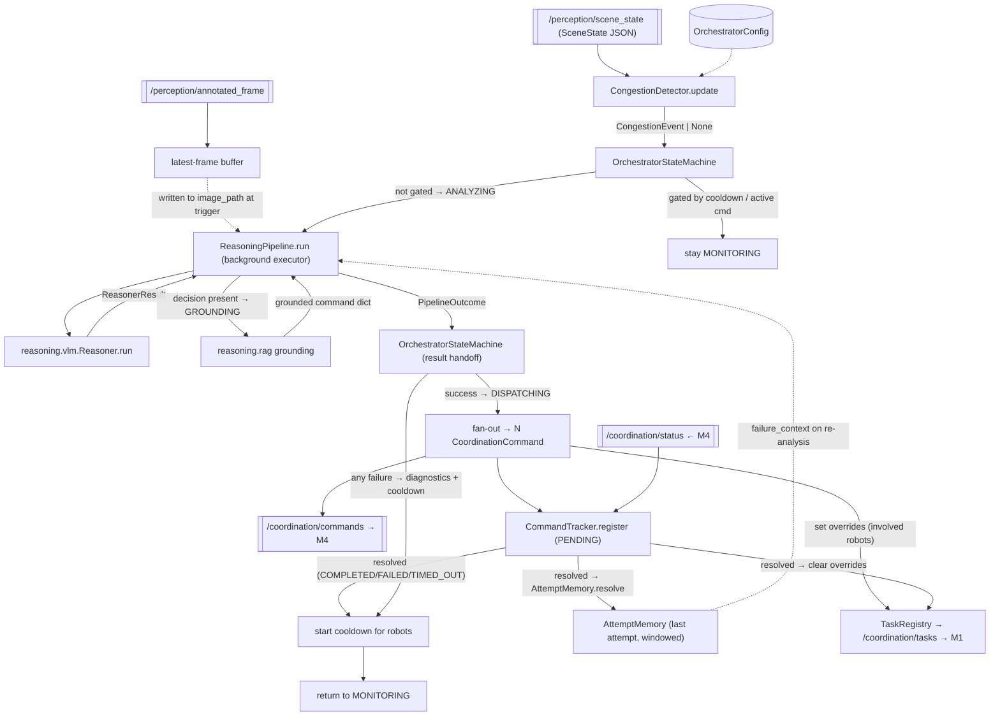

# Module 5 — Orchestrator — Implementation Spec

**Status:** Implementation target — design approved · **Level:** Implementation · **Source:** `project_proposal.md` §4.1, §4.6
**Layer:** 2 (semantic reasoning controller) · **Producers consumed:** M1 (perception), M2 (VLM), M3 (RAG), M4 (status) · **Consumers:** M1 (task registry), M4 (commands)

---

## 1. Overview

M5 is the central state machine that realizes the proposal's core principle:
**"Layer 2 intervenes only when Layer 1 fails."** It watches the perception
stream, decides *when* a jam is real, runs the M2→M3 reasoning pipeline, dispatches
the resulting commands to M4, tracks their lifecycle, and owns the task/status
registry that feeds M1.3.

**In scope:** congestion detection (progress-based stall timing), the
analyze→ground→dispatch state machine, in-process invocation of M2 and M3,
command fan-out and lifecycle tracking, cooldown/dedup gating, and the
coordination-task registry published to M1.

**Out of scope:** perception/state estimation (M1), the VLM decision itself (M2),
command grounding logic (M3), per-robot execution and safety enforcement (M4), and
mission planning. M5 does **not** assign initial mission goals — those load from
scenario/launch config at startup. M5 manages *coordination overrides* only.

**Trigger-policy ownership (§4.1):** M5 is the sole owner of *when* M2 runs. M2 and
M3 are stateless request/response services; M5 supplies the request and decides
whether to act on the result. Layer 1 (Nav2 via M4) runs continuously and is never
paused by M5 — coordination commands modulate it, they do not replace it.

**Integration principle:** M2 and M3 are non-ROS2 Python under `reasoning/`. M5
invokes them **in-process** (`reasoning.vlm.Reasoner.run` and the M3 grounding
entry point) on a background executor, behind a `ReasoningPipeline` Protocol so the
node logic stays unit-testable with a mock. The `/reasoning/analyze` ROS2 action
described in the M2 spec §5 is an alternative deployment and is **not** used here;
this is the deliberate, approved deviation for M5.

---

## 2. Inputs & Outputs

**Inputs**
- `SceneState` from M1 (`/perception/scene_state`, JSON `std_msgs/String`) — robot
  positions, headings, velocities, status, task strings, and the per-frame
  `dropped_frame` diagnostic. Parsed in the node into the internal `SceneSnapshot`
  projection (§4); M5 does **not** import `swarm_perception` models.
- Annotated frame from M1 (`/perception/annotated_frame`, `sensor_msgs/Image`,
  RGB) — buffered as a latest-frame slot together with its `frame_id`/stamp.
  `ReasonerRequest.image_path` is mandatory for M2, so at trigger time the
  background pipeline task writes the buffered frame to disk and passes that path
  (FR5.3.6). No frame buffered, or buffered frame stale beyond the skew limit →
  the trigger is suppressed (E9/E10).
- `CoordinationStatus` from M4 (`/coordination/status`) — per-command execution
  progress (`command_id`, `robot_id`, `status`, `detail`).
- Optional manual trigger: `TriggerCongestionAnalysis` service
  (`/orchestrator/trigger_analysis`) for operators/tests to force an analysis cycle.
- `OrchestratorConfig` from launch/config: thresholds, cooldowns, command timeouts,
  reasoning backend selection, frame dump location, and the initial task
  assignments per robot — task string **and goal coordinates** (the detector's
  distance-to-goal needs goal positions, and config is their single source; M1's
  `RobotState.goal` is itself read back from M5's registry).

**Outputs**
- `CoordinationCommand` messages to M4 (`/coordination/commands`) — **one per
  robot**, fanned out from the single grounded command produced by M3.
- Task/status registry to M1 (`/coordination/tasks`, JSON `std_msgs/String`) —
  per-robot **effective** task strings and goals for M1.3 annotation: the base
  mission assignment, overlaid by the active coordination override while a
  dispatched command is unresolved (FR5.5.4). Without the overlay, M1 frames and
  M2 prompts would show stale goals during the very interventions M5 issues.
- `OrchestratorDiagnostics` (logging/observability) — current state, last
  `request_id`, trigger reason, pipeline latency, dispatch/lifecycle counters.

### 2.1 Data Flow



When the detector returns `None`, or M2 returns `congestion_detected=false`
/ `decision=None`, M5 dispatches nothing and Layer 1 stays in control.

---

## 3. Functional Requirements

### M5.1 Congestion Detector
- FR5.1.1 Track each robot's **distance-to-goal progress** over time, not raw
  motion status. A robot is *stalled* when its minimum observed distance-to-goal
  has not improved by more than `progress_epsilon_m` for at least
  `stall_threshold_sec`, while it has an active task with a goal.
- FR5.1.2 Set `stall_threshold_sec` longer than Nav2's recovery cycle (≈5–10 s) so
  Layer 2 backstops Layer 1 rather than pre-empting it.
- FR5.1.3 Exclude `STALE` robots as trigger evidence; they carry no reliable
  position. Robots with no goal/task are not candidates for stall.
- FR5.1.4 **Hold detector state on dropped frames.** When `SceneState` indicates a
  late/suppressed frame (`dropped_frame=True` or empty robot list with the
  diagnostic set), do not advance timers or interpret the gap as progress/recovery.
- FR5.1.5 Emit a `CongestionEvent` (involved robot IDs, per-robot stall durations,
  `detected_at`, trigger reason) when one or more robots cross the stall threshold.
  Implemented as a pure stateful class:
  `CongestionDetector.update(scene_state, task_registry, now) -> CongestionEvent | None`,
  thresholds injected from config, **no `rclpy` import**.
- FR5.1.6 Spatial clustering (require N robots jammed within a radius) is a future
  refinement and explicitly out of scope for this milestone.
- FR5.1.7 (2026-09-17) Exclude robots within `goal_reached_tolerance_m` (default
  0.15 m, > Nav2's 0.1 m `xy_goal_tolerance`) of their effective goal from stall
  evidence, clearing any existing progress bookkeeping the same way `STALE`
  robots are handled. Runs C, D, G, H showed an arrived robot reads as
  permanently "stalled" (distance never improves because it is parked), which
  triggered spurious re-analysis cycles and, in run H, a bad `yield` that moved
  a parked robot off its goal. The close/slow-pair check is unaffected — two
  robots genuinely jammed at a goal are still flagged.
- FR5.1.8 (2026-09-17) Treat M4's arrival report (`CoordinationStatus` with
  `command_id="base_mission"`, `status="COMPLETED"`) as authoritative: the
  detector marks the robot arrived at its current effective goal and excuses it
  from progress-stall evidence while M1 still places it within
  `arrived_radius_m` (default 0.5 m) of that goal; the mark lapses when the
  robot is seen farther away or its effective goal changes. A robot that merely
  stalls short of its goal is never excused (Nav2 must have confirmed arrival).
  `CongestionEvent.distance_to_goal_m` carries each stalled robot's M1
  distance, and the `starting analysis` log prints it, so M1's offset at the
  goal is measurable. **Why:** run 4 (2026-09-17) fired `2 robot(s) stalled`
  every cooldown for 9 min on two robots parked at their goals (31 needless VLM
  calls) — M1's estimate exceeded `goal_reached_tolerance_m` where ground truth
  said 0.04–0.08 m. The close/slow-pair check is unaffected.

### M5.2 Orchestrator State Machine
- FR5.2.1 Maintain an explicit node-visible state:
  `MONITORING | ANALYZING | DISPATCHING`. The approved logical pipeline is
  `analyze → ground`, but because M2 and M3 run inside one bundled background call
  (FR5.3.2), grounding is **not** a separately observable node state — it is a
  sub-phase of `ANALYZING`, surfaced via `PipelineOutcome.terminal_stage` for
  diagnostics (see §8). Only `MONITORING` consumes new congestion events; events
  arriving in other states are ignored (single in-flight cycle).
- FR5.2.2 On a `CongestionEvent` in `MONITORING`, transition to `ANALYZING` only if
  the involved robots are **not** under cooldown and have **no** active command.
  Otherwise remain in `MONITORING`.
- FR5.2.3 Generate a `request_id` per cycle and thread it through M2, M3, dispatch,
  diagnostics, and logs for end-to-end traceability (C2).
- FR5.2.4 On pipeline success with `congestion_detected=true` and a valid grounded
  command, transition `ANALYZING → DISPATCHING`, fan out commands, then return to
  `MONITORING`.
- FR5.2.5 On `congestion_detected=false` or `decision=None`, dispatch nothing,
  record the outcome, start a short cooldown for the involved robots, and return to
  `MONITORING`.
- FR5.2.6 The state machine is pure transition logic over injected inputs (event,
  pipeline outcome, status update, clock) with **no `rclpy`** and no I/O.
- FR5.2.7 Maintain a per-robot **consecutive-failure counter**: incremented when a
  cycle involving the robot ends in failure (M2 `decision=None`, grounding failure,
  M4 `FAILED`/`TIMED_OUT`), reset on a cycle that resolves `COMPLETED`. Exposed in
  `OrchestratorDiagnostics`. No escalation behavior is built on it this milestone;
  it exists so a future escalation policy (§14) is a pure threshold check.

### M5.3 Reasoning Pipeline Adapter
- FR5.3.1 Expose a `ReasoningPipeline` Protocol with one method
  `run(request: ReasonerRequest) -> PipelineOutcome`, backend/transport agnostic.
- FR5.3.2 `InProcessPipeline` is the default adapter: it calls
  `reasoning.vlm.Reasoner.run`, and on a present decision with
  `congestion_detected=true`, calls the M3 grounding entry point, validating the
  result with `reasoning.rag.command_grounder.validate_coordination_command`.
- FR5.3.3 The pipeline runs on a **background executor**, never on the node's
  high-rate callback/spin thread. Results are handed back thread-safely.
- FR5.3.4 `PipelineOutcome` carries: the M2 `ReasonerResult` (decision +
  diagnostics), the grounded command dict (or `None`), a terminal stage marker
  (`vlm | grounding | ok`), and a failure reason when unsuccessful.
- FR5.3.5 M3 is currently a stub; M5 depends on the M3 **contract** (a
  `coordination_command`-schema dict) behind this Protocol, so M5 can be built and
  unit-tested against a mock pipeline before M3 is implemented.
- FR5.3.6 Maintain a **latest-frame buffer** fed by `/perception/annotated_frame`
  (single slot: frame bytes + `frame_id` + stamp). The raw buffered bytes are
  handed to the background pipeline task, which writes the PNG to
  `config.frame_dump_dir/<request_id>.png` **before** calling `Reasoner.run` and
  passes that path as `ReasonerRequest.image_path` (mandatory in the M2 contract).
  No disk I/O or PNG encoding on the node's spin thread. The frame is RGB at the
  M1 boundary; convert to BGR at the `cv2.imwrite` boundary (annotation status
  *colors* are semantic — a swapped-channel dump corrupts what M2 reads). If
  `config.frame_downscale_width` is set, downscale (preserving aspect) before
  writing to bound base64 payload size. Delete the file when the cycle resolves
  unless `config.keep_debug_frames` is true. If no frame has been received yet, or
  the buffered-frame stamp lags the scene-state stamp by more than
  `frame_scene_max_skew_sec`, suppress the trigger (E9/E10).

- FR5.3.7 (2026-09-17) Every decision artifact
  (`decision_log_dir/<request_id>.json`) records, besides the M2 result and
  grounding outcome: `run_id` (from `VGU_RUN_ID`, exported by the launcher;
  `null` if unset), `session_id` (per M5 process), `failure_context`, the
  **rendered prompt** (`system_prompt`, `user_prompt`, SHA-256 of each —
  rebuilt by the pure prompt builder from the exact `ReasonerRequest` sent, so
  a re-ask suffix on retry is not captured), the M1 `scene` snapshot the
  request was built from, and the detector's `distance_to_goal_m`. The request
  is built on the callback thread so the artifact and the worker share one
  object. Independently of triggers, M5 appends one scene snapshot per
  `scene_log_period_sec` to `scene_log_dir/<session_id>.jsonl` (`t`,
  `session_id`, `run_id`, `scene`) for offline trajectory reconstruction;
  `scene_log_dir: null` disables it. **Why:** the run-3 investigation could not
  reconstruct what the VLM was told nor prove M1's distance at a goal — both
  were unlogged.

### M5.4 Command Lifecycle & Fan-out
- FR5.4.1 Translate the single grounded command (schema: `command_id`, `actions[]`,
  `expected_resolution_time_sec`, `fallback`) into **N** ROS2 `CoordinationCommand`
  messages, one per `actions[i].robot_id` (see §9.2 mapping table).
- FR5.4.2 Track each dispatched command in a `CommandTracker` keyed by
  `command_id`, with per-robot `CommandState`
  (`PENDING → ACTIVE → COMPLETED | FAILED | TIMED_OUT`).
- FR5.4.3 Mark a command `TIMED_OUT` if no resolving `CoordinationStatus` arrives
  within its `timeout_sec` (derived from `expected_resolution_time_sec`).
- FR5.4.4 A command is *resolved* when all its robots reach a terminal state. On
  resolution, start the cooldown for those robots so the same jam is not
  re-triggered immediately.
- FR5.4.5 Retain the grounded command's `fallback` string with the record for
  diagnostics and future escalation; this milestone does not auto-execute fallback.
- FR5.4.6 (2026-09-17) Keep the last dispatched attempt (decided strategy, the
  maneuver actually fanned out — the decided strategy if its own action ran,
  else the single action name, else `mixed` — yielder, outcome) in a single-slot
  `AttemptMemory`. When a new analysis starts for an
  overlapping robot set within `failure_context_window_sec` of that command's
  resolution — whatever the outcome — attach it to the `ReasonerRequest` as
  `failure_context` and record it in the decision artifact. The memory is
  dropped on expiry, on an analysis for a disjoint robot set, or when a new
  attempt is dispatched; `0` disables it (RQ5 memoryless control). Design:
  `docs/superpowers/specs/2026-09-17-failure-context-closed-loop-design.md`.

### M5.5 Task / Status Registry
- FR5.5.1 Own the registry published on `/coordination/tasks` (JSON). Each entry
  holds the **base** mission assignment (task string + goal coordinates) and an
  optional **active coordination override** (action + override goal, `command_id`).
  The published JSON carries the **effective** task and goal: the override while
  one is active, the base assignment otherwise.
- FR5.5.2 Load initial per-robot base assignments (task **and goal**) from
  `OrchestratorConfig` at startup and publish once at startup and on change. M5
  never derives motion status (MOVING/SLOW/STOPPED/STALE) — that stays local to M1.
- FR5.5.3 Provide deterministic JSON serialization (sorted by `robot_id`) so the
  published registry is reproducible and diff-friendly.
- FR5.5.4 On command dispatch, set the override for each involved robot; when the
  command resolves (`COMPLETED`/`FAILED`/`TIMED_OUT`), clear the override so the
  effective goal **reverts to the base assignment**. Every override change
  republishes the registry.

### M5.6 ROS2 Node
- FR5.6.1 Keep callbacks thin: convert messages → models, call pure logic, publish.
  No reasoning/HTTP work in the subscription callback path.
- FR5.6.2 Use a periodic timer to drive command-timeout checks and to poll the
  background pipeline future for completion.
- FR5.6.3 Read all topic names, thresholds, timeouts, backend selection, and initial
  tasks from launch/config — no hardcoded alternates in source.
- FR5.6.4 Fail-fast at startup on invalid config (missing thresholds, unknown
  backend id, malformed initial-task map).

---

## 4. Data Structures / Schemas (contract C1)

New Pydantic v2 frozen models (`swarm_orchestrator/models.py`). Existing ROS2
messages (`CoordinationCommand`, `CoordinationStatus`, `RobotState`) and reasoning
models (`ReasonerRequest`, `ReasonerResult`, `CongestionDecision`) are reused, not
redefined.

**`OrchestratorConfig`** (frozen)

| field | type | notes |
|---|---|---|
| stall_threshold_sec | float | > Nav2 recovery cycle; default ≈ 12.0 |
| progress_epsilon_m | float | min distance-to-goal improvement counted as progress |
| cooldown_sec | float | per-robot re-trigger suppression after resolution/failure |
| failure_context_window_sec | float | seconds after command resolution in which the last attempt is attached to a re-analysis as `failure_context`; 0 disables (RQ5 memoryless control) |
| command_timeout_sec | float | fallback timeout when grounded value absent |
| reasoning_backend_id | str | passed through to M2 backend factory |
| initial_tasks | dict[str, TaskAssignment] | robot_id → base task + goal, loaded at startup |
| frame_dump_dir | str | directory for trigger-time frame PNGs (FR5.3.6) |
| scene_log_dir | str or null | directory for the per-session 1 Hz scene JSONL (FR5.3.7); null disables |
| scene_log_period_sec | float | scene-log period, default 1.0 (FR5.3.7) |
| arrived_radius_m | float | radius within which an M4-reported arrival excuses a robot from stall evidence, default 0.5 (FR5.1.8) |
| prompt_pairwise_geometry | bool | include the derived pairwise distance/facing lines in the VLM prompt, default true (M2 FR2.1.7; ablation axis) |
| keep_debug_frames | bool | retain dumped frames after cycle resolution; default false |
| frame_scene_max_skew_sec | float | max frame/scene stamp skew; beyond it the trigger is suppressed (E10) |
| frame_downscale_width | int \| None | optional pre-dump downscale width; None = full resolution |
| topics | dict[str, str] | resolved topic names (defaults in §5) |

**`TaskAssignment`** (frozen)

| field | type | notes |
|---|---|---|
| task | str | task string shown by M1.3 |
| goal | tuple[float, float] | world-frame goal `(x, y)` in meters |

**`SceneSnapshot`** / **`RobotView`** (frozen) — M5's internal projection of the
M1 `SceneState` JSON, parsed in the node. `RobotView`: `robot_id`, `x`, `y`,
`theta`, `linear_velocity`, `status`, `stamp`. `SceneSnapshot`: `stamp`,
`frame_id`, `robots: list[RobotView]`, `dropped_frame: bool`. Defined locally so
`swarm_orchestrator` does not import `swarm_perception` models (C1: modules stay
independently upgradeable behind the JSON contract).

**`CongestionEvent`** (frozen)

| field | type | notes |
|---|---|---|
| involved_robots | list[str] | stalled robot IDs (sorted) |
| stall_durations_sec | dict[str, float] | per-robot stall time at detection |
| detected_at | float | monotonic timestamp |
| reason | str | human-readable trigger reason |

**`CommandRecord`** (mutable tracker entry)

| field | type | notes |
|---|---|---|
| command_id | str | grounded command id |
| robot_states | dict[str, CommandState] | per-robot lifecycle state |
| dispatched_at | float | dispatch timestamp |
| timeout_sec | float | resolution deadline |
| fallback | str | retained fallback strategy |
| request_id | str | originating analysis cycle |

**`PipelineOutcome`** (frozen)

| field | type | notes |
|---|---|---|
| request_id | str | cycle correlation id |
| reasoner_result | ReasonerResult | M2 output (decision may be None) |
| grounded_command | dict \| None | M3 `coordination_command` dict |
| terminal_stage | enum | `vlm \| grounding \| ok` |
| failure_reason | str \| None | set when not `ok` |

**`OrchestratorDiagnostics`** (frozen) — current state, last `request_id`, last
trigger reason, pipeline latency, dispatch count, active-command count, and
per-robot consecutive-failure counts (FR5.2.7).

---

## 5. Interfaces

**ROS2 topics & services** (default names; overridable via config)

| direction | name | type | role |
|---|---|---|---|
| sub | `/perception/scene_state` | `std_msgs/String` (SceneState JSON) | perception input from M1 |
| sub | `/perception/annotated_frame` | `sensor_msgs/Image` (RGB) | latest-frame buffer for M2 image input (FR5.3.6) |
| sub | `/coordination/status` | `swarm_interfaces/CoordinationStatus` | execution feedback from M4 |
| pub | `/coordination/commands` | `swarm_interfaces/CoordinationCommand` | per-robot commands to M4 |
| pub | `/coordination/tasks` | `std_msgs/String` (registry JSON) | task/status registry to M1 |
| srv | `/orchestrator/trigger_analysis` | `swarm_interfaces/TriggerCongestionAnalysis` | manual analysis trigger |

The `/coordination/commands` name (plural) is the established contract in
`docs/modules.md` §M4.1, `docs/isaac_vlm_pipeline.md`, and `project_proposal.md` §M4.
Changing any of these requires updating those specs, launch/config, and M4.

**Message field reuse.** M5 dispatches against the existing `CoordinationCommand.msg`
(`command_id`, `robot_id`, `action`, `parameters_json`, `timeout_sec`) and consumes
the existing `CoordinationStatus.msg` (`command_id`, `robot_id`, `status`, `detail`).
The grounded-command schema has no per-robot `timeout_sec`; M5 derives it from
`expected_resolution_time_sec` (§9.2). No new `.msg` fields are required for this
milestone. If a future need arises (e.g., propagating `fallback` to M4), it is
flagged here as a contract change, **not** silently added.

---

## 6. Package Layout

```text
ros2_ws/src/swarm_orchestrator/swarm_orchestrator/
├── __init__.py
├── models.py             # Pydantic contracts (§4)
├── congestion_detector.py # CongestionDetector (extend existing stub) (§7.2)
├── state_machine.py       # OrchestratorStateMachine (§7.3)
├── command_lifecycle.py   # CommandState (exists) + CommandTracker (§7.4)
├── task_registry.py       # TaskRegistry (extend existing stub) (§7.5)
├── reasoning_pipeline.py  # ReasoningPipeline Protocol + InProcessPipeline (§7.6)
└── orchestrator_node.py   # thin ROS2 node (§7.7)
```

Pure-logic modules import no `rclpy`. The node imports everything and wires ROS2.

---

## 7. Function Specifications

### 7.1 Data Models (`models.py`)
Implement the §4 models as frozen Pydantic v2 (`ConfigDict(frozen=True)`), with
`field_validator`s for: non-empty `involved_robots`, sorted serialization, and
`stall_threshold_sec`/`cooldown_sec`/`command_timeout_sec` ≥ 0.
`failure_context_window_sec` is 0 or greater than
`cooldown_sec + stall_threshold_sec` (a smaller window can never fire).
`initial_tasks` keys must be non-empty strings.

### 7.2 `CongestionDetector` (`congestion_detector.py`)
Stateful class holding per-robot progress history. Retain the existing pure helper
`is_congested(wait_time_sec, threshold_sec)` for the stall comparison.

```python
class CongestionDetector:
    def __init__(self, config: OrchestratorConfig) -> None: ...
    def update(
        self,
        scene: SceneSnapshot,
        task_registry: TaskRegistry,
        now: float,
    ) -> CongestionEvent | None:
        """Advance per-robot progress timers and emit an event on stall."""
```

Behavior: for each robot with an active task+goal and status ≠ `STALE`, compute
distance-to-goal; track the running minimum and the time it was last improved by
`> progress_epsilon_m`. Stall duration = `now − last_improved_at`. On a dropped/late
frame, return early without mutating timers (FR5.1.4). Emit an event when any
robot's stall duration ≥ `stall_threshold_sec`.

### 7.3 `OrchestratorStateMachine` (`state_machine.py`)
Pure transition object. Methods return the next state and an optional action
directive (e.g., "start analysis", "dispatch", "cooldown"); the node performs side
effects. No `rclpy`, no threads, no I/O. Inputs: current state, optional
`CongestionEvent`, optional `PipelineOutcome`, optional resolved-command signal, and
`now`. Enforces single in-flight cycle (FR5.2.1) and cooldown/active-command gating
(FR5.2.2).

### 7.4 `CommandTracker` + `CooldownTracker` (`command_lifecycle.py`)
`CommandTracker` extends the existing `CommandState` enum: `register(record)`,
`apply_status(status)` (PENDING→ACTIVE→terminal), `check_timeouts(now)` → list of
timed-out commands, `is_resolved(command_id)`.

`CooldownTracker` is the **single owner** of cooldowns — they start both from
command resolution (a record exists) and from pipeline failures where nothing was
dispatched (no record exists), so they cannot live inside `CommandTracker`:
`start(robot_ids, now)`, `active_robots(now) -> set[str]`. The state machine
consults it for FR5.2.2 gating.

### 7.5 `TaskRegistry` (`task_registry.py`)
Extends the existing dataclass: entries become base `TaskAssignment` (task + goal)
plus an optional override slot (`action`, override goal, `command_id`).
`load_initial(config)`, `set_override(robot_id, action, goal, command_id)`,
`clear_override(robot_id)`, `effective(robot_id) -> (task, goal)`, and `to_json()`
(deterministic, sorted by `robot_id`, publishes effective values). The existing
`assign` updates the base assignment.

### 7.6 `ReasoningPipeline` (`reasoning_pipeline.py`)
Protocol + `InProcessPipeline`. The adapter constructs the M2 `Reasoner` from
config, calls `run`, and on a congestion decision invokes M3 grounding +
`validate_coordination_command`. Backend/HTTP details belong to M2/M3; the adapter
only orchestrates and packages a `PipelineOutcome`. Failures from either stage are
caught and reported via `failure_reason`, never raised past the adapter.

### 7.7 `OrchestratorNode` (`orchestrator_node.py`)
Thin node. The scene-state subscription parses JSON into `SceneSnapshot` and calls
`CongestionDetector.update` + `OrchestratorStateMachine`; the annotated-frame
subscription only swaps the latest-frame buffer (no copy beyond the message data,
no disk I/O in the callback). On a "start analysis" directive, hand the buffered
frame bytes + `request_id` to the background pipeline task, which writes the PNG
(RGB→BGR at the `cv2.imwrite` boundary, FR5.3.6), builds the `ReasonerRequest`,
and runs the pipeline; the node stores the future. A periodic
timer polls the future, runs `check_timeouts`, and publishes registry changes. On
pipeline completion, feed the `PipelineOutcome` back into the state machine and, on
success, fan out `CoordinationCommand`s and set registry overrides (FR5.5.4).
Structured logs include `request_id`, `command_id`, `robot_id`.

---

## 8. State Transition Table

| state | input | guard | next state | action |
|---|---|---|---|---|
| MONITORING | CongestionEvent | robots free of cooldown & active cmd, fresh frame buffered | ANALYZING | submit pipeline (task dumps frame) |
| MONITORING | CongestionEvent | no frame buffered, or frame stale beyond skew limit | MONITORING | log suppressed (E9/E10) |
| MONITORING | CongestionEvent | robots gated | MONITORING | log suppressed |
| MONITORING | None | — | MONITORING | — |
| ANALYZING | PipelineOutcome(stage=ok) | — | DISPATCHING | fan-out + dispatch |
| ANALYZING | PipelineOutcome(no congestion / decision=None) | — | MONITORING | cooldown(robots) + failure counts |
| ANALYZING | PipelineOutcome(failure) | — | MONITORING | diagnostics + cooldown + failure counts |
| DISPATCHING | dispatch complete | — | MONITORING | register records + set registry overrides |
| any | CoordinationStatus | — | (unchanged) | tracker.apply_status; on resolution: clear overrides + cooldown + update failure counts |
| any | timeout tick | command past deadline | (unchanged) | mark TIMED_OUT + clear overrides + cooldown + failure counts |

GROUNDING is an internal sub-stage of the pipeline run (within ANALYZING from the
node's perspective); it is surfaced via `PipelineOutcome.terminal_stage` for
diagnostics rather than as a node-visible state.

---

## 9. Algorithms & Parameters

### 9.1 Stall detection (per robot, per frame)
1. Skip if frame dropped/late (hold state).
2. Skip robots with no goal or status `STALE`.
3. `d = euclidean(position, goal)`.
4. If `d < min_distance[robot] − progress_epsilon_m`: update `min_distance`,
   `last_improved_at = now`.
5. `stall = now − last_improved_at`; flag if `stall ≥ stall_threshold_sec`.
6. Emit `CongestionEvent` for all flagged robots.

Defaults: `stall_threshold_sec = 12.0`, `progress_epsilon_m = 0.10`,
`cooldown_sec = 15.0`, `command_timeout_sec = 20.0`, `failure_context_window_sec = 60.0`,
`frame_dump_dir = data/logs/m5_frames`, `keep_debug_frames = false`,
`frame_scene_max_skew_sec = 1.0`, `frame_downscale_width = None` (full 1280×960;
set e.g. 800 if backend latency from the ~2 MB base64 payload becomes a problem).
All overridable via config.

Distance-to-goal uses the robot's **effective** goal from the registry
(override while active, base otherwise), so a robot making progress toward a
coordination waypoint is not counted as stalled against its mission goal.

### 9.2 Grounded command → ROS2 fan-out

| M3 grounded field | ROS2 `CoordinationCommand` field | rule |
|---|---|---|
| `command_id` | `command_id` | shared across all fan-out messages |
| `actions[i].robot_id` | `robot_id` | one message per action |
| `actions[i].action` | `action` | verbatim |
| `actions[i].parameters` | `parameters_json` | `json.dumps(parameters, sort_keys=True)` |
| `expected_resolution_time_sec` | `timeout_sec` | fallback to `config.command_timeout_sec` if 0/absent |
| `fallback` | — | retained in `CommandRecord`, not sent this milestone |

---

## 10. Non-Functional Requirements
- NFR5.1 The subscription/spin path must never block on M2/M3; all reasoning runs on
  a background executor (FR5.3.3).
- NFR5.2 Single in-flight reasoning cycle: at most one pipeline future active at a
  time; new events while busy are ignored (not queued) this milestone.
- NFR5.3 Pure-logic modules import no `rclpy` and are fully unit-testable on macOS.
- NFR5.4 Every dispatched command and every analysis cycle is traceable by
  `request_id`/`command_id` in structured logs (C2).
- NFR5.5 No secrets, base64 images, or full provider payloads in logs.

## 11. Error Handling & Edge Cases
- E1 **Malformed `SceneState` JSON** → log + skip frame; do not advance timers or
  crash the node.
- E2 **Dropped/late frame** → hold detector state (FR5.1.4); never read as recovery.
- E3 **M2 `decision=None` / `congestion_detected=false`** → no dispatch, cooldown,
  back to MONITORING (FR5.2.5).
- E4 **M3 grounding failure / schema-invalid command** → caught in adapter,
  `failure_reason` set, cooldown, back to MONITORING. No partial dispatch.
- E5 **M4 reports FAILED/TIMED_OUT** → mark record, start cooldown; M5 re-triggers
  only after cooldown if the jam persists. Layer 1 keeps recovering.
- E6 **Command timeout (no status)** → tracker marks `TIMED_OUT`, cooldown applied.
- E7 **Robot referenced in a grounded action but absent from current scene** →
  dispatch is still sent (M4 filters by robot id); logged as a warning.
- E8 **Invalid config at startup** → raise and fail fast (FR5.6.4).
- E9 **Trigger before any annotated frame arrives** → suppress the analysis cycle
  and log; do not invoke M2 without an image (the `ReasonerRequest` contract
  requires `image_path`).
- E10 **Frame/scene stamp skew beyond `frame_scene_max_skew_sec`** → treat as E9:
  suppress the trigger and log both stamps. A stale buffered frame (e.g., the
  annotated stream died while scene-state kept flowing) would have the VLM reason
  over an image that does not show the jam. This matches the M2 spec's edge-case
  table: stamp matching/rejection is M5's responsibility; M2 only checks existence.

## 12. Dependencies
- Runtime: `pydantic` v2, `rclpy` (node only), `reasoning.vlm`, `reasoning.rag`
  (in-process), `opencv-contrib-python` (PNG encode + RGB→BGR + optional downscale,
  FR5.3.6), stdlib `json`/`concurrent.futures`/`threading`.
- ROS2 package deps in `package.xml`: `rclpy`, `std_msgs`, `sensor_msgs` (annotated
  frame), `cv_bridge` (Image → ndarray), `swarm_interfaces`. **No dependency on `swarm_perception`** — M5 parses
  the SceneState JSON into its own `SceneSnapshot` projection (§4).
- **M3 (RAG) is a prerequisite for live operation** but not for building/testing M5:
  the `ReasoningPipeline` Protocol allows a mock until M3 lands.
- No new external dependencies introduced.

## 13. Testing & Validation

### Unit tests (`tests/unit/`, offline, no ROS2)
- `test_m5_congestion_detector.py` — progress-based stall, threshold timing, STALE
  exclusion, dropped-frame hold, multi-robot events, no-goal robots ignored.
- `test_m5_state_machine.py` — every transition in §8, cooldown/active-command
  gating, single in-flight enforcement, no-frame/stale-frame suppression (E9/E10),
  failure-counter increment/reset (FR5.2.7).
- `test_m5_command_lifecycle.py` — PENDING→ACTIVE→terminal, timeout detection,
  resolution → cooldown; `CooldownTracker` start/expiry, cooldown without a
  command record (pipeline-failure path).
- `test_m5_task_registry.py` — initial load with goals, assignment, override
  set/clear and effective-goal revert, deterministic JSON.
- `test_m5_reasoning_pipeline.py` — `InProcessPipeline` with mocked M2/M3:
  ok / no-congestion / vlm-failure / grounding-failure outcomes; fan-out mapping
  (§9.2); frame dump writes BGR-converted PNG at the expected path, optional
  downscale preserves aspect, cleanup honors `keep_debug_frames`.

### Node integration tests (`tests/integration/`, marked `ros2`)
- Scene-state → trigger → mocked pipeline → command publication on
  `/coordination/commands`.
- Status feedback updates lifecycle; timeout tick marks `TIMED_OUT`.
- Registry published on `/coordination/tasks` at startup and on change.

All external systems (M2 backend, M3 store, ROS2 runtime) are mocked in unit tests;
integration tests are marked so they are not confused with fast unit tests.

---

## 14. Open Questions / Future Work
- Spatial clustering for jam confirmation (FR5.1.6).
- Auto-execution of grounded `fallback` and a safe-stop escalation path after
  repeated failures for the same jam — implementable as a threshold check over the
  per-robot consecutive-failure counters (FR5.2.7).
- Queuing/coalescing concurrent congestion events instead of single in-flight.
- **Scenario task sequences** (deliberately deferred): scenarios may define
  per-robot task *sequences*; M5 would advance a robot to its next scenario-defined
  task on completion (registry bookkeeping, not mission planning — needed for
  throughput metrics). This milestone supports a single base assignment per robot.
