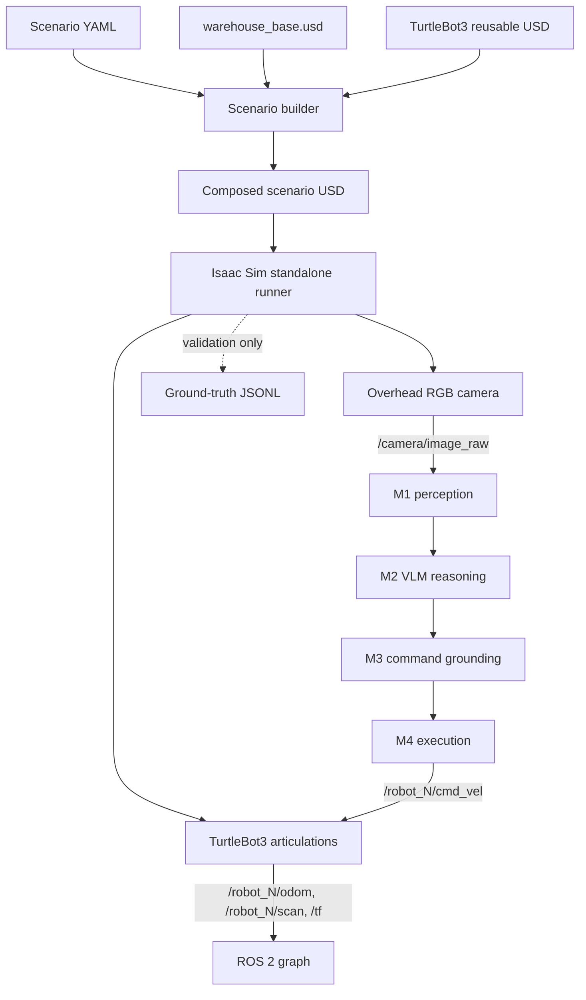

# Module 6 - Isaac Sim Warehouse Simulation - Implementation Spec

**Status:** Implementation target · **Level:** Implementation · **Source:** `simulation_requirements.md`
**Producer:** M6 simulation · **Consumers:** M1 perception, M4 execution, M5 orchestrator

---

## 1. Overview

M6 provides the deterministic Isaac Sim environment used to develop and test the
warehouse swarm-coordination pipeline. It owns the warehouse scene, reusable
TurtleBot3 Burger asset, simulated sensors, ROS 2 bridge graphs, scenario
configuration, standalone runner, and simulation-level validation.

The required runtime baseline is:

- NVIDIA Isaac Sim 6.0.
- ROS 2 Jazzy.
- PhysX simulation backend.
- OpenUSD scene composition.
- Linux with a supported NVIDIA GPU for runtime execution.
- GUI mode for asset development and headless standalone mode for repeatable
  tests.

**In scope:** M6.1 world and robot construction, ROS 2 simulation interfaces,
overhead camera and robot lidar, deterministic scenario loading, and the three
M6.2 conflict scenarios.

**Out of scope:** M6.3 benchmark algorithms, M6.4 aggregate metrics and
ablations, M1 ArUco detection, M2 VLM inference, M3 command grounding, M4 path
planning, and M5 task assignment. M6 exposes the environment and interfaces
those modules consume; it does not duplicate their behavior.

The existing `tools/isaac_scene` ASCII scene generator is a prototype. It may
remain temporarily for offline experiments, but it is not the implementation
target because it generates composed scene content into one file and does not
create validated Isaac Sim physics, sensors, or ROS 2 OmniGraphs.

---

## 2. Inputs & Outputs

### 2.1 Inputs

- Expanded TurtleBot3 Burger URDF and its mesh resources.
- Scenario YAML conforming to the schema in Section 4.
- Runtime arguments: scenario, seed, headless mode, repetition count, and
  optional duration override.
- ROS 2 velocity commands for each robot.
- Coordination and navigation behavior from M4 during end-to-end runs.

### 2.2 Outputs

- Reusable OpenUSD warehouse and robot assets.
- One composed USD root layer per scenario.
- ROS 2 topics published by M6:
  - `/clock`
  - `/camera/image_raw`
  - `/camera/camera_info`
  - `/robot_N/odom`
  - `/robot_N/scan`
  - `/tf`
  - `/tf_static`

  `/robot_N/cmd_vel` is an input M6 subscribes to (see Section 2.1), not an
  output. It is listed in the ROS interface table (Section 5.3) for
  completeness.
- Validation-only simulator ground-truth records.
- One run manifest per repetition with resolved configuration and outcome.

### 2.3 Data Flow



Simulator ground truth must not be published on an input consumed by M1 or M2.
It is written only to validation logs or exposed through test-only APIs.

---

## 3. Functional Requirements

### M6.1 Runtime and Stage Conventions

- FR6.1.1 Use Isaac Sim 6.0 and ROS 2 Jazzy as the only supported initial
  runtime baseline.
- FR6.1.2 Use PhysX. Newton is excluded because its Isaac Sim 6.0 integration is
  experimental and would require separate tuning and acceptance criteria.
- FR6.1.3 Every authored layer must declare:
  - `metersPerUnit = 1`
  - `upAxis = "Z"`
  - `timeCodesPerSecond = 60`
- FR6.1.4 Every referenceable asset must define a top-level default prim.
- FR6.1.5 The composed scenario stage must use `/World` as its default prim.
- FR6.1.6 Physics must run at a fixed 60 Hz. Rendering and the overhead camera
  must run at 30 Hz.
- FR6.1.7 All paths stored in USD composition arcs must be relative to the layer
  containing the arc. Local absolute paths and machine-specific Isaac install
  paths are forbidden.

### M6.2 USD Composition and Asset Ownership

- FR6.2.1 Isaac-native source code and assets live under top-level `isaac/`.
- FR6.2.2 `ros2_ws/src/swarm_simulation` remains the ROS-facing launch and
  package boundary. It must not own duplicate USD assets.
- FR6.2.3 Reusable component assets are assembled with USD references:
  - TurtleBot3
  - Rack block
  - Loading-zone marking
  - Scenario barrier
  - Dynamic obstacle
  - ArUco marker plate
- FR6.2.4 Each scenario root layer sublayers
  `assets/warehouse/warehouse_base.usd`. The scenario root layer is stronger
  than the base layer and authors robot references, transforms, goals, timed
  obstacle prims, and scenario-specific overrides.
- FR6.2.5 Do not flatten the base warehouse and scenario layers. Flattening is
  allowed only as a disposable debugging export and must never become an input
  to normal runs.
- FR6.2.6 The TurtleBot3 URDF importer may produce a packaged/flattened robot
  conversion internally. That packaged robot is treated as one reusable
  component referenced into scenarios.
- FR6.2.7 Use `kind = "component"` for independently referenceable assets and
  `kind = "assembly"` for the warehouse and scenario roots.
- FR6.2.8 Robot references may not be marked instanceable while per-robot sensor
  settings, namespaces, graph targets, or marker IDs differ. Meshes inside the
  imported asset may remain instanced by the importer.

### M6.3 Canonical Prim Namespace

Every composed scenario must provide these paths:

```text
/World
├── PhysicsScene
├── Environment
│   ├── Floor
│   ├── Walls
│   ├── RackBlocks
│   ├── Aisles
│   └── LoadingZones
├── Robots
│   └── robot_N
├── Sensors
│   └── OverheadCamera
├── DynamicObstacles
├── Scenario
│   ├── Goals
│   └── Metadata
└── ROSGraphs
    ├── Global
    └── robot_N
```

- FR6.3.1 Robot IDs and prim names use `robot_N`, where `N` is a positive
  integer without zero padding.
- FR6.3.2 The robot prim path is always `/World/Robots/robot_N`.
- FR6.3.3 Per-robot ROS graphs use `/World/ROSGraphs/robot_N`.
- FR6.3.4 Scenario-generated prims may not introduce alternate world, robot, or
  sensor roots.

### M6.4 TurtleBot3 Burger Asset

- FR6.4.1 Import an expanded TurtleBot3 Burger URDF with
  `isaacsim.asset.importer.urdf.URDFImporter`.
- FR6.4.2 Import as a movable base with self-collision disabled.
- FR6.4.3 Use URDF collision geometry. Generate collision from visuals only when
  a required link has no collision geometry; generated collision must use
  convex hull approximation.
- FR6.4.4 Preserve the imported asset package structure produced by Isaac Sim
  6.0. The canonical interface layer is:
  `isaac/assets/robots/turtlebot3_burger/turtlebot3_burger.usda`.
- FR6.4.5 The asset must contain exactly one
  `UsdPhysics.ArticulationRootAPI` within its default-prim subtree.
- FR6.4.6 The left and right wheel joints must be revolute joints with angular
  velocity drives:
  - Stiffness: `0`
  - Damping: `1000`
  - Drive type: acceleration
  - Target velocity: `0` at rest
- FR6.4.7 Differential-drive constants are:
  - Wheel radius: `0.033 m`
  - Wheel separation: `0.160 m`
  - Maximum linear velocity: `0.22 m/s`
  - Maximum angular velocity: `2.84 rad/s`
- FR6.4.8 A command watchdog sets both wheel targets to zero when no valid
  `/robot_N/cmd_vel` command is received for `0.5 s` of simulation time.
- FR6.4.9 Attach one forward-facing 2D RTX lidar under the robot base:
  - Frame: `robot_N/base_scan`
  - Horizontal field of view: `360 deg`
  - Angular resolution: `1 deg`
  - Update rate: `10 Hz`
  - Minimum range: `0.12 m`
  - Maximum range: `3.5 m`
- FR6.4.10 Attach a horizontal ArUco marker plate above the robot:
  - Dictionary: `DICT_4X4_50`
  - Printed marker size: `0.12 m` (sized so the plate does not overhang the
    ~`0.14 m x 0.18 m` Burger footprint while still resolving to at least
    ~4 px/module under the PoC overhead camera; see Section 6.6).
  - Marker ID: `N` for `robot_N`
  - Valid marker IDs: `1..49`
  - Plate must not participate in collision.
  - The marker image is generated with `cv2.aruco.generateImageMarker` and
    bound as an **unlit, full-contrast** texture (`UsdPreviewSurface` with
    emissive/unlit shading, no albedo tint, nearest-neighbour or unfiltered
    sampling). The plate must not pick up scene shading that would reduce
    black/white module contrast.
- FR6.4.11 The imported asset must pass Isaac Sim robot, physics, and SimReady
  validation rules before it is used by scenario generation.

### M6.5 Warehouse Asset

- FR6.5.1 The warehouse interior is `12.0 m x 8.0 m`, centered at world origin.
- FR6.5.2 The floor is at `z = 0`, is visible, and has static collision.
- FR6.5.3 Boundary walls are `0.10 m` thick and `1.20 m` high.
- FR6.5.4 The reusable base layout contains a cross-shaped pair of nominal
  `1.20 m` aisles meeting at `(0, 0)`.
- FR6.5.5 Rack blocks occupy the four quadrants outside the cross aisles.
  Collision geometry must be primitive boxes or convex hulls, not dynamic
  triangle meshes.
- FR6.5.6 Loading-zone floor markings are placed at the four aisle endpoints:
  `(-5.2, 0)`, `(5.2, 0)`, `(0, -3.2)`, and `(0, 3.2)`.
- FR6.5.7 The base warehouse includes no robots, goals, or active dynamic
  obstacles.
- FR6.5.8 The head-on scenario may reference barrier components that narrow a
  section of the horizontal aisle to an effective width of `0.55 m`. The
  nominal reusable aisle remains `1.20 m`.

### M6.6 Overhead Camera

- FR6.6.1 The camera prim is `/World/Sensors/OverheadCamera`.
- FR6.6.2 Camera position is `(0, 0, 3.0)` meters.
- FR6.6.3 The camera looks along local `-Z` with local `+Y` aligned to world
  `+Y`. No arbitrary roll is allowed.
- FR6.6.4 Camera parameters are:
  - Resolution: `1280 x 960`
  - Rate: `30 Hz`
  - Projection: pinhole
  - Focal length: `10.48 mm`
  - Horizontal aperture: `20.955 mm`
  - Vertical aperture: derived for square pixels as
    `20.955 * (960 / 1280) = 15.716 mm`. CameraInfo `K` and M1's homography
    must use this same square-pixel assumption.
  - Resulting field of view: `HFOV ~= 90 deg`, `VFOV ~= 73.7 deg`.
  - Clipping range: `0.1..100.0 m`
- FR6.6.5 This is a proof-of-concept camera. The rendered frame covers a
  central conflict region-of-interest of `6.0 m x 4.5 m` centered at the world
  origin, not the complete `12 m x 8 m` interior. This ROI captures the head-on
  narrow passage, the four-way intersection (robots spawn at `+/-3.0 m`), and
  the dynamic-obstacle location `(1.5, 0)`. Full-warehouse coverage is deferred
  (Section 13).
- FR6.6.6 Publish RGB as `sensor_msgs/msg/Image` on
  `/camera/image_raw`.
- FR6.6.7 Publish calibration as `sensor_msgs/msg/CameraInfo` on
  `/camera/camera_info`.
- FR6.6.8 Both messages use frame ID `overhead_camera` and simulation time.
- FR6.6.9 The camera is an ideal pinhole source. An ideal pinhole has zero lens
  distortion at any field of view, and the ground-plane homography is exact, so
  M1 keeps its zero-distortion / fixed-homography path even at `HFOV ~= 90 deg`.
  M1 remains responsible for ArUco detection and state estimation.
- FR6.6.10 Known PoC limitation: at `3.0 m` height with `HFOV ~= 90 deg`, a
  horizontal marker plate at the `+/-3.0 m` frame edge is viewed ~`45 deg`
  off-nadir, foreshortening it by ~`cos(45 deg) = 0.71` and dropping edge
  detection to ~`3 px/module`. Detection budget (~`4.3 px/module` at frame
  center) is sized for the center, where all three scenario conflicts form.
  Robots in the head-on scenario spawn at `+/-4.5 m`, outside the ROI, and are
  acquired by M1 only once they enter the central ROI.

### M6.7 ROS 2 OmniGraph Integration

- FR6.7.1 Enable `isaacsim.ros2.bridge`, `isaacsim.ros2.nodes`,
  `isaacsim.robot.wheeled_robots`, and `isaacsim.sensors.rtx`.
- FR6.7.2 Create global camera and clock graphs under
  `/World/ROSGraphs/Global`.
- FR6.7.3 Create one independent graph per robot. Do not rely on the robot prim
  path to create namespaces automatically.
- FR6.7.4 Each robot graph must:
  - Subscribe to `geometry_msgs/msg/Twist` on `/robot_N/cmd_vel`.
  - Convert twist commands with a differential controller.
  - Apply wheel velocities through the articulation controller.
  - Compute and publish `nav_msgs/msg/Odometry` on `/robot_N/odom`.
  - Publish `sensor_msgs/msg/LaserScan` on `/robot_N/scan`.
  - Publish the dynamic transform `robot_N/odom -> robot_N/base_footprint`
    (driven by computed odometry) on shared `/tf`.
  - Publish the fixed transforms `robot_N/base_footprint -> robot_N/base_link`
    and `robot_N/base_link -> robot_N/base_scan` on shared `/tf_static`.
- FR6.7.5 Frame names are:
  - `robot_N/odom`
  - `robot_N/base_footprint`
  - `robot_N/base_link`
  - `robot_N/base_scan`
- FR6.7.6 The transform chain is:

```text
robot_N/odom
    -> robot_N/base_footprint      (dynamic, /tf)
    -> robot_N/base_link           (static, /tf_static)
    -> robot_N/base_scan           (static, /tf_static)
```

Only `odom -> base_footprint` is time-varying. The remaining edges are fixed
mounting offsets and are published once on `/tf_static`.

- FR6.7.7 `/tf` and `/tf_static` are shared ROS topics. Uniqueness is provided by
  frame prefixes, not by separate per-robot TF topic names.
- FR6.7.8 Publish `/clock` as `rosgraph_msgs/msg/Clock`.
- FR6.7.9 Publishers and subscribers are expected to be inactive while the
  timeline is stopped. The runner must enter Play before topic-readiness checks.
- FR6.7.10 QoS profiles are:

| Interface | Reliability | Durability | History/depth |
|---|---|---|---|
| `/robot_N/cmd_vel` | Reliable | Volatile | Keep last / 10 |
| `/robot_N/odom` | Reliable | Volatile | Keep last / 10 |
| `/robot_N/scan` | Best effort | Volatile | Keep last / 5 |
| `/camera/image_raw` | Best effort | Volatile | Keep last / 5 |
| `/camera/camera_info` | Reliable | Volatile | Keep last / 5 |
| `/tf` | Best effort | Volatile | Keep last / 100 |
| `/tf_static` | Reliable | Transient local | Keep last / 1 |
| `/clock` | Best effort | Volatile | Keep last / 10 |

The graph authoring implementation must use the Isaac Sim 6.0 node types below.
If a patch release changes a registered node identifier, the implementation may
use the extension-provided ROS graph shortcut builder, but the connections and
external interfaces in this table remain mandatory.

| Graph role | Isaac Sim node type |
|---|---|
| Physics trigger | `isaacsim.core.nodes.OnPhysicsStep` |
| Twist subscriber | `isaacsim.ros2.bridge.ROS2SubscribeTwist` |
| Differential conversion | `isaacsim.robot.wheeled_robots.DifferentialController` |
| Wheel command application | `isaacsim.core.nodes.IsaacArticulationController` |
| Odometry computation | `isaacsim.core.nodes.IsaacComputeOdometry` |
| Odometry publication | `isaacsim.ros2.bridge.ROS2PublishOdometry` |
| Dynamic TF publication | `isaacsim.ros2.bridge.ROS2PublishRawTransformTree` |
| Clock publication | `isaacsim.ros2.bridge.ROS2PublishClock` |
| RGB publication | `isaacsim.ros2.bridge.ROS2CameraHelper` |
| CameraInfo publication | `isaacsim.ros2.bridge.ROS2CameraInfoHelper` |
| LaserScan publication | `isaacsim.ros2.bridge.ROS2RtxLidarHelper` |

### M6.8 Scenario Construction

- FR6.8.1 Scenario YAML is the source of truth. Scenario USD files are generated
  artifacts and must not be manually edited.
- FR6.8.2 Scenario generation must validate all referenced assets and reject
  missing or unresolved references.
- FR6.8.3 Robot spawn transforms, goal markers, robot references, marker IDs,
  ROS graphs, and timed obstacle prims are authored into the scenario layer.
- FR6.8.4 Goals are metadata and visual markers. M6 does not implement path
  planning or task allocation.
- FR6.8.5 Simulation tests may publish scripted `/cmd_vel` commands to establish
  a conflict. Scripted driving is test harness behavior, not a production M4
  replacement.
- FR6.8.5a The test harness includes a minimal, test-only reactive **stop
  stub**: per robot it drives forward at the scripted speed (`<= 0.15 m/s`) but
  commands zero velocity whenever that robot's `/robot_N/scan` minimum range is
  below `0.25 m`. The stub may only stop a robot; it must never reroute, plan,
  or steer. This makes the deadlock/bottleneck/anomaly conflicts form without
  robot-on-robot impact and without depending on M4. The stub is strictly test
  infrastructure and is not part of the M6 runtime or a substitute for M4
  safety. A recovery action is exercised by injecting independent `/cmd_vel`
  overrides that take precedence over the stub for the selected robot.
- FR6.8.6 Dynamic obstacles are pre-authored under
  `/World/DynamicObstacles` as inactive prims. Runtime events activate and
  deactivate them at fixed simulation timestamps.

### M6.9 Standalone Execution and Reset

- FR6.9.1 The runner starts `SimulationApp` before importing Isaac Sim,
  OmniGraph, or `pxr` modules.
- FR6.9.2 The runner supports GUI and headless operation from the same entrypoint.
- FR6.9.3 Startup order is:
  1. Parse and validate CLI/configuration.
  2. Start `SimulationApp`.
  3. Enable required extensions.
  4. Open the generated scenario stage.
  5. Validate the stage and graphs.
  6. Initialize physics and render products.
  7. Start the timeline.
  8. Wait for required ROS topics.
  9. Run the fixed-step loop.
- FR6.9.4 Reset between repetitions must:
  1. Stop the timeline.
  2. Detach runtime sensor writers and graph callbacks.
  3. Close/reopen the scenario root layer.
  4. Restore the configured seed.
  5. Reinitialize physics, render products, and event state.
  6. Start the timeline.
- FR6.9.5 Do not restore a mid-contact USD snapshot for repetition. PhysX contact
  state is not fully serialized, so deterministic repetitions restart from the
  initial scene.
- FR6.9.6 Determinism means identical configuration, spawn transforms, event
  times, and fixed-step command inputs. Bitwise-identical floating-point physics
  is not required.
- FR6.9.7 The runner exits nonzero on configuration, asset, stage, extension, or
  topic-readiness failure.

---

## 4. Data Structures / Schemas

Scenario configuration uses Pydantic v2 models with
`ConfigDict(frozen=True, extra="forbid")`.

### 4.1 Scenario Models

```python
class Pose2D(BaseModel):
    x: float
    y: float
    yaw_rad: float


class Goal2D(BaseModel):
    x: float
    y: float


class RobotScenarioConfig(BaseModel):
    robot_id: str
    marker_id: int
    spawn: Pose2D
    goal: Goal2D
    initial_task: str


class TimedObstacleConfig(BaseModel):
    obstacle_id: str
    asset: str
    spawn_at_sec: float
    remove_at_sec: float | None
    pose: Pose2D


class ExpectedConflictConfig(BaseModel):
    type: Literal["deadlock", "bottleneck", "anomaly"]
    involved_robots: tuple[str, ...]
    onset_window_sec: tuple[float, float]
    min_duration_sec: float


class ScenarioRuntimeOverrides(BaseModel):
    physics_hz: int = 60
    rendering_hz: int = 30
    duration_sec: float | None = None


class ScenarioConfig(BaseModel):
    schema_version: Literal[1]
    name: Literal[
        "head_on_deadlock",
        "intersection_bottleneck",
        "dynamic_anomaly",
    ]
    seed: int
    duration_sec: float
    robots: tuple[RobotScenarioConfig, ...]
    timed_obstacles: tuple[TimedObstacleConfig, ...] = ()
    expected_conflict: ExpectedConflictConfig
    runtime: ScenarioRuntimeOverrides = Field(
        default_factory=ScenarioRuntimeOverrides
    )
```

Validation rules:

- `seed >= 0`.
- `duration_sec > 0`.
- `robot_id` matches `^robot_[1-9][0-9]*$`.
- Robot IDs and marker IDs are unique.
- For `robot_N`, `marker_id == N`.
- Marker ID is in `1..49`.
- Spawn poses are inside the warehouse and do not overlap static collision.
- Goals are inside the warehouse.
- `spawn_at_sec >= 0`.
- `remove_at_sec`, when present, is greater than `spawn_at_sec`.
- Timed events occur within the resolved run duration.
- `expected_conflict.involved_robots` is a non-empty subset of configured robot
  IDs.
- `onset_window_sec` is increasing and contained within the run duration.
- `runtime.physics_hz` must equal `60` and `runtime.rendering_hz` must equal
  `30` for the initial implementation.

### 4.2 Asset and Runtime Models

```python
class RobotAssetConfig(BaseModel):
    asset_name: Literal["turtlebot3_burger"] = "turtlebot3_burger"
    left_wheel_joint: Literal["wheel_left_joint"] = "wheel_left_joint"
    right_wheel_joint: Literal["wheel_right_joint"] = "wheel_right_joint"
    base_link: Literal["base_link"] = "base_link"
    lidar_link: Literal["base_scan"] = "base_scan"
    wheel_radius_m: float = 0.033
    wheel_separation_m: float = 0.160
    max_linear_velocity_mps: float = 0.22
    max_angular_velocity_radps: float = 2.84
    wheel_drive_stiffness: float = 0.0
    wheel_drive_damping: float = 1000.0
    command_timeout_sec: float = 0.5
    wheel_static_friction: float = 0.8
    wheel_dynamic_friction: float = 0.6


class CameraConfig(BaseModel):
    prim_path: Literal["/World/Sensors/OverheadCamera"] = (
        "/World/Sensors/OverheadCamera"
    )
    frame_id: Literal["overhead_camera"] = "overhead_camera"
    width: Literal[1280] = 1280
    height: Literal[960] = 960
    fps: Literal[30] = 30
    position_m: tuple[float, float, float] = (0.0, 0.0, 3.0)
    focal_length_mm: float = 10.48
    horizontal_aperture_mm: float = 20.955
    # Square-pixel vertical aperture; CameraInfo K and M1 homography must match.
    vertical_aperture_mm: float = 15.716
    # Central conflict ROI covered at the configured height (PoC, not full room).
    roi_width_m: float = 6.0
    roi_depth_m: float = 4.5


class WarehouseConfig(BaseModel):
    width_m: float = 12.0
    depth_m: float = 8.0
    nominal_aisle_width_m: float = 1.2
    wall_thickness_m: float = 0.1
    wall_height_m: float = 1.2


class ResolvedRunConfig(BaseModel):
    scenario_path: Path
    scenario: ScenarioConfig
    headless: bool
    repetitions: int
    output_dir: Path
    topic_timeout_sec: float
    ros_domain_id: int | None


class RunResult(BaseModel):
    run_id: str
    repetition: int
    completed: bool
    elapsed_simulation_sec: float
    manifest_path: Path
    failure: str | None
```

These models are frozen and forbid extra fields. Model validators require the
numeric defaults shown above for schema version 1; changing one requires a spec
revision and renewed asset acceptance.

### 4.3 Canonical Head-On Configuration

```yaml
schema_version: 1
name: head_on_deadlock
seed: 42
duration_sec: 45.0

robots:
  - robot_id: robot_1
    marker_id: 1
    spawn: {x: -4.5, y: 0.0, yaw_rad: 0.0}
    goal: {x: 4.5, y: 0.0}
    initial_task: cross_narrow_aisle
  - robot_id: robot_2
    marker_id: 2
    spawn: {x: 4.5, y: 0.0, yaw_rad: 3.141592653589793}
    goal: {x: -4.5, y: 0.0}
    initial_task: cross_narrow_aisle

timed_obstacles: []

expected_conflict:
  type: deadlock
  involved_robots: [robot_1, robot_2]
  onset_window_sec: [8.0, 25.0]
  min_duration_sec: 2.0

runtime:
  physics_hz: 60
  rendering_hz: 30
```

### 4.4 Run Manifest

Each repetition writes `run_manifest.json`:

```json
{
  "run_id": "head_on_deadlock-seed42-rep000",
  "scenario": "head_on_deadlock",
  "scenario_schema_version": 1,
  "seed": 42,
  "repetition": 0,
  "headless": true,
  "isaac_sim_version": "6.0",
  "ros_distribution": "jazzy",
  "physics_hz": 60,
  "rendering_hz": 30,
  "started_at_utc": "2026-06-09T00:00:00Z",
  "completed": true,
  "failure": null
}
```

Validation ground truth is written to `ground_truth.jsonl` at 10 Hz, one JSON
object per line conforming to the frozen model below. This file is test
evidence only and is never published to M1 or M2.

```python
class GroundTruthRobot(BaseModel):
    robot_id: str
    x: float
    y: float
    yaw_rad: float
    linear_velocity_mps: float
    angular_velocity_radps: float


class GroundTruthRecord(BaseModel):
    sim_time_sec: float
    robots: tuple[GroundTruthRobot, ...]
    active_obstacle_ids: tuple[str, ...]
    robot_robot_contacts: tuple[tuple[str, str], ...]
    robot_static_contacts: tuple[str, ...]
    conflict_active: bool
```

`robot_static_contacts` lists robot IDs in contact with a wall or rack
collider; any non-empty entry fails the unified collision rule (Section 9.4).
`conflict_active` records whether the scenario's conflict oracle held at that
timestamp.

---

## 5. Interfaces

### 5.1 Command-Line Interfaces

Import the robot:

```bash
${ISAAC_SIM_ROOT}/python.sh -m isaac.scripts.import_turtlebot3 \
  --urdf /path/to/turtlebot3_burger.urdf \
  --output-dir isaac/assets/robots
```

Build the warehouse:

```bash
${ISAAC_SIM_ROOT}/python.sh -m isaac.scripts.build_warehouse
```

Build one scenario:

```bash
${ISAAC_SIM_ROOT}/python.sh -m isaac.scripts.build_scenario \
  --config isaac/config/scenarios/head_on_deadlock.yaml
```

Validate assets and a scenario:

```bash
${ISAAC_SIM_ROOT}/python.sh -m isaac.scripts.validate_simulation \
  --scenario isaac/scenarios/head_on_deadlock.usd
```

Run through the repository wrapper:

```bash
./scripts/run_simulation.sh \
  --scenario head_on_deadlock \
  --headless \
  --seed 42 \
  --repetitions 3
```

`scripts/run_simulation.sh` must source ROS 2 Jazzy, source the workspace when
available, validate `ISAAC_SIM_ROOT`, and delegate all remaining arguments to
`${ISAAC_SIM_ROOT}/python.sh -m isaac.scripts.run_simulation`.

### 5.2 Runner Arguments

| Argument | Type/default | Behavior |
|---|---|---|
| `--scenario` | required name or YAML path | Select scenario configuration |
| `--headless` | false | Disable GUI and viewport window |
| `--seed` | scenario value | Override scenario seed |
| `--duration-sec` | scenario value | Override run duration |
| `--repetitions` | `1` | Number of full stage reloads |
| `--output-dir` | `data/logs/simulation` | Run artifacts root |
| `--ros-domain-id` | environment | Override `ROS_DOMAIN_ID` before bridge initialization |
| `--topic-timeout-sec` | `15.0` | Readiness timeout after Play |

Unknown arguments are errors. Negative durations, seeds, or repetition counts
are rejected before starting Isaac Sim.

### 5.3 ROS Interfaces

| Topic | Type | Publisher | Subscriber |
|---|---|---|---|
| `/clock` | `rosgraph_msgs/msg/Clock` | M6 | ROS nodes using sim time |
| `/camera/image_raw` | `sensor_msgs/msg/Image` | M6 | M1 |
| `/camera/camera_info` | `sensor_msgs/msg/CameraInfo` | M6 | M1 |
| `/robot_N/cmd_vel` | `geometry_msgs/msg/Twist` | M4/test harness | M6 |
| `/robot_N/odom` | `nav_msgs/msg/Odometry` | M6 | M4/M5 |
| `/robot_N/scan` | `sensor_msgs/msg/LaserScan` | M6 | M4 |
| `/tf` | `tf2_msgs/msg/TFMessage` | M6 | M1/M4 |
| `/tf_static` | `tf2_msgs/msg/TFMessage` | M6 | M1/M4 |

All ROS nodes consuming simulation data must set `use_sim_time=true`.

---

## 6. Package Layout

```text
isaac/
├── __init__.py
├── assets/
│   ├── markers/
│   │   └── aruco_4x4_50/
│   ├── robots/
│   │   └── turtlebot3_burger/
│   │       ├── turtlebot3_burger.usda
│   │       └── configurations/
│   └── warehouse/
│       ├── rack_block.usd
│       ├── loading_zone.usd
│       ├── aisle_barrier.usd
│       ├── dynamic_obstacle.usd
│       └── warehouse_base.usd
├── config/
│   ├── lidar/
│   │   └── turtlebot3_lds_01.json
│   ├── robot.yaml
│   ├── warehouse.yaml
│   └── scenarios/
│       ├── head_on_deadlock.yaml
│       ├── intersection_bottleneck.yaml
│       └── dynamic_anomaly.yaml
├── scenarios/
│   ├── head_on_deadlock.usd
│   ├── intersection_bottleneck.usd
│   └── dynamic_anomaly.usd
├── scripts/
│   ├── __init__.py
│   ├── import_turtlebot3.py
│   ├── build_warehouse.py
│   ├── build_scenario.py
│   ├── validate_simulation.py
│   └── run_simulation.py
└── vgu_sim/
    ├── __init__.py
    ├── config.py
    ├── paths.py
    ├── robot_asset.py
    ├── warehouse_builder.py
    ├── scenario_builder.py
    ├── ros_graphs.py
    ├── event_scheduler.py
    ├── runner.py
    └── validation.py
```

Additional ownership:

- `ros2_ws/src/swarm_simulation/launch/isaac_sim.launch.py` starts or coordinates
  ROS-side consumers; it does not build USD.
- `tests/unit/` contains pure configuration and path tests.
- `tests/simulation/` contains tests requiring Isaac Sim and, where marked,
  ROS 2.
- `data/logs/simulation/` contains untracked run artifacts.

---

## 7. Function Specifications

### 7.1 Configuration

```python
def load_scenario_config(path: Path) -> ScenarioConfig
```

- Parse YAML with `yaml.safe_load`.
- Validate with `ScenarioConfig.model_validate`.
- Resolve no asset paths during parsing.
- Raise `ScenarioConfigError` with field-level context.

```python
def resolve_scenario_config(
    config: ScenarioConfig,
    *,
    seed_override: int | None,
    duration_override_sec: float | None,
) -> ScenarioConfig
```

- Apply CLI overrides immutably.
- Re-run all time-window validation after duration override.

### 7.2 Robot Import

```python
def import_turtlebot3(
    urdf_path: Path,
    output_root: Path,
    config: RobotAssetConfig,
) -> Path
```

- Require an expanded `.urdf` input. If a `.xacro` path is supplied by the CLI,
  expand it to a temporary URDF before calling this function.
- Configure `URDFImporter` for movable base, no self-collision, and packaged
  Isaac asset structure.
- Return the canonical interface-layer path.
- Validate articulation root, wheel joints, drives, collision, and units before
  returning.
- Do not silently overwrite an existing asset unless CLI `--force` is set.

### 7.3 Warehouse Building

```python
def build_warehouse_asset(
    config: WarehouseConfig,
    camera_config: CameraConfig,
    output_path: Path,
) -> Path
```

- Create a new stage with `Usd.Stage.CreateNew`.
- Define `/World` as default prim and assembly.
- Author warehouse content under `/World/Environment`.
- Author the fixed camera under `/World/Sensors` and global ROS graphs under
  `/World/ROSGraphs/Global`.
- Author geometry and reference component assets.
- Apply static collision to floor, walls, and rack collision prims.
- Save with `stage.Save()` and validate all external references.

### 7.4 Scenario Building

```python
def build_scenario_stage(
    config: ScenarioConfig,
    *,
    warehouse_path: Path,
    robot_asset_path: Path,
    output_path: Path,
) -> Path
```

- Create the scenario root layer.
- Add the warehouse base as the weakest sublayer.
- Set the stage edit target to the scenario root layer.
- Reference robots at canonical prim paths and author spawn transforms.
- Author markers, goals, inactive dynamic obstacles, and ROS graphs.
- Save without flattening.

### 7.5 ROS Graph Authoring

```python
def create_global_ros_graphs(
    stage: Usd.Stage,
    camera_prim_path: Sdf.Path,
    config: CameraConfig,
) -> None
```

- Create clock, RGB, and camera-info publishing graphs.
- Create one render product for the overhead camera.
- Use simulation time and the configured publish step.

```python
def create_robot_ros_graph(
    stage: Usd.Stage,
    robot: RobotScenarioConfig,
    robot_prim_path: Sdf.Path,
    config: RobotAssetConfig,
) -> None
```

- Create a unique graph path and namespace.
- Validate exactly one articulation root below the robot prim.
- Bind command, odometry, lidar, and TF nodes to that robot only.
- Fail on duplicate graph paths, topics, frame IDs, or target prims.

### 7.6 Timed Events

```python
class EventScheduler:
    def reset(self) -> None: ...
    def apply_due_events(self, simulation_time_sec: float) -> tuple[str, ...]: ...
```

- Sort events by `(time, obstacle_id, action)`.
- Apply each event once.
- Activate obstacle prims on spawn and deactivate them on removal.
- Return applied event IDs for logging.
- Reset must restore every dynamic obstacle to its authored inactive state.

### 7.7 Runner

```python
def run_repetition(
    app: SimulationApp,
    config: ResolvedRunConfig,
    repetition: int,
) -> RunResult
```

- Load a fresh scenario stage.
- Start Play before checking ROS topics.
- Step physics at 60 Hz and render every second physics step.
- Execute timed events against simulation time.
- Stop at duration, fatal runtime error, or explicit shutdown.
- Always stop the timeline and detach writers in `finally`.

```python
def run_simulation(config: ResolvedRunConfig) -> tuple[RunResult, ...]
```

- Start repetitions sequentially in one Isaac Sim process.
- Reload the full stage between repetitions.
- Return non-success when any repetition fails.

---

## 8. Scenario Specifications

### 8.1 Head-On Deadlock

- Robots: `robot_1`, `robot_2`.
- Spawn poses:
  - `robot_1`: `(-4.5, 0.0, 0.0)`
  - `robot_2`: `(4.5, 0.0, pi)`
- Goals are the opposite aisle endpoints.
- Scenario barriers narrow the central horizontal passage to `0.55 m`.
- Test harness drives both robots forward at no more than `0.15 m/s` under the
  stop stub (FR6.8.5a).
- Expected conflict:
  - Both robots are inside the narrowed section.
  - Both linear speeds remain below `0.01 m/s` for at least `2.0 s`.
  - No penetrating collision and no contact with a wall or rack collider
    occurs. With the stop stub active, no robot-on-robot impact occurs (see the
    unified collision rule in Section 9.4).
- Recovery acceptance:
  - Independent `/cmd_vel` commands can stop/reverse one robot while commanding
    the other forward.
  - The selected robot exits the passage without collision.

### 8.2 Intersection Bottleneck

- Robots: `robot_1..robot_4`.
- Spawn one robot on each cross-aisle approach, `3.0 m` from the origin.
- Each goal lies beyond the intersection on the opposite approach.
- Scripted test commands (under the stop stub, FR6.8.5a) produce arrival times
  within `0.5 s`.
- Expected conflict:
  - At least three configured robots enter a `1.0 m` radius around the origin.
  - Mean speed of involved robots stays below `0.03 m/s` for at least `2.0 s`.
  - No penetrating collision and no contact with a wall or rack collider
    occurs (unified collision rule, Section 9.4).
- The scenario validates bottleneck formation only. Throughput comparison is
  deferred to M6.4.

### 8.3 Dynamic Anomaly

- Robots: `robot_1..robot_4`, using the same cross-aisle approaches.
- Dynamic obstacle asset: `assets/warehouse/dynamic_obstacle.usd`.
- Obstacle spawn time: `8.0 s`.
- Obstacle removal time: `20.0 s`.
- Obstacle pose: `(1.5, 0.0, 0.0)` in the east approach.
- Expected conflict:
  - Obstacle is absent before `8.0 s`.
  - It is visible and collidable during `[8.0, 20.0)`.
  - It is absent from rendering and collision after `20.0 s`.
  - `robot_1` or its configured involved robot set slows/stops (under the stop
    stub, FR6.8.5a) while the route is blocked, with no penetrating collision
    and no contact with a wall or rack collider (unified collision rule,
    Section 9.4).

---

## 9. Algorithms & Parameters

### 9.1 Coordinate Conventions

- World frame is right-handed, Z-up.
- Positions are meters.
- Robot yaw is radians around `+Z`.
- Positive linear velocity is robot-local `+X`.
- Positive angular velocity is counter-clockwise around `+Z`.
- Camera image coordinates use `(u, v)` with origin at top-left; M1 owns the
  pixel-to-world homography.

### 9.2 Physics

- Fixed physics timestep: `1/60 s`.
- Gravity: `(0, 0, -9.81) m/s^2`.
- Solver: PhysX TGS.
- Robot articulation solver iterations:
  - Position: `8`
  - Velocity: `1`
- Continuous collision detection is not required at TurtleBot3 speed limits.
- Dynamic obstacles are rigid/static colliders only; no deformables, particles,
  or conveyor behavior is allowed.

### 9.3 Differential Drive

For linear command `v` and angular command `w`:

```text
left_wheel_rad_s  = (v - w * wheel_separation / 2) / wheel_radius
right_wheel_rad_s = (v + w * wheel_separation / 2) / wheel_radius
```

Clamp `v` to `[-0.22, 0.22] m/s` and `w` to
`[-2.84, 2.84] rad/s` before conversion. Non-finite command values are rejected
and result in a zero-velocity command.

### 9.4 Conflict Detection for Tests

Simulation acceptance tests use ground truth only to determine whether the
configured conflict occurred:

- `STOPPED`: planar speed `< 0.01 m/s`.
- `SLOW`: planar speed `< 0.03 m/s`.
- Head-on conflict: both involved robots stopped for the configured duration
  while their center distance is `< 0.8 m`.
- Intersection conflict: at least three involved robots within `1.0 m` of the
  origin and mean speed `< 0.03 m/s`.
- Anomaly conflict: configured obstacle active and an involved robot slow or
  stopped within `1.0 m` upstream of it.

**Unified collision rule (all scenarios).** A run satisfies the collision
constraint when, for the whole repetition:

- no robot collider penetrates or contacts a wall or rack collider, and
- no robot-on-robot contact impulse exceeds `0.0 N*s` while the stop stub
  (FR6.8.5a) is active (i.e. the stub stops robots before impact).

"No collision" is defined as the above, not as the absence of all proximity.
This rule replaces the earlier per-scenario phrasings so that head-on,
intersection, and anomaly all use one definition.

**Oracle robustness under non-bitwise physics (FR6.9.6).** Because RTX lidar and
PhysX are not bitwise reproducible, oracle thresholds are evaluated with
hysteresis over the configured `min_duration_sec` window rather than on single
samples, and each scenario's acceptance is judged across `--repetitions`
(default for acceptance: `>= 3`). A scenario passes when the conflict oracle is
satisfied in every repetition; a single non-reproducing repetition fails the
scenario and is reported, not silently retried.

These definitions are test oracles, not inputs to M1, M2, or M5.

### 9.5 Rendering and Lighting

The overhead RGB image is the only ArUco input, so render settings are
functional requirements, not cosmetics:

- A single overhead dome or rectangular area light provides even, top-down
  illumination of the central ROI with no harsh shadows across marker plates.
- Motion blur is disabled. At `30 Hz` it would smear the already-small marker
  modules below the detection budget.
- Auto-exposure / tone mapping must not clip marker black/white contrast; use a
  fixed exposure tuned so white modules stay below saturation.
- Anti-aliasing is permitted but must not over-blur module edges; prefer a
  setting that preserves the `~4.3 px/module` center budget (FR6.6.10).
- The floor and rack materials around the ROI should be matte to avoid
  specular highlights that mimic marker borders.

---

## 10. Error Handling & Edge Cases

- Missing `ISAAC_SIM_ROOT`: wrapper exits before launch with setup guidance.
- Wrong ROS distribution: reject values other than `jazzy` for this baseline.
- ROS libraries unavailable: fail bridge initialization; do not continue in a
  non-ROS mode.
- Invalid or unresolved USD reference: fail scenario build or stage validation.
- Mixed stage units/up axis: fail validation rather than applying implicit
  corrective scaling.
- Missing/multiple articulation roots: fail robot validation.
- Missing wheel joint or drive: fail import validation.
- Duplicate robot, marker, topic, graph, or frame ID: fail scenario validation.
- Invalid spawn collision: report robot ID and conflicting prim path.
- Camera cannot see the full `6.0 m x 4.5 m` central conflict ROI (Section 6.6):
  fail camera-frustum validation. Coverage of the complete warehouse interior is
  not required for the PoC.
- Topic readiness timeout: write failed run manifest and exit nonzero.
- No command within watchdog interval: command zero wheel velocity and continue.
- Non-finite command: command zero velocity and log one rate-limited warning.
- Timeline stop/start without reset: unsupported for repetitions; use full reset
  sequence.
- Runtime event references an invalid obstacle prim: fail the repetition.
- User interruption: stop timeline, detach writers, flush manifest/logs, and
  close `SimulationApp`.

---

## 11. Dependencies

Runtime extensions:

- `isaacsim.asset.importer.urdf`
- `isaacsim.asset.transformer.rules`
- `isaacsim.core.api`
- `isaacsim.core.nodes`
- `isaacsim.robot.wheeled_robots`
- `isaacsim.ros2.bridge`
- `isaacsim.ros2.nodes`
- `isaacsim.sensors.rtx`
- `omni.graph`
- `omni.replicator.core`
- `omni.usd`

Project/runtime dependencies:

- ROS 2 Jazzy.
- `turtlebot3_description` or an equivalent expanded Burger URDF source.
- Pydantic v2.
- PyYAML.
- ROS message packages for geometry, navigation, sensors, clock, and TF.

Official technical references:

- Isaac Sim ROS 2:
  <https://docs.isaacsim.omniverse.nvidia.com/latest/ros2_tutorials/ros2_landing_page.html>
- OpenUSD references and payloads:
  <https://github.com/NVIDIA-Omniverse/LearnOpenUSD/blob/main/docs/creating-composition-arcs/references-payloads/index.md>
- OpenUSD reference semantics:
  <https://openusd.org/release/glossary.html#usdglossary-references>
- OpenUSD sublayers versus references:
  <https://openusd.org/release/usdfaq.html#i-have-some-layers-i-want-to-combine-should-i-use-sublayers-or-references>
- OpenUSD default prim guidance:
  <https://github.com/NVIDIA-Omniverse/LearnOpenUSD/blob/main/docs/composition-basics/default-prim.md>

---

## 12. Testing & Validation

### 12.1 Test Categories

Pure host tests:

```bash
pytest tests/unit -q
```

- Scenario schema validation.
- CLI override validation.
- Robot/marker ID mapping.
- Event ordering.
- Relative path generation.
- Conflict-oracle pure functions.

Isaac Sim headless tests:

```bash
${ISAAC_SIM_ROOT}/python.sh -m pytest \
  -m isaac_sim \
  tests/simulation
```

- USD composition and unresolved references.
- Default prim, units, and Z-up metadata.
- Canonical prim namespace.
- Physics scene and static collision.
- TurtleBot3 articulation, wheel joints, drives, lidar, and marker.
- Camera frustum and render product.
- OmniGraph target prims, topics, namespaces, and frames.
- Timed obstacle activation/deactivation.
- Full stage reload across repetitions.

ROS 2 integration tests:

```bash
${ISAAC_SIM_ROOT}/python.sh -m pytest \
  -m "isaac_sim and ros2" \
  tests/simulation
```

- Required topics appear after Play.
- Topic types and QoS match Section 3.
- Camera publishes at `30 Hz +/- 10%`.
- Lidar publishes at `10 Hz +/- 10%`.
- Odometry and TF frames are unique per robot.
- Separate `/cmd_vel` commands move only the addressed robot.
- Command watchdog stops a robot within `0.6 s`.
- `/clock` advances monotonically during Play.

### 12.2 Scenario Acceptance

Scope column: **M6** rows are satisfied by M6 plus its test harness (scripted
`/cmd_vel` and the stop stub, FR6.8.5a). **E2E** rows additionally require the
M1->M2->M3->M4 pipeline and are milestones gated on those modules.

| Check | Scope | Expected | Actual |
|---|---|---|---|
| Robot asset validation | M6 | One articulation root; valid wheels, collision, lidar, marker | Pending |
| Warehouse composition | M6 | References resolve; base remains unflattened | Pending |
| Head-on formation | M6 | Two robots stop in narrow passage under stop stub; unified collision rule holds | Pending |
| Per-robot control | M6 | Commands affect only the addressed robot | Pending |
| M1 camera input | M6 | RGB and CameraInfo published at configured shape/rate | Pending |
| ArUco visibility | M6+M1 | M1 detects robot IDs 1 and 2 with no ID swap once inside the ROI | Pending |
| Reset determinism | M6 | Repetitions restore identical spawn/event state | Pending |
| Intersection formation | M6 | Configured bottleneck oracle becomes true | Pending |
| Dynamic anomaly | M6 | Obstacle activates/removes at configured simulation times | Pending |
| Recovery release | E2E | Post-decision command releases one robot without collision | Pending |

The first acceptance target passes only when:

1. Two robots enter the head-on passage and satisfy the conflict oracle (M6
   with the stop stub).
2. Both markers are visible and correctly identified by M1 once the robots are
   inside the central ROI (M6+M1).
3. ROS topics and TF frames are unique and valid (M6).
4. A post-decision command can independently stop/reverse one robot and release
   the other. The M6 harness can demonstrate this with an injected `/cmd_vel`
   override; demonstrating it from a real VLM decision is the E2E milestone.
5. The unified collision rule (Section 9.4) holds during formation and recovery.

---

## 13. Assumptions and Deferred Work

- Isaac Sim runtime execution occurs on Linux/NVIDIA hardware. The current macOS
  workspace supports documentation and host-only tests, not Isaac runtime
  validation.
- ROS 2 Jazzy replaces the repository's current Humble launcher assumption for
  the M6 implementation target.
- The canonical head-on scenario uses two robots. Existing four-robot placeholder
  YAML is not authoritative.
- Imported TurtleBot3 package contents are generated artifacts and must not be
  hand-edited. Post-import tuning is scripted and repeatable.
- M6 logs validation ground truth but does not publish it to the VLM pipeline.
- **PoC camera coverage.** The overhead camera covers a central `6.0 m x 4.5 m`
  conflict ROI from `3.0 m` height, not the full `12 m x 8 m` interior
  (Section 6.6). Full-warehouse single-camera coverage at reliable ArUco
  resolution is deferred; it would require higher sensor resolution or a
  multi-camera setup (the latter conflicts with M1's single-camera assumption).
  Head-on robots are acquired by M1 only after entering the ROI.
- **Stop stub is test-only.** The reactive lidar stop stub (FR6.8.5a) exists to
  form conflicts without M4 and is not an M4 substitute or part of the M6
  runtime. Conflicts driven by real M4 coordination are an E2E milestone.
- **Tilted/oblique camera deferred.** The PoC uses a nadir (straight-down)
  camera because, at the 3 m ceiling, a tilt forces a shallow ~30 deg
  depression whose keystone foreshortening makes far-ROI markers undetectable
  even at 4K. A tilted/realistic-CCTV mount is a post-PoC enhancement, gated on
  **raising the mount to ~5 m or higher** (which restores a steep depression and
  full-ROI detection at ~1920x1440), plus an occlusion check against the 1.2 m
  racks. It must remain a **config-only change**: keep the full camera pose
  (position and orientation) parameterized in `CameraConfig`, and have M1 derive
  the ground-plane homography from camera intrinsics + extrinsics generically
  rather than hardcoding the nadir/identity-rotation assumption. The horizontal
  yaw-invariant marker plate (FR6.4.10) already supports any camera angle.
- **Determinism scope.** Configuration, spawns, and event times are
  reproducible, but RTX-lidar/PhysX outputs are not bitwise reproducible
  (FR6.9.6). Oracle acceptance is therefore judged with hysteresis across
  `>= 3` repetitions (Section 9.4), not on a single bitwise-identical run.
- **macOS workflow.** On the current macOS workspace only the host-only layer
  (config models, path logic, scenario/CLI validation, conflict-oracle pure
  functions) is locally testable. USD authoring, ROS graphs, the runner, and
  all scenario acceptance require Linux/NVIDIA Isaac Sim and are not verifiable
  on this machine.
- Benchmark baselines, throughput, waiting time, energy, collision-rate
  aggregation, report tables, and ablations require a separate M6.3-M6.4 spec.
