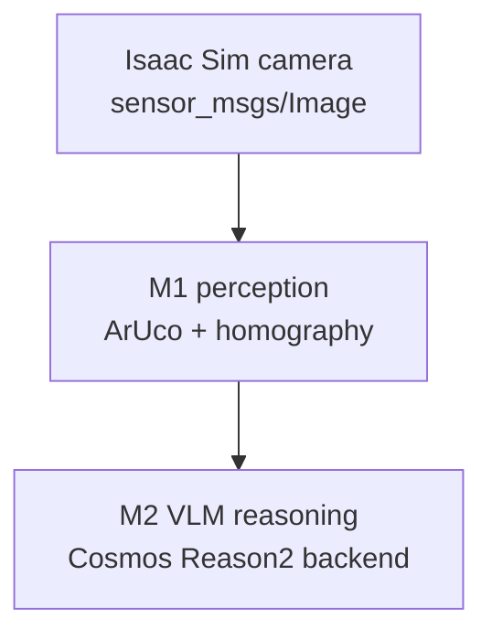

# Documentation Style Guide

---

## Purpose

This guide defines the documentation format for the VGU VLM Swarm project:
ROS2 perception/execution modules, VLM/RAG reasoning modules, simulation
pipelines, and evaluation reports. Follow it when writing specs, implementation
reports, setup guides, and benchmark notes so every document has the same shape
and can be reviewed module by module.

---

## Markdown Formatting Rules

Apply these rules to every document:

- One blank line before and after every heading, list, table, code fence, and `---`.
- `---` separates top-level `##` sections only; do not place it between `###`
  subsections.
- Heading levels must be sequential; do not jump from `##` to `####`.
- Nested list items use two-space indentation.
- Every code block carries a language tag: `python`, `bash`, `yaml`, `json`,
  `mermaid`, or `text`.
- Table separator rows use compact alignment: `|---|---|`.
- Use absolute topic names for ROS2 interfaces, for example
  `/perception/scene_state`.
- Use module IDs consistently: `M1` perception, `M2` VLM reasoning, `M3` RAG
  grounding, `M4` execution/safety, `M5` orchestrator, `M6` simulation/evaluation.

---

## Document Header

Every project document begins with this block:

```markdown
# <Title>

**Prepared:** YYYY-MM-DD

**Revision history:**
- Initial draft: <one-line description>
- Rev 2: <what changed>

**commit:** [link](<commit-url>)
```

Rules:

- `**Prepared:**` is the date the initial draft was written; do not update it
  for revisions.
- Each revision is one line.
- Revision numbers start at `Rev 2`; the initial draft is not numbered.
- `**commit:**` is optional. When used, it is the last line of the header block
  and links to the commit that introduced the current document state.
- Do not add extra metadata fields to the header block.

---

## Spec Structure

Use this structure for `docs/specs/module*.md`:

```markdown
# Module N - <Module Name> - Implementation Spec

**Status:** <Draft | Implementation target | Implemented>

---

## 1. Overview
## 2. Inputs & Outputs
## 3. Functional Requirements
## 4. Data Structures / Schemas
## 5. Interfaces
## 6. Package Layout
## 7. Function Specifications
## 8. Algorithms & Parameters
## 9. Error Handling & Edge Cases
## 10. Dependencies
## 11. Testing & Validation
## 12. Open Questions / Assumptions
```

Rules:

- Specs describe the implementation contract, not progress.
- Function signatures must be concrete enough to implement without guessing.
- Pydantic models must list validation rules and serialization rules.
- ROS2 topics, services, and message names must be explicit when known.
- External runtime dependencies must identify the package name actually installed,
  for example `opencv-contrib-python` when `cv2.aruco` is required.

---

## Module Implementation Report Structure

Use this section order for implementation reports. This replaces the old progress
report format.

```markdown
# Module <ID> Implementation Report - <Short Title>

**Prepared:** YYYY-MM-DD

**Revision history:**
- Initial draft: <one-line description>

---

## Overview
### Module Scope
### What Was Implemented
### Data Flow
    ```mermaid ...```
### This Report

---

## Objective

---

## Implemented Files

---

## Module: `<path/to/file.py>`
### Design Decisions
### Public Interface
### Runtime Behavior

---

## Verification

---

## Known Limitations

---

## Dependency Changes

---

## Next Module Entry Criteria
```

Section rules:

- **Overview / Module Scope** - 2-4 bullets describing the module boundary.
- **Overview / What Was Implemented** - bullet per implemented capability.
- **Overview / Data Flow** - one Mermaid diagram for the implemented path.
- **Overview / This Report** - one sentence stating the report scope.
- **Objective** - checklist of concrete deliverables.
- **Implemented Files** - table with columns `File | Role | Status`.
- **Module** - one section per important file or package unit.
- **Verification** - command block, output summary, and acceptance criteria table.
- **Known Limitations** - bullet per limitation with the module or milestone that
  will address it.
- **Dependency Changes** - table with columns `Change | Reason`; write
  `No new dependencies` when none.
- **Next Module Entry Criteria** - checklist for what must be true before the
  next module starts.

Research-only reports replace **Implemented Files**, **Module**, and
**Verification** with:

```markdown
## Sources Checked
## Comparison Matrix
## Decision
## Risks and Mitigations
```

---

## Module Section Format

Each `## Module:` section follows this structure:

````markdown
## Module: `ros2_ws/src/swarm_perception/swarm_perception/geometry.py`

### Design Decisions

- Decision 1 - reason
- Decision 2 - reason

### Public Interface

```python
def function_name(arg: type) -> ReturnType
```

- Behavior bullet
- Failure mode or edge case

### Runtime Behavior

- ROS2 topic, service, file I/O, or backend call behavior
- Timing, retry, or state-management behavior
````

Rules:

- Design Decisions come before Public Interface.
- Each design decision bullet states the decision and the reason separated by
  ` - `.
- Public Interface shows the signature in a code block, then behavior bullets.
- Runtime Behavior is required when the module touches ROS2, OpenCV, VLM HTTP,
  filesystem artifacts, or simulation state.

---

## Acceptance Criteria Table

Every verification section contains this table:

```markdown
| Check | Expected | Actual |
|---|---|---|
| <what is verified> | <expected value or behavior> | <actual result and pass/fail> |
```

Use `PASS` or `FAIL` in the `Actual` column. If a check fails, add a follow-up
note below the table.

---

## Diagrams

- Use Mermaid for all architecture and data-flow diagrams.
- Use `flowchart TD` for top-down pipelines and `flowchart LR` for left-to-right
  module relationships.
- Every node label should contain the module or file and its role when practical.
- Keep diagrams implementation-level; avoid marketing-style summaries.

Example:



---

## Docstrings

Use Google style on every public function and class:

```python
def pixel_to_world(pixel: tuple[float, float], homography: np.ndarray) -> tuple[float, float]:
    """Transform one pixel coordinate into world-frame meters.

    Args:
        pixel: Pixel coordinate as `(u, v)`.
        homography: Matrix mapping image coordinates to world coordinates.

    Returns:
        World coordinate as `(x, y)` in meters.
    """
```

Rules:

- One-line summary first and end it with a period.
- Include a blank line between the summary and `Args`.
- `Args` and `Returns` use short phrases.
- Add `Raises` only when the function deliberately raises as part of its public
  contract.

---

## Tables

Use a table when the content has two or more attributes per item.

| Table type | Required columns |
|---|---|
| ROS2 interface | `Name | Type | Direction | Payload` |
| Config reference | `Key | Default | Description` |
| Data model field | `Field | Type | Description` |
| Acceptance criteria | `Check | Expected | Actual` |
| Dependency changes | `Change | Reason` |
| Implemented files | `File | Role | Status` |
| Comparison matrix | one column per option, one row per criterion |

Cell content should be a phrase, not a paragraph.

---

## Sources

- Link official docs, GitHub repos, PyPI pages, ROS package docs, NVIDIA docs,
  or primary papers.
- Label each source: `[Library name - official docs](url)`.
- Separate verified facts from recommendations.
- Include the library or tool version when the API is version-sensitive.
- For Isaac Sim, ROS2, llama.cpp, Cosmos Reason2, and OpenCV ArUco, prefer
  official docs or primary repositories.

---

## Revision History

```markdown
**Revision history:**
- Initial draft: <one-line summary of what the initial draft covered>
- Rev 2: <what changed and why>
- Rev 3 (YYYY-MM-DD): <what changed and why>
```

- Revision numbers are sequential integers starting at 2.
- Each revision line is one sentence maximum.
- Historical implementation reports should not be rewritten after submission;
  add a revision entry instead.

---

## Commit Messages

- Format: `type: summary` using Conventional Commits.
- Common types: `feat`, `fix`, `docs`, `test`, `refactor`, `chore`.
- Subject line under 72 characters.
- No body paragraph; reasoning belongs in the PR description, spec, or module
  implementation report.
- No `Co-Authored-By` trailer.
